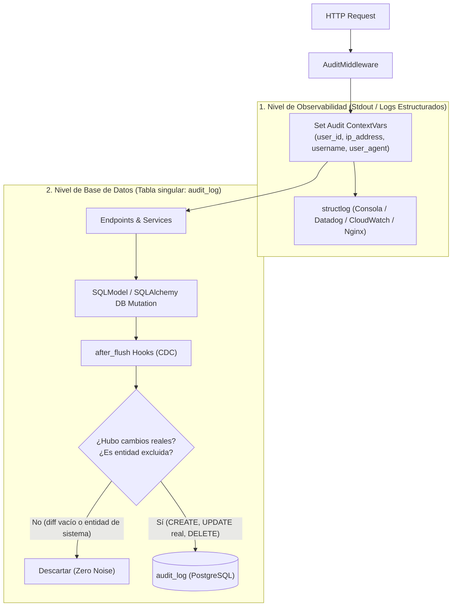

# Guía del Sistema de Auditoría (Audit System)

## 1. Introducción

El **Sistema de Auditoría** de `uyuni-backend` es un componente de nivel empresarial diseñado para proporcionar visibilidad completa sobre **quién** hizo **qué**, **cuándo** y **con qué resultado**.

Este sistema cumple con estándares de seguridad y cumplimiento (compliance) al registrar de forma estructurada los cambios en los datos (**Data Audit / CDC**) y, opcionalmente, accesos a rutas HTTP (**Access Logging**).

---

## 2. Arquitectura de Auditoría en Producción

En sistemas empresariales de producción con alto tráfico, registrar cada petición HTTP en la base de datos relacional genera una saturación rápida (el backup de la base de datos termina pesando gigabytes solo en logs). Por ello, el sistema implementa una **separación de responsabilidades clara**:



### Nivel 1: Auditoría de Datos de Negocio (Data Audit / CDC) - **RECOMENDADO Y ACTIVO POR DEFECTO**
*   **Componente**: `app/core/audit/hooks.py`
*   **Responsabilidad**: Detectar cambios transaccionales en la base de datos (INSERT, UPDATE, DELETE) de manera automática.
*   **Tecnología**: SQLAlchemy Event Hooks (`after_flush`).
*   **Filtro Zero-Noise**:
    *   **CREATE**: Captura el snapshot inicial del objeto.
    *   **UPDATE**: Captura el "Diff" (`old` vs `new`) **únicamente** si hubo cambios reales en las columnas. Si un registro se marca como dirty sin cambios en sus atributos, el hook **lo descarta automáticamente** (evitando filas con `changes: null`).
    *   **DELETE**: Registra el estado previo de la entidad antes de eliminarse.
    *   **Entidades Excluidas (`EXCLUDED_AUDIT_ENTITIES`)**: Entidades internas de navegación y tokens del sistema (`Module`, `ModuleGroup`, `RoleModule`, `UserLogLogin`, `UserRevokedToken`, `AuditLog`) se excluyen del CDC para no generar ruido innecesario en cada sincronización de inicio.
*   **Almacenamiento**: Tabla `audit_log` (Acción: `CREATE`, `UPDATE`, `DELETE`).
*   **Variable de Entorno**: `ENABLE_DATA_AUDIT=True`.

### Nivel 2: Auditoría de Acceso HTTP (Access Logging en BD) - **OPCIONAL**
*   **Componente**: `app/core/audit/middleware.py`
*   **Responsabilidad**: Registrar peticiones HTTP directamente en la base de datos `audit_log`.
*   **Configuración Recomendada en Producción**: `ENABLE_ACCESS_AUDIT=False`.
    *   *¿Por qué?*: En entornos de producción reales, los accesos HTTP se delegan al servidor web (Nginx, Caddy, Cloudflare) o a logging estructurado (`ENABLE_ACCESS_LOGS=True` con `structlog`), evitando que consultas masivas (como autocompletados o `/api/catalogs/bulk`) colapsen el almacenamiento de la base de datos relacional.
    *   **Preservación de Contexto**: Aunque `ENABLE_ACCESS_AUDIT=False`, el middleware **siempre inicializa el contexto** (`user_id`, `ip_address`, `username`, `user_agent`). De esta forma, cualquier transacción que altere datos (ej. crear una venta, editar un producto) sabrá con exactitud qué usuario y qué IP ejecutaron la acción.
*   **Exclusión de Rutas (`AUDIT_EXCLUDED_PATHS`)**:
    *   `/docs`, `/redoc`, `/openapi.json`, `GET:/health`, `/`, `/api/catalogs`.

### Nivel 3: Almacenamiento en Frío (Cold Storage)
*   **Componente**: `scripts/archive_audit.py`
*   **Responsabilidad**: Mantener la base de datos ligera y performante.
*   **Funcionamiento**: Mueve registros antiguos (ej. > 90 días) de la tabla `audit_log` a archivos comprimidos (`.json.gz`) para auditorías a largo plazo.

---

## 3. Guía para Desarrolladores

### 3.1. Nuevos Modelos de Base de Datos
Al crear un nuevo modelo con `SQLModel`, la auditoría de datos (Hooks) funcionará automáticamente siempre que uses la `Session` estándar de la aplicación.

**Requisito Importante**: Asegúrate de que tu modelo herede de `SQLModel` y sea parte de la metadata importada en `alembic/env.py`.

### 3.2. Auditoría de Usuarios (AuditMixin)
Para rastrear automáticamente **quién creó** o **actualizó** un registro, tu modelo debe heredar de `AuditMixin`.

```python
from app.models.mixins import AuditMixin

class Task(BaseModel, AuditMixin, table=True):
    # ... campos ...
```

**Beneficios**:
*   `created_at` / `updated_at`: Se manejan automáticamente (Default Factory en hora local/UTC).
*   `created_by_id` / `updated_by_id`: Un Hook de SQLAlchemy (`before_flush`) intercepta el guardado e inyecta el ID del usuario autenticado automáticamente sin necesidad de pasarlo manualmente en el Service.

### 3.3. Configuración en `.env`

```ini
# Auditoría de Datos en Base de Datos (CDC para Ventas, Productos, Usuarios, etc.)
ENABLE_DATA_AUDIT=True

# Auditoría de Peticiones HTTP en Base de Datos (False recomendado para producción)
ENABLE_ACCESS_AUDIT=False

# Logging Estructurado a Consola/Stdout (Recomendado en Producción)
ENABLE_ACCESS_LOGS=True
ACCESS_LOGS_ONLY_ERRORS=False

# Rutas Excluidas
AUDIT_EXCLUDED_PATHS='["/docs", "/redoc", "/openapi.json", "GET:/health", "/", "/api/catalogs"]'
AUDIT_LOG_EXCLUDE_STATUS_CODES='[404]'
AUDIT_LOG_INCLUDED_METHODS='["POST", "PUT", "PATCH", "DELETE"]'
```

---

## 4. Estructura de la Base de Datos (`audit_log`)

> [!NOTE]
> Siguiendo el estándar de arquitectura obligatorio de Uyuni Backend, el nombre de la tabla es estrictamente **singular**: `audit_log`.

| Columna | Tipo | Descripción |
| :--- | :--- | :--- |
| `id` | UUID | Identificador único (UUIDv7 secuencial). |
| `user_id` | UUID | ID del usuario que realizó la acción (o NULL si es Anónimo/Sistema). |
| `username` | String | Username capturado en el momento (redundancia útil si el usuario se elimina). |
| `action` | String | `CREATE`, `UPDATE`, `DELETE`, `ACCESS`. |
| `entity_type` | String | Nombre del Modelo (ej. `CommerceSale`, `CommerceProduct`, `User`) o `Endpoint`. |
| `entity_id` | String | ID de la entidad afectada o Path del endpoint. |
| `changes` | JSON | Diff de cambios (`old` vs `new`) o metadatos de la operación. |
| `ip_address` | String | Dirección IP real del cliente (resolviendo proxies y Cloudflare). |
| `user_agent` | String | Navegador o cliente HTTP utilizado. |
| `timestamp` | Datetime | Fecha y hora exacta de la transacción. |

**Ejemplo de JSON en `changes` (UPDATE real):**
```json
{
  "price": {
    "old": "100.00",
    "new": "120.50"
  },
  "status": {
    "old": "disponible",
    "new": "vendido"
  }
}
```

---

## 5. Mantenimiento y Depuración de Datos

### 5.1. Limpieza de Registros Residuales (Zero-Noise Cleanup)
Si una base de datos contiene registros históricos antiguos sin valor (como `UPDATE Module null` o peticiones `ACCESS` a catálogos), se puede ejecutar la siguiente consulta SQL de saneamiento:

```sql
DELETE FROM audit_log 
WHERE changes IS NULL 
   OR changes::text = 'null'
   OR action = 'ACCESS'
   OR entity_type IN ('AuditLog', 'UserLogLogin', 'UserRevokedToken', 'Module', 'ModuleGroup', 'RoleModule');
```

### 5.2. Archivo a Frío (Cold Storage)
Se recomienda configurar un **Cron Job** semanal o mensual en el servidor para archivar registros de más de 90 días a disco comprimido:

```bash
# Archivar registros mayores a 90 días hacia almacenamiento persistente
venv/bin/python scripts/archive_audit.py --days 90 --dir /var/backups/uyuni/audit
```

---

## 6. Buenas Prácticas en Producción

1. **Mantener `ENABLE_DATA_AUDIT=True`**: Garantiza trazabilidad de cada cambio en inventario, ventas y permisos.
2. **Mantener `ENABLE_ACCESS_AUDIT=False`**: Evita la inflación innecesaria de la base de datos relacional y los backups.
3. **Monitorear vía Nginx / Logs**: Los análisis de tráfico web, bots y latencias deben realizarse desde los logs del servidor web (Nginx/Traefik) o Cloudflare, no desde la tabla `audit_log`.
