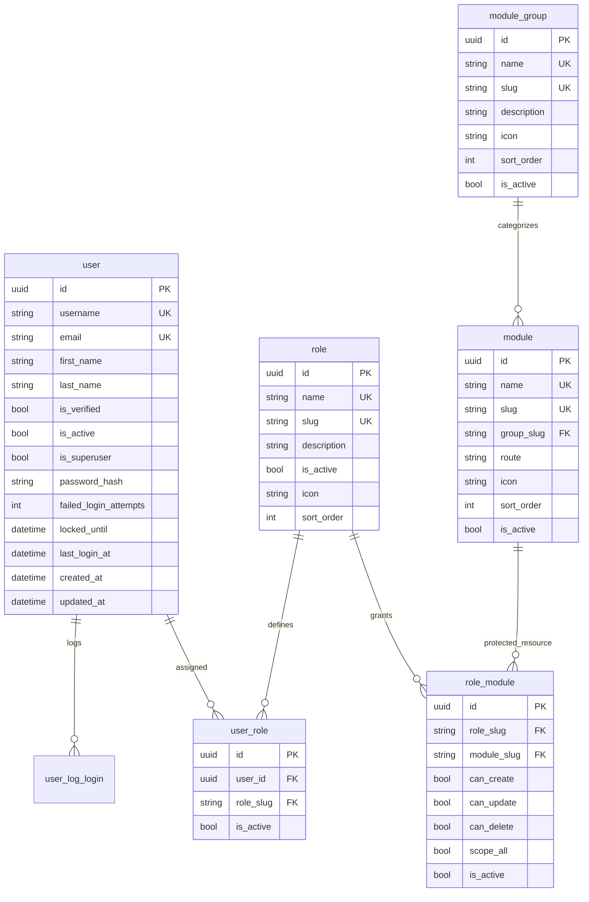

# Core Module Guide - Security, Users & Domain Manifests

Este documento describe la arquitectura, el modelo de datos y la implementación del módulo **Core** del sistema, encargado de la gestión de usuarios, seguridad, control de acceso y manifiestos de dominio para emprendimientos y plataformas comerciales.

---

## 1. Arquitectura Modular

El módulo Core implementa el patrón de **Arquitectura Modular DDD-Lite** con soporte para manifiestos declarativos:

### Estructura de Archivos
```text
app/modules/core/
├── __init__.py
├── constants.py        # CoreModuleSlug (RBAC slugs: USERS = "users")
├── manifest.py         # Manifiesto declarativo del dominio Core (Grupo: Configuración)
├── routers.py          # Agregador raíz (Nested Router)
└── users/              # Gestión de Cuentas de Usuario (CRUD)
    ├── __init__.py
    ├── repository.py   # Repositorio UserRepository heredando de BaseRepository[User]
    ├── service.py      # UserService (Hashing, validaciones de email/username único)
    ├── schemas.py      # UserCreate, UserRead, UserReadDetailed, UserUpdate
    └── routers.py      # Endpoints RESTful (/core/users)
```

---

## 2. Diagrama Entidad-Relación (Estándar Singular)

Todas las entidades de base de datos están normalizadas estrictamente bajo la **Singular Table Naming Convention**:



---

## 3. Manifiestos de Dominio y Sincronización Automática

El módulo Core no requiere inserciones manuales en SQL para sus menús de navegación. Define su estructura en `manifest.py`:

```python
core_manifest = DomainManifest(
    domain_name="core",
    groups=[
        GroupDefinition(
            name="Configuración",
            slug="configuration",
            description="Gestión de Cuentas y Accesos de Usuario",
            sort_order=1,
            icon="pi pi-cog",
            is_active=True,
            modules=[
                ModuleDefinition(
                    name="Usuarios",
                    slug="users",
                    description="Gestión de Cuentas de Usuario",
                    group_slug="configuration",
                    sort_order=1,
                    icon="pi pi-user",
                    route="users",
                    is_active=True,
                ),
            ],
        ),
    ],
)
```

Al iniciar el servidor o ejecutar el script `seeds/seed_create_modules.py`, el `ManifestRegistry` sincroniza de forma idempotente:
1. Crea o actualiza el grupo `configuration` en la tabla `module_group`.
2. Crea o actualiza el módulo `users` en la tabla `module`.
3. Sincroniza los permisos iniciales para el rol `admin` en `role_module`.

---

## 4. Soporte para DataTables del Frontend (PrimeNG)

El submódulo `/core/users` soporta de forma nativa la integración con tablas avanzadas:
1. **Paginación en Servidor**: Parámetros `skip` y `limit`.
2. **Ordenamiento Dinámico**: Usando `sort_by` y `sort_order` sobre cualquier columna.
3. **Búsqueda Global Polimórfica**: Filtrado insensible a mayúsculas/minúsculas por `username`, `email`, `first_name`, `last_name`.
4. **Endpoint de Conteo**: `/core/users/count` para la paginación reactiva.

---

## 5. Integración RBAC

Los endpoints de usuarios están protegidos a través de la dependencia de permisos:

```python
from app.auth.permissions import PermissionChecker, PermissionAction
from app.modules.core.constants import CoreModuleSlug

@router.get(
    "",
    dependencies=[Depends(PermissionChecker(CoreModuleSlug.USERS, PermissionAction.READ))],
    response_model=List[UserReadDetailed],
)
def get_users(...):
    ...
```
