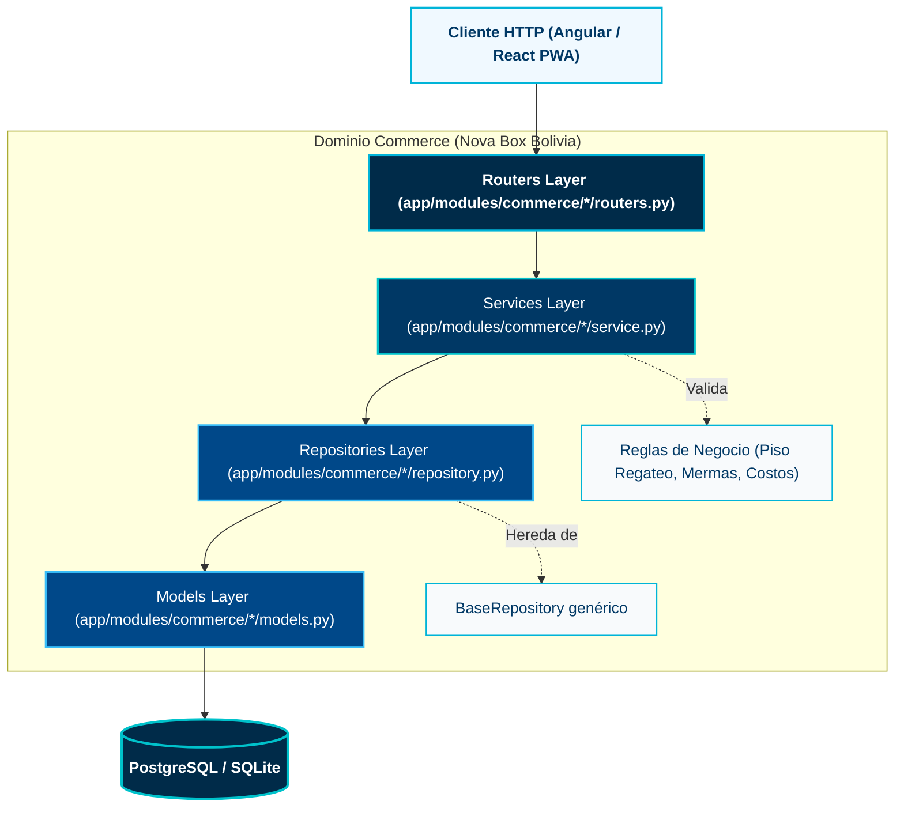
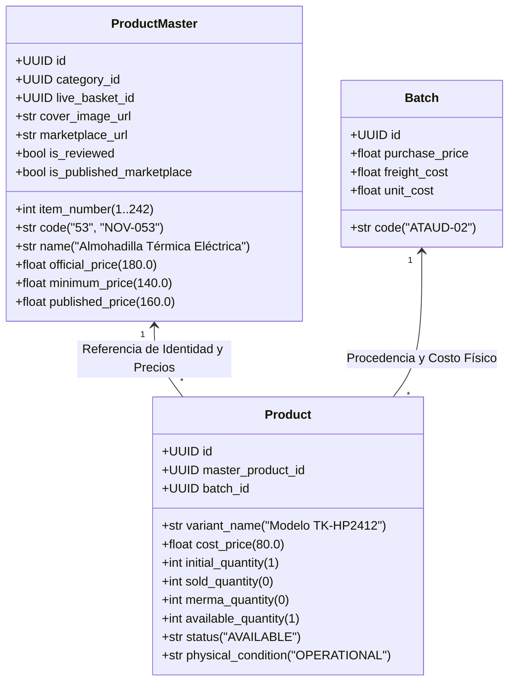
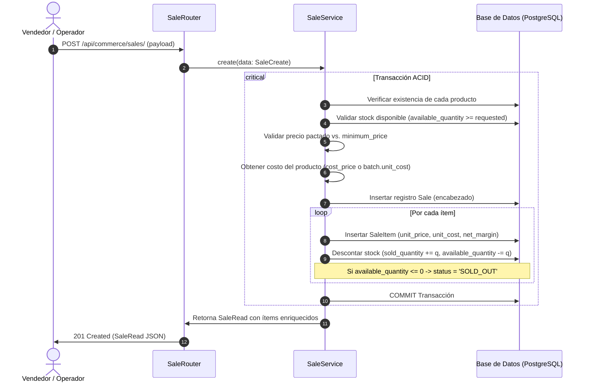

# 01. Arquitectura y Reglas de Negocio — Commerce

Este documento describe la arquitectura interna, los patrones de diseño y las reglas de negocio críticas implementadas en el módulo `commerce` de **Uyuni Backend**.

---

## 🏛️ Patrón Arquitectónico (DDD-Lite + Clean Architecture)

El módulo sigue una arquitectura desacoplada y orientada al dominio (DDD-Lite) donde cada submódulo encapsula su responsabilidad respetando el principio de inversión de dependencias:



### Responsabilidades por Capa:

1. **Routers (`routers.py`):**
   - Manejo de solicitudes y respuestas HTTP.
   - Seguridad mediante dependencias de FastAPI: validación de tokens JWT y permisos RBAC (`PermissionChecker`).
   - Serialización y deserialización a través de esquemas Pydantic v2 (`ProductRead`, `SaleCreate`, etc.).
   - No contienen lógica de negocio ni consultas de base de datos directas.

2. **Services (`service.py`):**
   - Encapsulan toda la lógica de negocio y las reglas de dominio.
   - Coordinan transacciones atómicas (por ejemplo, registrar una venta y descontar stock simultáneamente).
   - Recalculan costos y puntos de equilibrio de lotes de importación.
   - Lanzan excepciones de negocio tipadas (`BadRequestException`, `NotFoundException`).

3. **Repositories (`repository.py`):**
   - Heredan de `BaseRepository[T]`.
   - Aíslan el acceso a datos y encapsulan queries ORM complejas.
   - Implementan búsqueda global multi-campo insensible a mayúsculas (`_apply_search` con joins optimizados).

4. **Models (`models.py`):**
   - Entidades de base de datos declaradas con SQLModel.
   - Heredan de `BaseModel` (que provee UUIDv7 como clave primaria) y `AuditMixin` (captura automática de fechas y usuario creador/modificador).

---

## 💡 Decisión de Diseño Clave: Ficha Maestra vs. Inventario por Lote

Uno de los mayores refinamientos de este backend fue la **separación estricta entre la Ficha Comercial Maestra y el Inventario Físico por Caja**:



### Justificación de Negocio:
1. **El mismo producto puede llegar en diferentes lotes a diferentes costos:** Por ejemplo, la *Almohadilla Térmica* (#53) llegó tanto en la caja `Digital` (fila 53 del Excel original) como en el lote `Ataúd 2` (fila 165). En el modelo anterior, esto obligaba a duplicar la ficha comercial o a sobreescribir los costos.
2. **Coherencia con el Repositorio de Marketing:** En `/opt/nova/nova-home-tech/products/`, cada carpeta representa un producto comercial (`053-almohadilla-termica-electrica/`) que almacena fotos WebP, videos, investigación y guiones publicitarios. La tabla `commerce_product_master` es el espejo exacto en base de datos de esta estructura intelectual.
3. **Existencias Consolidadas vs. Trazabilidad Física:** Cuando el cliente consulta el catálogo en la PWA o el streamer revisa su canasta en vivo, le interesa saber que hay **2 unidades disponibles en total** (#53). Cuando el operador empaqueta el pedido en almacén, necesita saber exactamente **de qué caja física extraer la unidad** y cuál fue su costo real.

---

## ⚖️ Reglas de Negocio Críticas

### 1. Piso Mínimo de Regateo (`minimum_price`)
- **Regla:** En Bolivia, la venta por Marketplace y streaming implica una alta tasa de regateo por parte de los clientes. Cada producto maestro tiene un `official_price` (precio de lista), un `published_price` (precio en publicidad) y un `minimum_price` (piso absoluto de seguridad que garantiza margen neto positivo).
- **Control en `SaleService`:**
  ```python
  if product.minimum_price > 0 and item_data.unit_price < product.minimum_price and not data.allow_below_minimum:
      raise BadRequestException(
          detail=f"Precio pactado ({item_data.unit_price}) menor al mínimo ({product.minimum_price}) para '{product.name}'. Requiere autorización (allow_below_minimum=True)."
      )
  ```
- **Excepción autorizada:** Un administrador puede vender por debajo del mínimo (por ejemplo, remate de unidad con raspones leves) enviando explícitamente `allow_below_minimum=True` en el payload de la venta.

### 2. Contabilidad de Costos por Lote y Absorción de Mermas
- **Regla:** Al comprar una caja de liquidación cerrada (por ejemplo, $4,000 Bs por la caja + $200 Bs de flete = $4,200 Bs costo total), se recibe una cantidad inicial de productos heterogéneos. Si 2 productos llegan rotos o inservibles (**merma**), el costo de la caja no disminuye; en su lugar, **las unidades vendibles restantes deben absorber el costo de las unidades mermadas**.
- **Fórmula implementada en `BatchService`:**
  $$\text{sellable\_items\_count} = \text{initial\_items\_count} - \text{merma\_items\_count}$$
  $$\text{unit\_cost} = \frac{\text{total\_cost}}{\text{sellable\_items\_count}}$$
- **Cascada automática:** Cada vez que se crea, actualiza o elimina un producto asociado a una caja, o se incrementa su merma (`merma_quantity`), el servicio `BatchService.recalculate_from_products` recalcula automáticamente los conteos, el costo unitario promedio del lote y el estado financiero hacia el punto de equilibrio.

### 3. Transacción Atómica de Ventas (`SaleService`)
- **Regla:** Una venta debe ser indivisible. Si la transacción falla en cualquier punto (por ejemplo, stock insuficiente en el segundo producto de un carrito con 3 ítems), la base de datos revierte completamente la operación sin dejar registros parciales.
- **Flujo de Ejecución Atómica:**



### 4. Búsqueda Inteligente Multi-Criterio
- **En `ProductRepository`:** Al buscar en el inventario físico (`GET /api/commerce/products/?search=reloj`), el repositorio realiza un `LEFT JOIN` transparente con `commerce_product_master` buscando simultáneamente en:
  - Nombre del producto maestro (`name`).
  - Código comercial (`code`).
  - Variante de lote (`variant_name`).
  - Estado y condición física (`status`, `physical_condition`).
  - Número de ítem numérico (`item_number` si el término es numérico).
- **En `ProductMasterRepository`:** Normaliza automáticamente búsquedas con caracteres comunes como `#53`, `NOV-53`, `NOV-053` o simplemente `53`.

