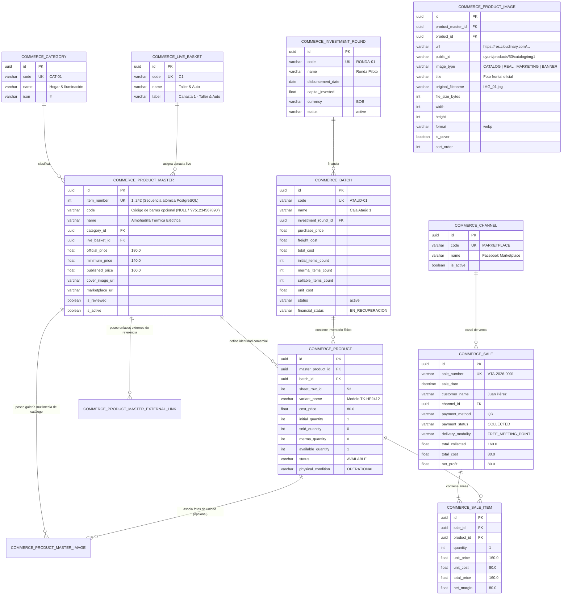

# 02. Diccionario de Base de Datos — Commerce

Este documento es la referencia técnica completa de la estructura de base de datos relacional para el dominio `commerce`. Contiene el diagrama Entidad-Relación (ERD) oficial y la descripción semántica campo por campo de las 11 tablas del sistema.

---

## 🗺️ Diagrama Entidad-Relación (ERD)

---

## 🗃️ Diccionario Detallado por Tabla

> [!NOTE]
> Todas las tablas heredan de `BaseModel` y `AuditMixin`, lo que significa que contienen automáticamente las siguientes 4 columnas de auditoría:
> - `created_at` (TIMESTAMP): Fecha y hora UTC de creación del registro.
> - `updated_at` (TIMESTAMP): Fecha y hora UTC de la última modificación.
> - `created_by_id` (UUID, FK -> `user.id`): Usuario que originó el registro.
> - `updated_by_id` (UUID, FK -> `user.id`): Usuario que realizó el último cambio.

---

### 1. `commerce_investment_round` (Rondas de Inversión)
Representa las inyecciones de capital financiero para la adquisición de lotes de importación.

| Columna | Tipo SQL | Nulo | Default | Índice / Restricción | Descripción Semántica |
| :--- | :--- | :---: | :---: | :---: | :--- |
| `id` | `UUID` | No | UUIDv7 | PK, Index | Identificador único universal secuencial. |
| `code` | `VARCHAR(50)` | No | — | Unique, Index | Código único de la ronda (ej: `RONDA-01`, `RONDA-02`). |
| `name` | `VARCHAR(150)` | No | — | — | Nombre descriptivo (ej: `1ra Compra (Piloto)`). |
| `disbursement_date` | `DATE` | Sí | `NULL` | — | Fecha en que se liberaron los fondos de inversión. |
| `capital_invested` | `DOUBLE PRECISION`| No | `0.0` | — | Monto total desembolsado en la moneda designada. |
| `currency` | `VARCHAR(3)` | No | `'BOB'` | — | Código ISO 4217 de la moneda (`BOB`, `USD`). |
| `status` | `VARCHAR(50)` | No | `'active'`| — | Estado de la ronda (`active`, `liquidated`, `closed`). |
| `observations` | `VARCHAR(1000)`| Sí | `NULL` | — | Notas adicionales o acuerdos de reparto de utilidades. |

---

### 2. `commerce_batch` (Cajas / Lotes Importados)
Representa una caja, palet o lote de liquidación cerrado importado desde EEUU.

| Columna | Tipo SQL | Nulo | Default | Índice / Restricción | Descripción Semántica |
| :--- | :--- | :---: | :---: | :---: | :--- |
| `id` | `UUID` | No | UUIDv7 | PK, Index | Identificador único universal. |
| `code` | `VARCHAR(50)` | No | — | Unique, Index | Código de caja (ej: `DIGITAL`, `ATAUD-01`, `AMAZON-NEXT`). |
| `name` | `VARCHAR(150)` | No | — | — | Nombre visible de la caja. |
| `investment_round_id`| `UUID` | Sí | `NULL` | FK -> `commerce_investment_round.id` | Ronda financiera que fondeó la compra. |
| `provider` | `VARCHAR(150)` | Sí | `NULL` | — | Proveedor o liquidador de origen (ej: Quicklotz, Direct Liquidation). |
| `batch_type` | `VARCHAR(150)` | Sí | `NULL` | — | Tipo de contenido (ej: `Electrónicos Pequeños`, `Ataúd Mixto`). |
| `costing_method` | `VARCHAR(50)` | No | `'WEIGHTED_RETAIL'` | — | Método de costeo: `WEIGHTED_RETAIL` (Prorrateo ponderado), `SPECIFIC_ITEM` (Costo real por ítem), `FLAT_AVERAGE` (Promedio plano). |
| `purchase_date` | `DATE` | Sí | `NULL` | — | Fecha de compra de la caja. |
| `purchase_price` | `DOUBLE PRECISION`| No | `0.0` | — | Costo de adquisición de la caja. |
| `freight_cost` | `DOUBLE PRECISION`| No | `0.0` | — | Flete, aranceles y transporte hasta el almacén. |
| `total_cost` | `DOUBLE PRECISION`| No | `0.0` | — | Costo total consolidado (`purchase_price + freight_cost`). |
| `currency` | `VARCHAR(3)` | No | `'BOB'` | — | Moneda del costo (`BOB`). |
| `initial_items_count`| `INTEGER` | No | `0` | — | Cantidad total de ítems físicos recibidos al abrir la caja. |
| `merma_items_count` | `INTEGER` | No | `0` | — | Cantidad de ítems rotos, inservibles o descartados. |
| `sellable_items_count`| `INTEGER` | No | `0` | — | Ítems comercializables (`initial - merma`). |
| `unit_cost` | `DOUBLE PRECISION`| No | `0.0` | — | Costo unitario promedio calculado (`total_cost / sellable_items`). |
| `status` | `VARCHAR(50)` | No | `'active'`| — | Estado operativo (`active`, `liquidated`, `archived`). |
| `financial_status` | `VARCHAR(50)` | No | `'EN_RECUPERACION'`| — | Estado de retorno de inversión (`EN_RECUPERACION`, `RECUPERADO`). |
| `observations` | `VARCHAR(1000)`| Sí | `NULL` | — | Observaciones de desempaque o control de calidad. |

---

### 3. `commerce_category` (Categorías de Catálogo)
Categorías generales del catálogo de productos.

| Columna | Tipo SQL | Nulo | Default | Índice / Restricción | Descripción Semántica |
| :--- | :--- | :---: | :---: | :---: | :--- |
| `id` | `UUID` | No | UUIDv7 | PK, Index | Identificador único universal. |
| `code` | `VARCHAR(50)` | No | — | Unique, Index | Código de categoría (ej: `CAT-01`, `CAT-02`). |
| `name` | `VARCHAR(150)` | No | — | Index | Nombre oficial (ej: `Hogar & Iluminación`). |
| `icon` | `VARCHAR(10)` | Sí | `NULL` | — | Emoji representativo para UI (`💡`, `🎧`, `💻`, `🚗`). |
| `description` | `VARCHAR(1000)`| Sí | `NULL` | — | Descripción detallada de la categoría. |
| `typical_products` | `VARCHAR(1000)`| Sí | `NULL` | — | Ejemplos de productos típicos contenidos. |

---

### 4. `commerce_live_basket` (Canastas TikTok Live)
Clasificación operativa y comercial para las transmisiones en vivo de TikTok.

| Columna | Tipo SQL | Nulo | Default | Índice / Restricción | Descripción Semántica |
| :--- | :--- | :---: | :---: | :---: | :--- |
| `id` | `UUID` | No | UUIDv7 | PK, Index | Identificador único universal. |
| `code` | `VARCHAR(50)` | No | — | Unique, Index | Código corto (ej: `C1`, `C2`, `C3`, `C4`, `C+1`, `FONDO`). |
| `name` | `VARCHAR(150)` | No | — | — | Nombre temático (ej: `Taller & Auto`, `Cables & Regletas`). |
| `label` | `VARCHAR(200)` | No | — | — | Etiqueta para selectbox (`Canasta 1 - Taller & Auto`). |
| `description` | `VARCHAR(1000)`| Sí | `NULL` | — | Criterio de asignación para orientar al streamer. |
| `price_range` | `VARCHAR(100)` | Sí | `NULL` | — | Rango de precios sugerido (ej: `Bs. 40 - 200`). |
| `target_audience` | `VARCHAR(255)` | Sí | `NULL` | — | Audiencia objetivo (ej: `Mecánicos, Choferes, Varones 25-45`). |

---

### 5. `commerce_channel` (Canales de Venta)
Medios comerciales a través de los cuales se concretan las ventas.

| Columna | Tipo SQL | Nulo | Default | Índice / Restricción | Descripción Semántica |
| :--- | :--- | :---: | :---: | :---: | :--- |
| `id` | `UUID` | No | UUIDv7 | PK, Index | Identificador único universal. |
| `code` | `VARCHAR(50)` | No | — | Unique, Index | Slug o código único (`MARKETPLACE`, `TIKTOK_LIVE`, `WHATSAPP`). |
| `name` | `VARCHAR(150)` | No | — | Index | Nombre legible (ej: `Facebook Marketplace`, `TikTok Live`). |
| `description` | `VARCHAR(500)` | Sí | `NULL` | — | Notas sobre comisiones o particularidades del canal. |
| `is_active` | `BOOLEAN` | No | `true` | — | ¿Disponible para registrar ventas en la actualidad? |

---

### 6. `commerce_product_master` (Ficha Maestra de Producto)
La ficha comercial e intelectual del producto. Es la entidad central de mercadotecnia y catálogo.

| Columna | Tipo SQL | Nulo | Default | Índice / Restricción | Descripción Semántica |
| :--- | :--- | :---: | :---: | :---: | :--- |
| `id` | `UUID` | No | UUIDv7 | PK, Index | Identificador único universal. |
| `item_number` | `INTEGER` | No | Sequence | Unique, Index | Número de catálogo secuencial atómico autogenerado por el backend (`commerce_product_master_item_number_seq`). |
| `code` | `VARCHAR(50)` | Sí | `NULL` | Index | Código de barras o SKU comercial opcional (`"7751234567890"`). Sin restricción UNIQUE global para Multi-Tenancy. |
| `name` | `VARCHAR(255)` | No | — | Index | Nombre comercial oficial del producto. |
| `description` | `VARCHAR(2000)`| Sí | `NULL` | — | Descripción detallada para PWA y publicaciones. |
| `category_id` | `UUID` | Sí | `NULL` | FK -> `commerce_category.id`, Index | Categoría del catálogo. |
| `live_basket_id` | `UUID` | Sí | `NULL` | FK -> `commerce_live_basket.id`, Index | Canasta temática para TikTok Live. |
| `brand` | `VARCHAR(150)` | Sí | `NULL` | — | Marca del fabricante (ej: `Anker`, `Logitech`, `Genérico`). |
| `model` | `VARCHAR(150)` | Sí | `NULL` | — | Modelo comercial del producto. |
| `official_price` | `DOUBLE PRECISION`| No | `0.0` | — | **P. Lista (Mercado)**: Precio de referencia promedio investigado en el mercado local (Bolivia). Sirve como ancla referencial de ahorro frente a la competencia. |
| `published_price` | `DOUBLE PRECISION`| Sí | `NULL` | — | **P. Publicado (Venta Cliente)**: **Precio oficial de venta al público** anunciado en Marketplace y redes. Monto principal cotizado de entrada al cliente. |
| `minimum_price` | `DOUBLE PRECISION`| No | `0.0` | — | **Piso Regateo (Mínimo Protegido)**: Límite mínimo de venta autorizado para cerrar trato si el cliente pide rebaja. Si es igual al publicado, el producto es de Precio Fijo. |
| `currency` | `VARCHAR(3)` | No | `'BOB'` | — | Moneda de comercialización (`BOB`). |
| `cover_image_url` | `VARCHAR(500)` | Sí | `NULL` | — | URL de la foto principal WebP para catálogos y PWA. |
| `features` | `VARCHAR(2000)`| Sí | `NULL` | — | Características técnicas viñeteadas para el cliente. |
| `marketing_details`| `VARCHAR(2000)`| Sí | `NULL` | — | Guion de venta rápida, ganchos de live y objeciones frecuentes. |
| `is_reviewed` | `BOOLEAN` | No | `false` | — | ¿La ficha de producto está completamente investigada y aprobada? |
| `is_fb_verified` | `BOOLEAN` | No | `false` | — | ¿Creativos de Facebook verificados contra políticas publicitarias? |
| `has_video` | `BOOLEAN` | No | `false` | — | ¿Cuenta con video de demostración grabado para TikTok/Reels? |
| `is_published_marketplace`| `BOOLEAN` | No | `false` | — | ¿La publicación se encuentra actualmente activa en Marketplace? Se activa automáticamente si se agrega un enlace de tipo `MARKETPLACE`. |
| `is_whatsapp_published` | `BOOLEAN` | No | `false` | — | ¿Publicado en el catálogo o grupos de WhatsApp? |
| `is_active` | `BOOLEAN` | No | `true` | Index | ¿Producto activo en catálogo? (`false` = archivado). |

> **Nota de Retrocompatibilidad:** Los campos `external_info_url` y `marketplace_url` fueron migrados y eliminados de la tabla física `commerce_product_master`. En la API REST (`ProductMasterRead`) se exponen como propiedades calculadas dinámicamente a partir de los enlaces que tengan `is_primary = true` y correspondan a `link_type = 'REFERENCE'` o `link_type = 'MARKETPLACE'` en `commerce_product_master_external_link`.

---

### 7. `commerce_product` (Inventario Físico por Lote)
Existencias físicas reales de un producto dentro de una caja de importación específica.

| Columna | Tipo SQL | Nulo | Default | Índice / Restricción | Descripción Semántica |
| :--- | :--- | :---: | :---: | :---: | :--- |
| `id` | `UUID` | No | UUIDv7 | PK, Index | Identificador único universal. |
| `master_product_id`| `UUID` | No | — | FK -> `commerce_product_master.id`, Index | Ficha Maestra obligatoria a la que pertenece esta unidad física. |
| `batch_id` | `UUID` | Sí | `NULL` | FK -> `commerce_batch.id`, Index | Caja o lote físico del cual se extrajo la unidad. |
| `sheet_row_id` | `INTEGER` | Sí | `NULL` | Index | ID numérico histórico de fila en la hoja de liquidación. |
| `variant_name` | `VARCHAR(100)` | Sí | `NULL` | — | Variante física de este lote (ej: `Color Blanco`, `Diseño Luna`). |
| `cost_price` | `DOUBLE PRECISION`| Sí | `NULL` | — | Costo unitario específico asignado a esta unidad física en este lote. |
| `initial_quantity` | `INTEGER` | No | `1` | — | Unidades físicas que llegaron en esta caja. |
| `sold_quantity` | `INTEGER` | No | `0` | — | Unidades ya vendidas y cobradas de este lote. |
| `merma_quantity` | `INTEGER` | No | `0` | — | Unidades rotas o defectuosas descartadas de este lote. |
| `available_quantity`| `INTEGER` | No | `1` | — | Existencias físicas disponibles actualmente para venta. |
| `status` | `VARCHAR(50)` | No | `'AVAILABLE'`| Index | Estado comercial: `AVAILABLE`, `RESERVED`, `SOLD_OUT`, `SCRAPPED`. |
| `physical_condition`| `VARCHAR(50)` | No | `'OPERATIONAL'`| — | Condición física: `OPERATIONAL`, `DAMAGED_SCRAP`, `FOR_PARTS`, `INCOMPLETE`. |
| `defect_detail` | `VARCHAR(500)` | Sí | `NULL` | — | Detalle de raspón, accesorio faltante o reparación realizada. |
| `is_reviewed` | `BOOLEAN` | No | `false` | — | ¿Fue probado físicamente en mesa de trabajo que enciende y funciona? |

---

### 8. `commerce_sale` (Transacciones de Venta)
Encabezado de la transacción comercial.

| Columna | Tipo SQL | Nulo | Default | Índice / Restricción | Descripción Semántica |
| :--- | :--- | :---: | :---: | :---: | :--- |
| `id` | `UUID` | No | UUIDv7 | PK, Index | Identificador único universal. |
| `sale_number` | `VARCHAR(50)` | No | — | Unique, Index | Código de venta único generado (ej: `VTA-20261110-A1B2C3`). |
| `sheet_sale_id` | `INTEGER` | Sí | `NULL` | Index | ID de venta histórica en Google Sheets. |
| `sale_date` | `TIMESTAMP` | No | `now()` | Index | Fecha y hora exacta de la transacción. |
| `customer_name` | `VARCHAR(150)` | No | `'Cliente Casual'`| — | Nombre o alias del comprador. |
| `customer_phone` | `VARCHAR(50)` | Sí | `NULL` | — | Teléfono de contacto de WhatsApp para entrega. |
| `channel_id` | `UUID` | Sí | `NULL` | FK -> `commerce_channel.id`, Index | Canal comercial utilizado. |
| `channel` | `VARCHAR(50)` | No | `'Marketplace'`| — | Nombre textual del canal (`Marketplace`, `TikTok Live`). |
| `payment_method` | `VARCHAR(50)` | No | `'QR'` | — | Método de pago: `QR`, `CASH`, `TRANSFER`, `COURTESY`. |
| `payment_status` | `VARCHAR(50)` | No | `'COLLECTED'`| — | Estado del cobro: `COLLECTED`, `PENDING`, `COURTESY`, `REFUNDED`. |
| `delivery_modality`| `VARCHAR(100)` | No | `'FREE_MEETING_POINT'`| — | Modalidad: `FREE_MEETING_POINT`, `HOME_DELIVERY`, `TERMINAL_BUS`, `STORE_PICKUP`. |
| `delivery_address` | `VARCHAR(255)` | Sí | `NULL` | — | Dirección o punto de encuentro acordado (ej: `Plaza Colón`). |
| `delivery_cost` | `DOUBLE PRECISION`| No | `0.0` | — | Costo de envío o transporte incurrido. |
| `delivery_cost_paid_by`| `VARCHAR(50)` | No | `'FREE'` | — | Quién asume el flete: `FREE` (gratis), `CUSTOMER` (cliente), `STORE` (tienda). |
| `delivery_status` | `VARCHAR(50)` | No | `'DELIVERED'`| — | Estado de logística: `DELIVERED`, `SHIPPED`, `PENDING`. |
| `total_collected` | `DOUBLE PRECISION`| No | `0.0` | — | Monto final efectivamente cobrado al cliente. |
| `total_cost` | `DOUBLE PRECISION`| No | `0.0` | — | Costo agregado de los productos vendidos según el lote físico. |
| `net_profit` | `DOUBLE PRECISION`| No | `0.0` | — | Ganancia neta real de la transacción (`total_collected - total_cost`). |
| `currency` | `VARCHAR(3)` | No | `'BOB'` | — | Moneda de cobro (`BOB`). |
| `observations` | `VARCHAR(1000)`| Sí | `NULL` | — | Notas de entrega o comentarios del cliente. |

---

### 9. `commerce_sale_item` (Detalle de Ítems Vendidos)
Líneas de detalle que relacionan la venta con las unidades físicas del inventario.

| Columna | Tipo SQL | Nulo | Default | Índice / Restricción | Descripción Semántica |
| :--- | :--- | :---: | :---: | :---: | :--- |
| `id` | `UUID` | No | UUIDv7 | PK, Index | Identificador único universal. |
| `sale_id` | `UUID` | No | — | FK -> `commerce_sale.id`, Index | Venta a la que pertenece esta línea. |
| `product_id` | `UUID` | No | — | FK -> `commerce_product.id`, Index | Unidad física específica del lote que fue vendida. |
| `quantity` | `INTEGER` | No | `1` | — | Cantidad vendida de este ítem (usualmente 1 en liquidación). |
| `unit_price` | `DOUBLE PRECISION`| No | `0.0` | — | Precio unitario real pactado con el cliente. |
| `unit_cost` | `DOUBLE PRECISION`| No | `0.0` | — | Costo unitario que tenía el producto al momento de la venta. |
| `total_price` | `DOUBLE PRECISION`| No | `0.0` | — | Subtotal pactado (`unit_price * quantity`). |
| `net_margin` | `DOUBLE PRECISION`| No | `0.0` | — | Margen neto de esta línea (`total_price - (unit_cost * quantity)`). |

---

### 10. `commerce_product_master_image` (Galería Multimedia y Fotografías de Catálogo)
Almacena las referencias, metadatos y enlaces de Cloudinary para la galería de fotos oficiales y creativos de la Ficha Maestra.

| Columna | Tipo SQL | Nulo | Default | Índice / Restricción | Descripción Semántica |
| :--- | :--- | :---: | :---: | :---: | :--- |
| `id` | `UUID` | No | UUIDv7 | PK, Index | Identificador único universal secuencial. |
| `product_master_id`| `UUID` | No | — | FK -> `commerce_product_master.id`, Index | Ficha Maestra a la que pertenece esta fotografía o creativo. |
| `product_id` | `UUID` | Sí | `NULL` | FK -> `commerce_product.id`, Index | Producto físico específico si es fotografía de estado real / unboxing. |
| `url` | `VARCHAR(500)` | No | — | — | URL pública HTTPS optimizada de Cloudinary (WebP inteligente). |
| `public_id` | `VARCHAR(255)` | No | — | Index | ID del recurso en Cloudinary para gestión y eliminación física. |
| `image_type` | `VARCHAR(30)` | No | `'CATALOG'`| Index | Categoría: `CATALOG` (web/PWA), `REAL` (almacén), `MARKETING` (banners), `BANNER`. |
| `title` | `VARCHAR(200)` | Sí | `NULL` | — | Título o texto alternativo de la imagen. |
| `original_filename`| `VARCHAR(255)` | Sí | `NULL` | — | Nombre original del archivo al subirse desde el frontend. |
| `file_size_bytes` | `INTEGER` | Sí | `NULL` | — | Peso del archivo procesado en bytes. |
| `width` | `INTEGER` | Sí | `NULL` | — | Ancho en píxeles. |
| `height` | `INTEGER` | Sí | `NULL` | — | Alto en píxeles. |
| `format` | `VARCHAR(10)` | Sí | `NULL` | — | Formato de compresión (`webp`, `png`, `jpg`, `avif`). |
| `is_cover` | `BOOLEAN` | No | `false` | Index | ¿Es la fotografía de portada oficial del producto? |
| `sort_order` | `INTEGER` | No | `0` | Index | Posición de secuencia para galerías y carruseles (1, 2, 3...). |

---

### 11. `commerce_product_master_external_link` (Enlaces de Información Externa y Publicaciones de Ficha Maestra)
Permite asociar 1 o más enlaces tanto de portales de referencia técnica (Amazon, eBay, AliExpress, Alibaba, Walmart, YouTube, TikTok, MercadoLibre) como de publicaciones comerciales propias activas (Facebook Marketplace, MercadoLibre propio, TikTok Shop, etc.). Soporta múltiples publicaciones por producto (ej. cuentas de Liz y Henry), auto-clasificación de portal, filtrado por tipo (`link_type`), visibilidad pública para catálogo y designación de enlace principal independiente por categoría.

| Columna | Tipo SQL | Nulo | Default | Índice / Restricción | Descripción Semántica |
| :--- | :--- | :---: | :---: | :---: | :--- |
| `id` | `UUID` | No | UUIDv7 | PK, Index | Identificador único universal secuencial. |
| `product_master_id`| `UUID` | No | — | FK -> `commerce_product_master.id`, Index | Ficha Maestra a la que pertenece este enlace externo. |
| `url` | `VARCHAR(1000)`| No | — | — | URL completa del producto o publicación externa. |
| `portal` | `VARCHAR(50)` | No | `'OTHER'` | Index | Identificador del portal (`AMAZON`, `EBAY`, `ALIBABA`, `ALIEXPRESS`, `WALMART`, `MERCADOLIBRE`, `FACEBOOK`, `INSTAGRAM`, `TIKTOK`, `WHATSAPP`, `YOUTUBE`, `OTHER`). |
| `link_type` | `VARCHAR(20)` | No | `'REFERENCE'` | Index | Tipo de enlace: `'REFERENCE'` (información técnica/proveedor) o `'MARKETPLACE'` (publicación comercial propia). |
| `label` | `VARCHAR(150)` | Sí | `NULL` | — | Etiqueta amigable visible (ej. `Amazon UK`, `Facebook Marketplace - Liz`, `Marketplace - Henry`, `Alibaba`). |
| `is_primary` | `BOOLEAN` | No | `false` | Index | ¿Es el enlace principal dentro de su `link_type`? (expuesto como `master.external_info_url` o `master.marketplace_url`). |
| `is_public` | `BOOLEAN` | No | `true` | Index | ¿Visible para el comprador en la PWA / catálogo público? (`false` = uso interno confidencial de almacén o compra mayorista). |
| `sort_order` | `INTEGER` | No | `0` | Index | Secuencia de presentación visual en las fichas del frontend. |

