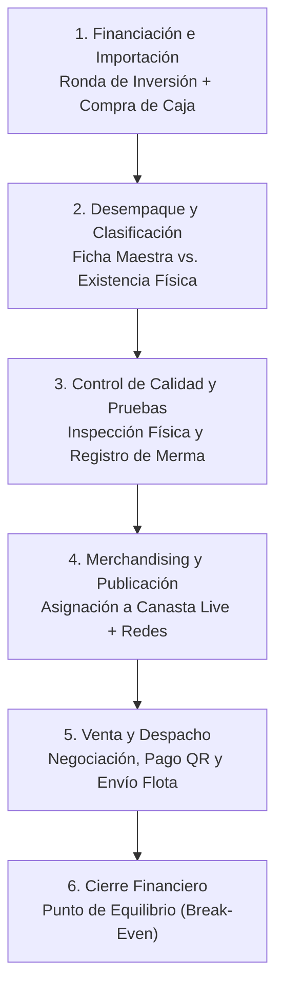

# 04. Flujo Operativo y Ciclo de Vida — Commerce

Este documento describe de manera **didáctica y paso a paso** el ciclo de vida completo de un producto en el ecosistema comercial: desde que los inversionistas desembolsan el capital para adquirir una caja o lote de importación hasta que el producto es vendido, despachado y se cierra el retorno de inversión del lote.

---

## 🔄 Visión General del Ciclo de Vida

---

## 📋 Las 6 Fases Operativas Paso a Paso

### Fase 1: Financiación y Adquisición del Lote
1. **Apertura de la Ronda (`InvestmentRound`):**
   - Se crea una ronda (ej: `RONDA-02` - 2da Compra Combo Paralelo) con un capital asignado (ej: Bs. 15,000).
2. **Registro de la Caja o Lote (`Batch`):**
   - Cuando se adquiere una caja de liquidación (ej: `ATAUD-02`), se registra con su costo de compra (ej: Bs. 4,000) y el flete internacional hasta el almacén en Cochabamba (ej: Bs. 300).
   - Costo total de la caja: **Bs. 4,300**.
   - Estado financiero inicial: `EN_RECUPERACION`.

---

### Fase 2: Desempaque, Clasificación e Inventariado
Al abrir la caja física en el almacén, el operador saca cada producto y realiza una doble verificación:

1. **¿El producto ya existe en el catálogo maestro? (`ProductMaster`):**
   - **Caso A (Producto Nuevo):** Se crea una nueva Ficha Maestra con su número correlativo limpio (`item_number: 243`), nombre oficial, categoría y precios de referencia (`official_price: 180`, `minimum_price: 140`). Se almacenan las fotos y creativos correspondientes en el repositorio o CDN de medios (`products/243-...`).
   - **Caso B (Producto Repetido):** Si el producto ya existía de una importación anterior (por ejemplo, el producto `#53 - Almohadilla Térmica`), **NO** se duplica la ficha maestra. Se utiliza la ficha existente `#53`.
2. **Registro de la Unidad Física en el Lote (`Product`):**
   - Se crea el registro de inventario físico vinculándolo a la ficha maestra (`master_product_id`) y a la caja de donde salió (`batch_id`).
   - Se indica la variante física específica si aplica (ej: `variant_name: "Color Gris"` o `"Modelo TK-HP2412"`).

---

### Fase 3: Control de Calidad, Pruebas y Tratamiento de Merma
Los productos de liquidación provienen de devoluciones o excedentes de tiendas estadounidenses; por tanto, **cada unidad debe ser probada individualmente en mesa de trabajo**:

1. **Inspección Operativa:**
   - Se conecta a la corriente y se comprueba que encienda, caliente o sincronice correctamente.
   - Si funciona al 100%: Se marca `is_reviewed = True` y `physical_condition = "OPERATIONAL"`.
2. **Tratamiento de Defectos o Merma:**
   - **Daño Estético Menor:** Si funciona pero tiene un raspón, se registra en `defect_detail: "Pequeño raspón en la esquina trasera"` y permanece como disponible.
   - **Unidad Insensible o Inservible (Merma):**
     - Si el producto llegó roto o quemado, se actualiza el producto con `merma_quantity = 1` y `physical_condition = "DAMAGED_SCRAP"`.
     - El stock disponible pasa a 0 (`available_quantity = 0`) y el estado a `"SCRAPPED"`.
     - **Efecto Financiero:** El servicio `BatchService` recalcula automáticamente el costo unitario de la caja:
       - Si la caja costó Bs. 4,300 y llegaron 50 ítems, pero 2 fueron merma, ahora hay **48 ítems vendibles**.
       - El costo unitario de cada producto vendible se eleva automáticamente a:
         $$\text{unit\_cost} = \frac{4,300}{48} = \text{Bs. } 89.58$$
       - De esta manera, **el negocio nunca pierde dinero por unidades rotas**, ya que su costo queda distribuido de forma transparente en las unidades buenas.

---

### Fase 4: Merchandising para TikTok Live y Redes Sociales
Antes de la transmisión en vivo, el equipo organiza los productos para facilitar la dinámica de subasta y venta rápida:

1. **Asignación de Canasta (`live_basket_id`):**
   - Cada producto maestro tiene asignada una canasta temática según su tipo y rango de precio:
     - `C1 Taller & Auto`: Linternas mecánicas, cargadores de batería, compresores portátiles.
     - `C2 Cables & Regletas`: Hubs USB, cables blindados, cargadores GaN.
     - `C3 Hogar & Cocina`: Afiladores eléctricos, luces solares, almohadillas térmicas.
     - `C4 Salud & Belleza`: Masajeadores, secadores iónicos, perfiladores.
     - `C+1 Remate Flash`: Productos especiales para dinamizar el live en momentos de alto tráfico.
2. **Publicación Multicanal:**
   - Se publican las fotos WebP en Facebook Marketplace (`is_published_marketplace = True`) y en catálogos de WhatsApp.
   - Los clientes pueden ver el catálogo público en tiempo real mediante la **PWA de Clientes** (`/apps/catalog-pwa`), la cual consulta directamente los productos con stock disponible sin necesidad de recompilar la web.

---

### Fase 5: Negociación, Regateo y Venta Atómica
Durante el live o por chat de Marketplace, un cliente expresa interés en un producto:

1. **Negociación y Piso de Regateo:**
   - El precio de publicación es de Bs. 160 (`published_price`).
   - El cliente ofrece Bs. 140. El vendedor acepta porque el piso protegido (`minimum_price`) es Bs. 140.
   - Si el cliente ofreciera Bs. 120, el sistema bloquearía el registro a menos que un supervisor active `allow_below_minimum = True`.
2. **Registro de la Venta (`POST /api/commerce/sales`):**
   - El operador selecciona el método de pago boliviano acordado:
     - `QR`: Pago inmediato por Simple QR.
     - `CASH`: Efectivo en punto de entrega.
     - `TRANSFER`: Transferencia bancaria (BNB, BCP, Banco Unión).
   - Selecciona la logística de entrega:
     - `FREE_MEETING_POINT`: Punto neutro sin costo (ej: Plaza Colón, Correo).
     - `HOME_DELIVERY`: Delivery con moto a domicilio.
     - `TERMINAL_BUS`: Envío por flota interdepartamental (Trans Copacabana, Bolívar) para clientes de La Paz, Santa Cruz u Oruro.
3. **Ejecución Atómica en Base de Datos:**
   - Se descuenta la unidad del inventario físico (`available_quantity = 0`, `status = "SOLD_OUT"`).
   - Se calcula el margen neto en el acto:
     $$\text{net\_margin} = \text{precio pactado (140)} - \text{costo del lote (89.58)} = \text{Bs. } +50.42$$

---

### Fase 6: Cierre Financiero y Retorno de Inversión (Break-Even)
1. **Seguimiento del Lote:**
   - Con cada venta registrada, el sistema suma el capital recuperado de esa caja específica.
2. **Punto de Equilibrio (*Break-Even*):**
   - En cuanto las ventas de la caja superan los Bs. 4,300 iniciales, el campo `financial_status` del lote cambia a `"RECUPERADO"`.
3. **Distribución de Utilidades:**
   - A partir de ese momento, cada venta subsiguiente de esa caja representa **100% utilidad neta**, permitiendo a los administradores generar los reportes de liquidación para los inversionistas de la ronda.

