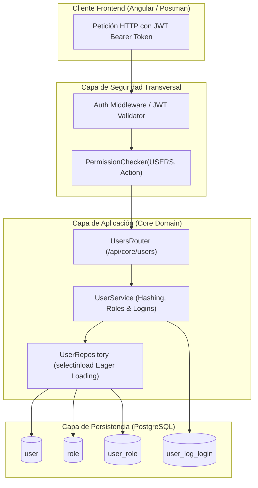
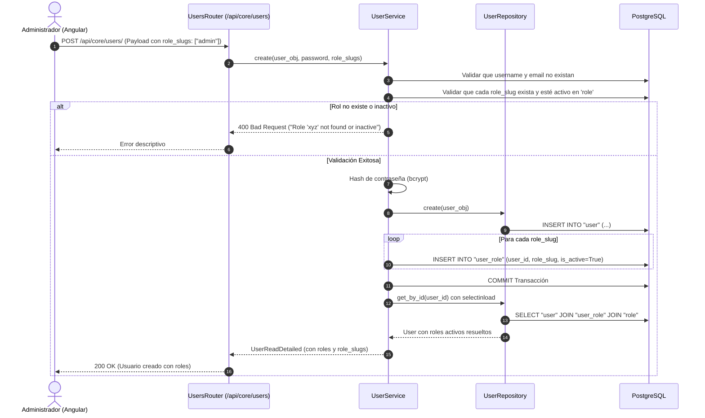

# 01. Arquitectura y Reglas de Negocio — Core & Identity

Este documento detalla los principios de diseño, la estructura modular y las reglas de negocio críticas implementadas en el módulo **Core** para la gestión de usuarios, seguridad y control de acceso.

---

## 🏛️ Arquitectura Modular DDD-Lite

El módulo sigue la arquitectura en capas estricta del backend:

```text
Routers (API REST) ──► Services (Reglas de Negocio) ──► Repositories (Data Access) ──► Models / Database
```



---

## 🔐 Reglas de Negocio Críticas

### 1. Unicidad, Formato e Inmutabilidad de Identidad
- **Username (Nombre de Usuario):**
  - **Sin espacios:** Se rechaza cualquier espacio intermedio, inicial o final (ej: `"henry. taby"` es rechazado con error 422).
  - **Longitud:** Obligatoriamente entre 3 y 30 caracteres.
  - **Caracteres permitidos:** Alfanuméricos, punto (`.`), guion (`-`) y guion bajo (`_`).
  - **Sin caracteres especiales consecutivos:** No se permite `..`, `--`, `__` ni combinaciones consecutivas.
  - **Sin iniciar ni terminar en signos:** Debe empezar y terminar con un carácter alfanumérico.
  - **Normalización:** Se convierte automáticamente a minúsculas (`lowercase`), evitando problemas de duplicidad como `Admin` vs `admin`.
- **Email (Correo Electrónico):**
  - Validador estricto RFC 5322 (`EmailStr`): Obliga a tener un formato de email real con dominio y TLD válido.
  - Normalización: Se limpia de espacios y se normaliza a minúsculas automáticamente (`lower().strip()`).
- **Contraseña:** Mínimo 6 caracteres tanto en creación como en actualización.
- **Nombres:** Se limpian automáticamente de espacios innecesarios (`strip()`).
- **Hashing Obligatorio:** Las contraseñas en texto plano nunca tocan la base de datos ni los logs de auditoría. Se procesan siempre mediante `get_password_hash` (bcrypt con salt seguro).

### 2. Gestión Atómica de Roles (`user_role`)
- Al crear o actualizar un usuario, el cliente puede enviar una lista de identificadores (`role_slugs: ["admin", "vendedor"]`).
- **Validación Preventiva:** Cada rol enviado debe existir previamente en la tabla `role` y tener `is_active = True`. De lo contrario, se rechaza la transacción completa con `400 Bad Request`.
- **Sincronización Inteligente (`_sync_user_roles`):**
  - Si un rol ya fue asignado previamente y se desmarcó, se marca `is_active = False` (preservando el historial de auditoría CDC).
  - Si un rol inactivo vuelve a seleccionarse, se reactiva con `is_active = True`.
  - Si es un rol nuevo, se inserta una nueva tupla en `user_role`.

### 3. Trazabilidad y Auditoría de Inicios de Sesión (`user_log_login`)
- Cada llamada al endpoint de login (`POST /api/auth/login`) genera un registro inmutable en `user_log_login`.
- Registra:
  - `user_id`: Identificador del usuario (o `null` si el usuario no existía).
  - `username`: Nombre de usuario ingresado en el formulario.
  - `ip_address`: Dirección IP de origen (capturada desde encabezados `X-Forwarded-For` o conexión directa).
  - `host_info`: User-Agent del navegador y sistema operativo cliente.
  - `is_successful`: `true` si las credenciales fueron válidas; `false` si falló la contraseña o el usuario estaba bloqueado.
  - `logged_out_at`: Se actualiza cuando el usuario consume `POST /api/auth/logout`.
- **Regla de Privacidad:** En los endpoints públicos o de consulta de usuarios (`GET /api/core/users/{id}/logins`), **nunca** se retorna el token JWT generado ni hashes de seguridad.

### 4. Protección contra Fuerza Bruta
- La entidad `user` mantiene los contadores `failed_login_attempts` y `locked_until`.
- Tras superar el umbral configurado de intentos erróneos, la cuenta se bloquea automáticamente por un tiempo determinado, impidiendo nuevos accesos aun cuando se ingrese la contraseña correcta posteriormente.

---

## 🔄 Ciclo de Vida: Creación y Asignación de Roles



