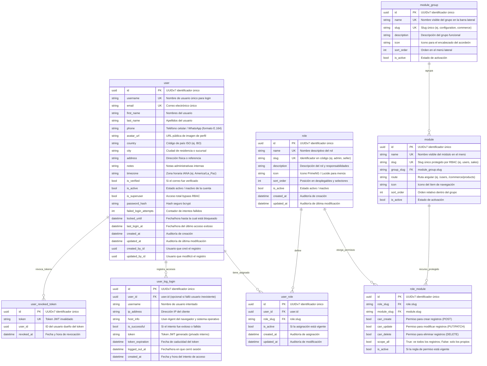

# 02. Diccionario de Base de Datos — Core & Identity

Todas las tablas del sistema siguen rigurosamente el estándar **Singular Table Naming Convention** (`user`, `role`, `user_role`, etc.) y utilizan identificadores primarios UUID (o códigos slug para recursos estables).

---

## 📊 Diagrama Entidad-Relación (ERD)

---

## 📑 Diccionario Campo por Campo

### 1. Tabla: `user`
Almacena las cuentas de usuario y credenciales del sistema.

| Columna | Tipo | Nulo | Clave | Descripción |
| :--- | :--- | :---: | :---: | :--- |
| `id` | `UUID` | No | PK | Identificador único UUIDv7. |
| `username` | `VARCHAR` | No | UK | Nombre de usuario único para el inicio de sesión. |
| `email` | `VARCHAR` | No | UK | Correo electrónico principal de la cuenta. |
| `first_name` | `VARCHAR` | Sí | | Nombres de pila de la persona. |
| `last_name` | `VARCHAR` | Sí | | Apellidos de la persona. |
| `phone` | `VARCHAR(30)` | Sí | | Teléfono celular / WhatsApp (formato E.164). |
| `avatar_url` | `VARCHAR(500)` | Sí | | URL de la imagen de perfil (Cloudinary, R2). |
| `country` | `VARCHAR(10)` | Sí | | Código de país ISO (Default: `"BO"`). |
| `city` | `VARCHAR(100)` | Sí | | Ciudad de residencia o sucursal operativa. |
| `address` | `VARCHAR(255)` | Sí | | Dirección física o referencia de ubicación. |
| `notes` | `TEXT` | Sí | | Notas administrativas y supervisión interna. |
| `timezone` | `VARCHAR(50)` | Sí | | Zona horaria IANA (Default: `"America/La_Paz"`). |
| `password_hash` | `VARCHAR` | No | | Hash seguro bcrypt (nunca retornado en respuestas JSON). |
| `is_verified` | `BOOLEAN` | No | | `true` si el correo ha sido verificado. Default: `false`. |
| `is_active` | `BOOLEAN` | No | | `true` si la cuenta puede iniciar sesión. Default: `true`. |
| `is_superuser` | `BOOLEAN` | No | | `true` si tiene privilegios de superadministrador. Default: `false`. |
| `failed_login_attempts` | `INTEGER` | No | | Contador de fallos consecutivos de autenticación. |
| `locked_until` | `TIMESTAMP` | Sí | | Si no es nulo y es futuro, bloquea cualquier intento de login. |
| `last_login_at` | `TIMESTAMP` | Sí | | Marca temporal del último inicio de sesión exitoso. |
| `created_at` | `TIMESTAMP` | Sí | | Fecha y hora de creación del registro (CDC). |
| `updated_at` | `TIMESTAMP` | Sí | | Fecha y hora de última modificación (CDC). |
| `created_by_id` | `UUID` | Sí | | UUID del usuario creador (CDC). |
| `updated_by_id` | `UUID` | Sí | | UUID del usuario modificador (CDC). |

---

### 2. Tabla: `role`
Catálogo de roles del sistema definidos en el arranque o por dominios.

| Columna | Tipo | Nulo | Clave | Descripción |
| :--- | :--- | :---: | :---: | :--- |
| `id` | `UUID` | No | PK | Identificador único UUIDv7. |
| `name` | `VARCHAR` | No | UK | Nombre del rol (ej: `"Administrador Sistema"`). |
| `slug` | `VARCHAR` | No | UK | Clave alfanumérica fija en código (ej: `"admin"`, `"seller"`). |
| `description` | `VARCHAR` | Sí | | Descripción operativa del perfil. |
| `icon` | `VARCHAR` | Sí | | Icono representativo (ej: `"pi pi-user"`). |
| `sort_order` | `INTEGER` | Sí | | Prioridad de visualización en selectores. |
| `is_active` | `BOOLEAN` | No | | Si el rol está habilitado para ser asignado. Default: `true`. |

---

### 3. Tabla: `user_role`
Tabla asociativa muchos a muchos entre usuarios y roles.

| Columna | Tipo | Nulo | Clave | Descripción |
| :--- | :--- | :---: | :---: | :--- |
| `id` | `UUID` | No | PK | Identificador único de la asignación. |
| `user_id` | `UUID` | No | FK | Referencia foránea a `user.id`. |
| `role_slug` | `VARCHAR` | No | FK | Referencia foránea a `role.slug`. |
| `is_active` | `BOOLEAN` | No | | `true` si el rol está activo en el usuario; `false` si fue revocado. |

---

### 4. Tabla: `user_log_login`
Bitácora de seguridad y auditoría de accesos.

| Columna | Tipo | Nulo | Clave | Descripción |
| :--- | :--- | :---: | :---: | :--- |
| `id` | `UUID` | No | PK | Identificador único del evento de log. |
| `user_id` | `UUID` | Sí | FK | Referencia a `user.id` (nulo si el usuario no existía). |
| `username` | `VARCHAR` | Sí | | Usuario enviado en la petición de login. |
| `ip_address` | `VARCHAR` | No | | Dirección IP de origen de la conexión. |
| `host_info` | `VARCHAR` | No | | User-Agent completo (navegador, versión, sistema operativo). |
| `is_successful` | `BOOLEAN` | No | | `true`: autenticado correctamente. `false`: contraseña errónea o bloqueado. |
| `token` | `VARCHAR` | Sí | | Token generado (privado, nunca expuesto por API). |
| `token_expiration` | `TIMESTAMP` | Sí | | Fecha límite de validez del token. |
| `logged_out_at` | `TIMESTAMP` | Sí | | Fecha/hora en la que se realizó logout voluntario. |
| `created_at` | `TIMESTAMP` | Sí | | Marca temporal del intento de login. |

