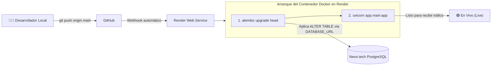
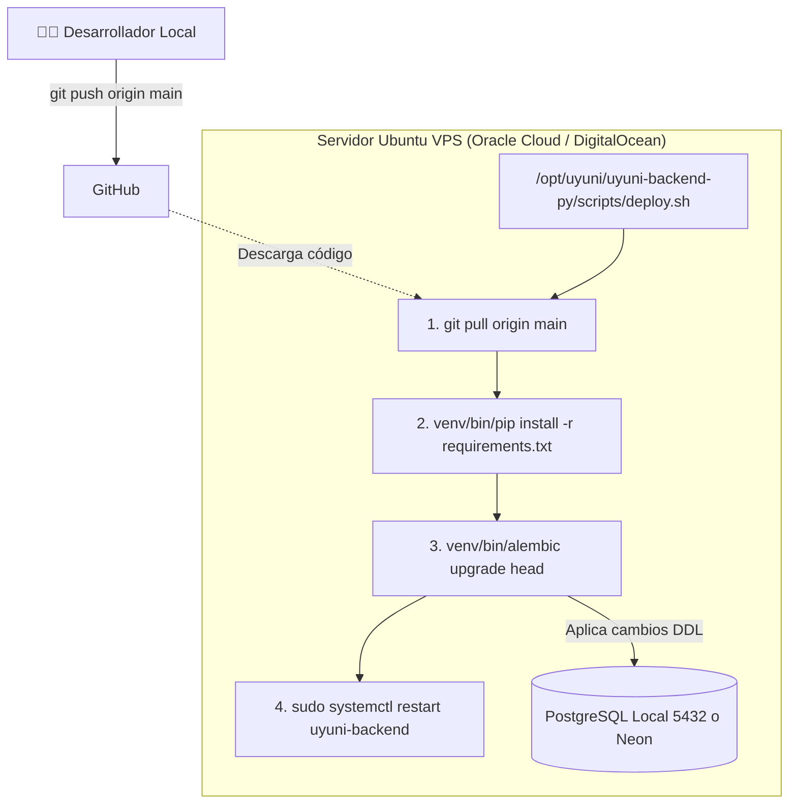

# Guía de Actualizaciones y Migraciones en Producción (Render vs. VPS Oracle / Ubuntu)

Esta guía explica en detalle cómo se aplican los cambios de código y las **migraciones de base de datos** (nuevas columnas, nuevas tablas, índices) en los diferentes entornos de despliegue donde opera **Uyuni Backend**: plataformas PaaS/Serverless (**Render.com + Neon**) y servidores virtuales dedicados (**VPS Ubuntu en Oracle Cloud / DigitalOcean / Hetzner**).

---

## 🧠 1. El Concepto Fundamental: `create_all()` vs. `Alembic`

Para entender por qué las migraciones funcionan como funcionan:

| Mecanismo | ¿Qué hace? | ¿Sirve para actualizar tablas existentes? |
| :--- | :--- | :---: |
| **`SQLModel.metadata.create_all()`** (FastAPI Lifespan) | Ejecuta `CREATE TABLE IF NOT EXISTS`. Si la tabla no existe en la BD, la crea desde cero. | ❌ **NO**. Si la tabla `user` ya existe en la base de datos, `create_all()` **ignora por completo** los nuevos campos (`phone`, `avatar_url`, `city`, etc.). |
| **`Alembic Migrations`** (`alembic upgrade head`) | Lee los archivos versionados en `alembic/versions/` e inspecciona la tabla interna `alembic_version`. Ejecuta sentencias SQL reales como `ALTER TABLE "user" ADD COLUMN phone VARCHAR(30);`. | ✅ **SÍ**. Es el estándar de la industria para evolucionar la estructura de la base de datos sin perder datos. |

> [!IMPORTANT]
> **Regla de Oro en Producción:** Cada vez que modifiques un modelo en `app/models/`, **debes generar una migración de Alembic** (`alembic revision --autogenerate -m "descripcion"`) y asegurarte de incluir el archivo generado en `alembic/versions/` dentro de tu commit (`git add .`).

---

## 🟣 2. Escenario A: Despliegue en Render.com (Contenedores + Neon PostgreSQL)

En este escenario, el backend corre en un contenedor Docker en Render y la base de datos PostgreSQL corre en **Neon.tech**.



### ¿Cómo está automatizado?
En el repositorio dejamos configurado:
1. **[`Dockerfile`](../../Dockerfile):**
   ```dockerfile
   CMD ["sh", "-c", "alembic upgrade head && uvicorn app.main:app --host 0.0.0.0 --port ${PORT:-8000} --workers 2"]
   ```
2. **[`render.yaml`](../../render.yaml):**
   ```yaml
   preDeployCommand: alembic upgrade head
   ```

### Procedimiento para actualizar Render:
Solo requieres **3 comandos Git** desde tu máquina de desarrollo:

```bash
# 1. Asegurar que agregas código y archivo de migración en alembic/versions/
git add .

# 2. Crear el commit descriptivo
git commit -m "feat(core): add user profile fields and me endpoints"

# 3. Subir a la rama de producción
git push origin main
```

**¿Qué ocurre a continuación?**
1. Render detecta el commit en GitHub y compila la imagen Docker.
2. Al iniciar el contenedor, ejecuta `alembic upgrade head`.
3. Alembic se conecta a Neon usando la variable `DATABASE_URL`, detecta que falta la migración y agrega las columnas a la tabla `user` en Neon.
4. Luego arranca Uvicorn y el servicio pasa el `/health` check.
5. **Cero comandos manuales.** Todo queda sincronizado en ~90 segundos.

---

## 🟠 3. Escenario B: Despliegue en VPS Propio (Oracle Cloud / Ubuntu / Nginx / Systemd)

Si decides montar el backend en un **VPS propio** como el **Always Free Tier de Oracle Cloud (OCI)** (que ofrece instancias ARM Ampere de hasta 4 OCPU y 24 GB de RAM gratis de por vida, o AMD Micro):



### Procedimiento para actualizar el VPS:

#### Paso 1: Sube tus cambios a GitHub (en tu máquina local)
```bash
git add .
git commit -m "feat(core): add profile fields and endpoints"
git push origin main
```

#### Paso 2: Conéctate por SSH a tu VPS de Oracle Cloud
```bash
ssh -i ~/.ssh/tu_clave_oracle ubuntu@IP_PUBLICA_ORACLE
```

#### Paso 3: Ejecuta el script de despliegue automatizado
El proyecto ya cuenta con el script oficial [`scripts/deploy.sh`](../../scripts/deploy.sh). Solo ejecutas:

```bash
sudo -u deploy /opt/uyuni/uyuni-backend-py/scripts/deploy.sh
```

*(O si ejecutas como tu propio usuario con sudo: `cd /opt/uyuni/uyuni-backend-py && git pull origin main && venv/bin/alembic upgrade head && sudo systemctl restart uyuni-backend`)*.

**¿Qué hace este comando automáticamente?**
1. **`git pull origin main`**: Descarga los nuevos archivos (incluyendo la migración `alembic/versions/e976c6814a87_add_profile_fields_to_user.py`).
2. **`venv/bin/pip install -r requirements.txt`**: Instala cualquier librería nueva si se agregó alguna.
3. **`venv/bin/alembic upgrade head`**: Conecta a la base de datos (PostgreSQL local del VPS o Neon) y aplica las nuevas columnas de forma segura.
4. **`sudo systemctl restart uyuni-backend`**: Reinicia el demonio de FastAPI con cero interrupciones perceptibles.

---

## 🛡️ 4. Particularidades Críticas de Oracle Cloud (OCI Always Free)

Si utilizas Oracle Cloud Infrastructure (OCI) para tu VPS, ten en cuenta estos 3 puntos específicos:

### 1. Puertos en la Consola Web de Oracle (Security Lists / Ingress Rules)
Por defecto, Oracle bloquea todo el tráfico entrante salvo el puerto 22 (SSH). Para que tu API sea visible en Internet:
1. En la consola de Oracle Cloud: Ve a **Networking > Virtual Cloud Networks (VCN)**.
2. Selecciona tu VCN > **Security Lists** > **Default Security List**.
3. En **Ingress Rules**, añade dos reglas:
   - **HTTP:** Source CIDR: `0.0.0.0/0`, Protocolo: `TCP`, Destination Port: `80`.
   - **HTTPS:** Source CIDR: `0.0.0.0/0`, Protocolo: `TCP`, Destination Port: `443`.

### 2. Firewall Interno de Ubuntu en Oracle (`iptables`)
A diferencia de otros proveedores, las imágenes oficiales de Ubuntu en Oracle vienen con reglas estrictas de `iptables` preinstaladas que bloquean los puertos 80 y 443 incluso si los abriste en la consola web.
Para habilitarlos dentro del VPS:
```bash
sudo iptables -I INPUT 6 -m state --state NEW -p tcp --dport 80 -j ACCEPT
sudo iptables -I INPUT 6 -m state --state NEW -p tcp --dport 443 -j ACCEPT
sudo netfilter-persistent save
```

### 3. Memoria Swap Recomendada
Si usas la instancia pequeña AMD (1 GB RAM), activa 2 GB de Swap para que Alembic y la compilación de librerías no sufran OOM (*Out Of Memory*):
```bash
sudo fallocate -l 2G /swapfile
sudo chmod 600 /swapfile
sudo mkswap /swapfile
sudo swapon /swapfile
echo '/swapfile none swap sw 0 0' | sudo tee -a /etc/fstab
```

---

## 📊 5. Tabla Comparativa Resumen: Render vs. VPS Oracle

| Característica | Render.com + Neon | VPS Ubuntu en Oracle Cloud |
| :--- | :--- | :--- |
| **Costo** | $0.00 / mes (Free Tier) | $0.00 / mes (Always Free Tier) |
| **Tipo de Servicio** | PaaS Serverless (Contenedor Docker) | Servidor IaaS Dedicado (Linux KVM) |
| **Recursos** | 0.1 CPU, 512 MB RAM | Hasta 4 OCPU ARM, 24 GB RAM o 1 AMD, 1 GB |
| **Cómo se actualiza** | **100% Automático con `git push`** | `git push` + 1 comando en el VPS (`scripts/deploy.sh`) |
| **Cómo se aplica la migración** | Ejecutada por Docker al arrancar (`alembic upgrade head`) | Ejecutada por `deploy.sh` antes del reinicio del servicio |
| **Mantenimiento del SO** | Cero (Render gestiona el host) | Manual (actualizar paquetes Ubuntu, certificados Nginx) |
| **Sleep por inactividad** | Sí (se evita con ping cada 5 min de UptimeRobot) | No (máquina 100% encendida 24/7) |

---

## ✅ 6. Checklist de Seguridad Antes de Cualquier Migración

- [x] Las nuevas columnas son `nullable=True` o tienen un valor `default` (nunca agregues columnas `NOT NULL` sin default en tablas con registros existentes).
- [x] El archivo generado en `alembic/versions/` está rastreado en Git (`git add alembic/versions/`).
- [x] Ejecutaste `venv/bin/alembic check` localmente para confirmar que no hay desvíos de esquema.
- [x] Ejecutaste la suite de tests (`venv/bin/pytest tests/`) para asegurar que no se rompieron validaciones.

