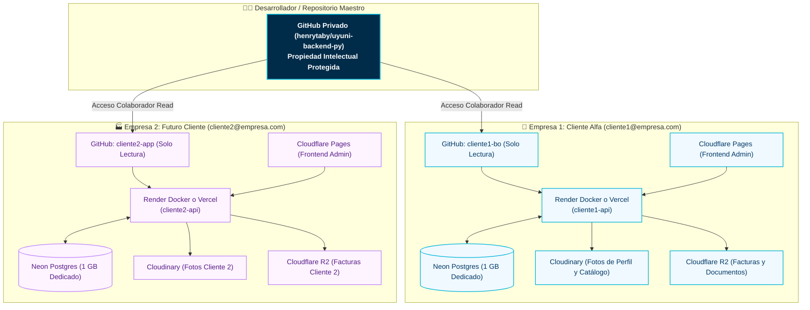

# 🚀 Suite de Despliegue, Infraestructura y Marca Blanca (Uyuni ERP)

Este directorio centraliza toda la documentación operativa, guías de infraestructura en la nube, manuales de puesta en producción y procedimientos de replicación marca blanca (*White-Label / Single-Tenant*) para **Uyuni Backend & Ecosistema Comercial**.

---

## 📚 Mapa de Guías Disponibles

| Guía | Propósito | Entorno / Servicios | Costo Estimado |
| :--- | :--- | :--- | :---: |
| 🏢 **[Manual de Replicación para Clientes (Marca Blanca)](./CLIENT_REPLICATION_PLAYBOOK.md)** | Procedimiento paso a paso para dar de alta una nueva empresa (marca blanca) con aislamiento total de datos, cuentas gratuitas dedicadas y protección de propiedad intelectual del desarrollador. | GitHub + Neon + Render/Vercel + Cloudinary + Cloudflare | **$0.00 / mes** |
| 🟣 **[Guía de Despliegue en Render.com](./RENDER_DEPLOYMENT_GUIDE.md)** | Despliegue continuo en contenedor Docker MicroVM (Python 3.14 nativo), configuración de variables, health checks y monitor Keep-Alive 24/7 con UptimeRobot. | Render (Docker) + UptimeRobot | **$0.00 / mes** |
| ☁️ **[Guía de Arquitectura Serverless en la Nube](./SERVERLESS_DEPLOYMENT_GUIDE.md)** | Arquitectura moderna en la nube sin mantenimiento de Linux. Combina bases de datos PostgreSQL serverless, cómputo backend, almacenamiento de fotos y documentos privados. | Neon.tech + Vercel/Render + Cloudflare Pages/R2 + Cloudinary | **$0.00 / mes** |
| 🖥️ **[Guía de Despliegue en VPS Linux (Ubuntu)](./UBUNTU_VPS_DEPLOYMENT_GUIDE.md)** | Instalación tradicional en un servidor privado virtual propio con servicio de sistema Systemd, Nginx como Reverse Proxy y certificados SSL automáticos de Let's Encrypt. Compatible con Oracle Cloud Always Free. | Ubuntu 22.04/24.04 + Systemd + Nginx + Certbot | ~$5 - $15 / mes (o $0.00 en Oracle) |
| 🔄 **[Guía de Actualizaciones y Migraciones en Producción](./PRODUCTION_UPDATES_AND_MIGRATIONS_GUIDE.md)** | Procedimiento de despliegue continuo y actualización de esquemas de base de datos con Alembic en producción. Comparativa detallada Render vs. VPS Oracle/Ubuntu. | Alembic + Docker + Neon / PostgreSQL Local + Systemd | **$0.00** |

---

## 🏛️ Filosofía de Arquitectura y Aislamiento por Empresa

---

## ⚡ Guía de Inicio Rápido (Quickstart)

1. **¿Vas a desplegar una nueva empresa o cliente?**  
   👉 Sigue el [**Manual de Replicación para Clientes (`CLIENT_REPLICATION_PLAYBOOK.md`)**](./CLIENT_REPLICATION_PLAYBOOK.md).
2. **¿Quieres montar el backend en Render.com ahora mismo?**  
   👉 Sigue la [**Guía de Render.com (`RENDER_DEPLOYMENT_GUIDE.md`)**](./RENDER_DEPLOYMENT_GUIDE.md).
3. **¿Tienes un servidor VPS propio con Linux Ubuntu (Oracle Cloud, DigitalOcean, etc.)?**  
   👉 Sigue la [**Guía de VPS Ubuntu (`UBUNTU_VPS_DEPLOYMENT_GUIDE.md`)**](./UBUNTU_VPS_DEPLOYMENT_GUIDE.md).
4. **¿Modificaste campos en la base de datos y necesitas actualizar producción?**  
   👉 Sigue la [**Guía de Actualizaciones y Migraciones en Producción (`PRODUCTION_UPDATES_AND_MIGRATIONS_GUIDE.md`)**](./PRODUCTION_UPDATES_AND_MIGRATIONS_GUIDE.md).

