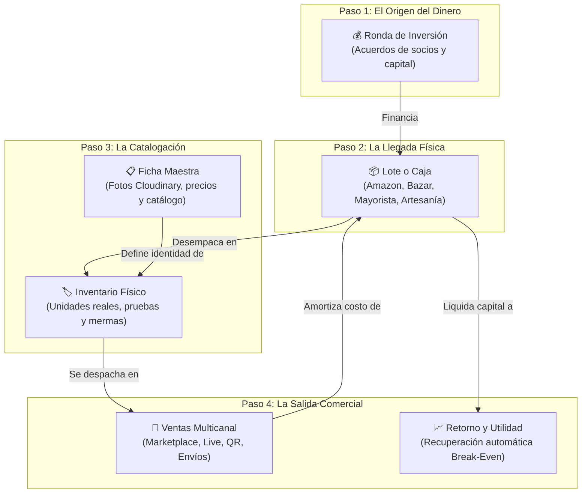
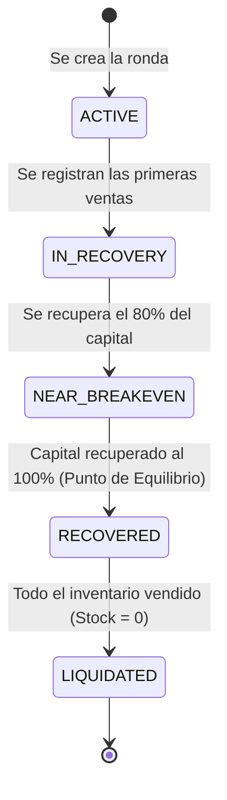
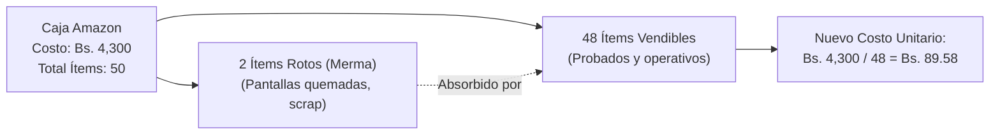
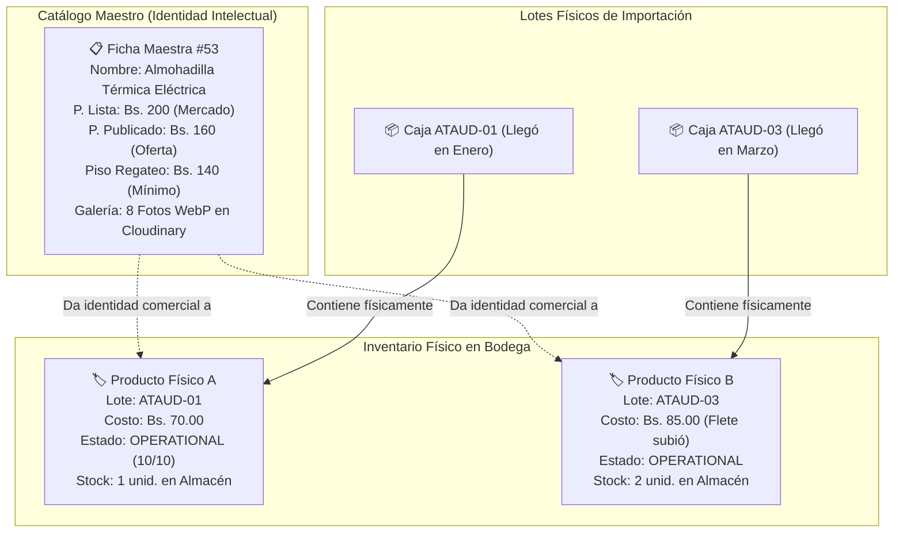
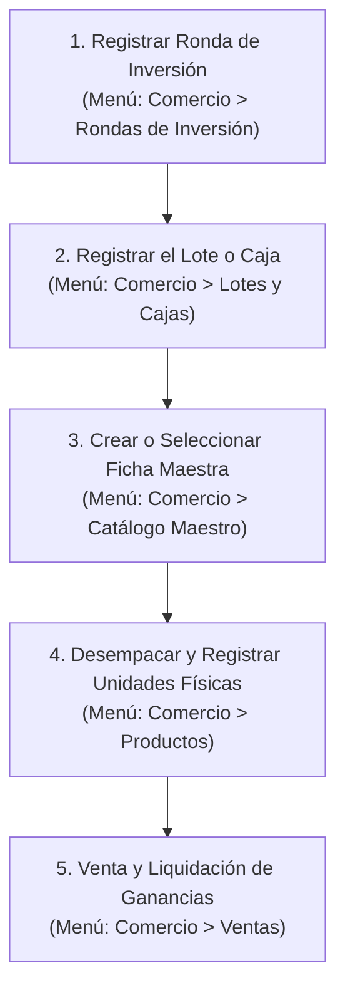

# Manual de Negocio y Operaciones: Rondas de Inversión y Lotes de Mercadería

> **Dirigido a:** Socios fundadores, inversionistas, administradores de almacén y nuevos operadores del sistema Uyuni.  
> **Objetivo:** Comprender la lógica comercial del negocio minorista y dominar el uso del software paso a paso, desde que se concibe el capital hasta que la mercadería genera utilidades reales.

---

## 🧭 1. El Viaje del Negocio: La «Receta Comercial»

Para tener éxito en el modelo de negocio de Uyuni (importación de liquidaciones, subastas en vivo por TikTok Live, ventas por Marketplace y bazares de segunda mano), **el orden de los factores sí altera el producto**.

No se puede vender un producto sin saber cuánto costó; y no se puede comprar mercadería si antes no se tiene claro de qué bolsillo o fondo de socios proviene el dinero. Por ello, el sistema Uyuni sigue una secuencia lógica y cronológica inmutable:

---

## 💰 2. Rondas de Inversión: El Capital de los Socios

### 2.1. ¿Qué es una Ronda de Inversión en la vida real?
Una **Ronda de Inversión** es una "bolsa común" o acuerdo financiero formal entre los socios para una campaña comercial específica. Representa el dinero comprometido para comprar mercadería.

#### 💡 Ejemplo de la vida real (Campaña Navideña):
> Juan y Pedro deciden importar productos para vender a fin de año.
> - Acuerdan un presupuesto de **Bs. 15,000**.
> - Juan aporta el 60% (Bs. 9,000) y Pedro el 40% (Bs. 6,000).
> - Crean la ronda **`RONDA-04` - Campaña Fin de Año**.
> - Con ese dinero compran dos cajas de liquidación en Estados Unidos y pagan los fletes marítimos y aduaneros.
> - **El objetivo de la ronda:** Rastrear hasta el último centavo de las ventas futuras para saber exactamente **cuándo se recuperan los Bs. 15,000** y a partir de qué momento el negocio genera ganancias líquidas para repartir.

#### 💡 Ejemplo de la vida real (Bazar Familiar / Sin capital previo):
> Los socios deciden que antes de importar van a vender ropa usada, adornos de casa y artículos electrónicos que tienen en sus domicilios.
> - Crean la ronda **`RONDA-BAZAR` - Bazar y Cosas Propias**.
> - Inversión inicial: **Bs. 0.00**. No se pidió dinero prestado ni se arriesgó capital en efectivo.
> - Cada artículo que se vende representa flujo de caja positivo inmediato.

---

### 2.2. Campos del Formulario de Rondas y Reglas de Integridad

Al registrar o editar una Ronda de Inversión en el sistema, te encontrarás con estos campos:

| Campo en Pantalla | ¿Quién lo llena? | Tipo de Dato | Propósito y Regla de Negocio |
| :--- | :---: | :---: | :--- |
| **Código** | **Automático / Opcional** | Texto (`RONDA-01`) | Identificador único de la ronda. Si lo dejas vacío, el backend lo genera solo correlativamente (`RONDA-01`, `RONDA-02`...). Puedes ingresar uno propio como `RND-BAZAR`. |
| **Nombre de la Ronda** | **Usuario** | Texto | Nombre descriptivo claro. Ejemplo: *"1ra Compra Piloto"*, *"Campaña Día de la Madre"*, *"Bazar Cosas Usadas"*. |
| **Fecha de Desembolso** | **Usuario** | Fecha | Día en que los socios depositaron el dinero o se dio inicio formal a la campaña. |
| **Capital Aportado (Bs)** | **100% CALCULADO** | Moneda (`Bs.`) | **No es editable a mano**. ¿Por qué? Porque el capital real invertido es la **suma exacta de las cajas o lotes (`commerce_batch`)** que se compren para esta ronda. Evita errores humanos de ingresar números inventados. |
| **Estado de la Ronda** | **100% CALCULADO** | Badge / Etiqueta | **No es editable a mano**. Se calcula matemáticamente de acuerdo a las ventas registradas contra los lotes. |
| **Observaciones o Condiciones del Aporte** | **Usuario** | Texto libre | Espacio para documentar acuerdos entre socios: porcentajes de participación (*Juan 60%, Pedro 40%*), plazos de devolución o condiciones pactadas. |

---

### 2.3. Ciclo de Vida y Estados Financieros de la Ronda

El backend supervisa de forma atómica cada venta que ocurre en el sistema. A medida que los productos de los lotes se venden, el estado de la ronda avanza automáticamente:

1. **`ACTIVE` (Activa):** La ronda fue creada y tiene lotes asignados, pero aún no se han registrado ventas de sus productos.
2. **`IN_RECOVERY` (En Recuperación):** Ya comenzaron las ventas en vivo o por Marketplace, y el dinero recaudado amortiza el capital invertido (avance menor al 80%).
3. **`NEAR_BREAKEVEN` (Casi en Tablas):** Las ventas han recuperado el 80% o más del capital aportado. Los socios están a punto de salir de la zona de riesgo.
4. **`RECOVERED` (Punto de Equilibrio / Break-Even Alcanzado):**  
   $$\text{Capital Recuperado} \ge \text{Capital Invertido}$$  
   **¡Momento cumbre del negocio!** Los socios ya recuperaron cada peso desembolsado. A partir de este momento, **toda venta subsiguiente es 100% ganancia neta**.
5. **`LIQUIDATED` (Liquidada):** Se alcanzó el punto de equilibrio y además **todas las unidades vendibles de los lotes se agotaron** (`stock disponible = 0`). La ronda se considera exitosamente concluida.

> [!IMPORTANT]
> **Regla de Protección de Integridad:**  
> El sistema **jamás te permitirá eliminar una Ronda de Inversión si ya tiene Lotes o Cajas vinculadas**. Si intentas borrarla, el sistema mostrará una alerta de seguridad para evitar que queden cajas huérfanas en la base de datos. Para eliminar una ronda, primero debes desvincular o eliminar sus lotes.

---

## 📦 3. Lotes y Cajas (`commerce_batch`): La Entrada Física

### 3.1. ¿Qué es un Lote o Caja?
En el sistema, el nombre oficial del módulo es **«Lotes y Cajas»**. Es la entidad física que agrupa un conjunto de mercadería que entra al almacén bajo una misma procedencia, flete y método de costeo.

---

### 3.2. Las 4 Modalidades de Lotes con Ejemplos Reales

No toda la mercadería se compra ni se costea igual. Uyuni soporta 4 modalidades de negocio del mundo real mediante el campo **`costing_method` (Método de Costeo)**:

#### 🟢 Modalidad 1: Cajas Sorpresa de Amazon / Liquidaciones (`WEIGHTED_RETAIL`)
*Es el corazón del negocio de importación minorista.*

- **Escenario Real:** Compras un "ataúd" o pallet de devoluciones en Amazon o Target por **Bs. 4,000**. El flete internacional y aduana cuesta **Bs. 300**. Costo total del lote: **Bs. 4,300**.
- **El Desafío:** No sabes exactamente qué viene dentro hasta abrirla en el almacén de Cochabamba. Al abrir la caja encuentras 40 ítems completamente dispares: un radio inteligente de auto, 15 cables USB, un taladro inalámbrico, juguetes y luces solares.
- **¿Por qué NO dividir en partes iguales?**:  
  Si divides los Bs. 4,300 entre 40 productos, cada uno tendría un costo promedio de Bs. 107.50.  
  - Si vendes el cable USB a Bs. 30 (su precio real de mercado), ¡el sistema diría que perdiste Bs. 77.50 en el cable!  
  - Y si vendes el radio de auto en Bs. 700, diría que ganaste Bs. 592.50. Esa contabilidad es falsa y engañosa.
- **La Solución Uyuni (Prorrateo Ponderado por Valor Comercial):**  
  El sistema calcula el costo de cada producto proporcionalmente a su precio de venta al público (`published_price`). Los productos caros absorben más costo de la caja y los productos económicos absorben una fracción pequeña, garantizando que **todos los productos dejen un margen de ganancia coherente y positivo**.

#### 🟡 Modalidad 2: Bazar Familiar y Cosas Propias de Socios (`SPECIFIC_ITEM`)
*Venta de cosas usadas propias, de la familia o aportes de amigos.*

- **Escenario Real:** Los socios deciden vender artículos propios usados (ropa, consolas, juguetes viejos, adornos del hogar) o cosas que familiares dan para vender.
- **El Costo Inicial:** **Bs. 0.00**. No se desembolsó dinero para comprar un contenedor cerrado.
- **Cosas Propias (Costo 0):**  
  Una chaqueta de cuero propia que ya no usas. Le pones `cost_price = 0.0`. En catálogo la publicas en Bs. 120. Cuando se vende, los **Bs. 120 son 100% utilidad limpia** para la empresa.
- **Consignación de Familiares o Amigos (Pago acordado tras la venta):**  
  Tu primo te dice: *"Tengo esta bicicleta; véndanla en Marketplace. A mí me dan Bs. 200 cuando se venda, y todo lo que le saquen por encima es para ustedes"*.
  - En el producto registras `cost_price = 200.0`.
  - En el catálogo maestro la publicas en `published_price = 350.0` con piso de regateo `minimum_price = 300.0`.
  - Cuando se vende a Bs. 320:
    - Cobrado: Bs. 320.
    - Costo reconocido: Bs. 200 (para pagarle al primo).
    - **Ganancia Neta para Uyuni: Bs. 120**.
  - *Ventaja clave:* El lote acumula automáticamente de abajo hacia arriba (`SPECIFIC_ITEM`) la suma de las deudas o costos de los productos ingresados.

#### 🔵 Modalidad 3: Lote Mayorista Homogéneo (`FLAT_AVERAGE`)
*Compra tradicional de productos nuevos idénticos.*

- **Escenario Real:** Compras a un importador mayorista 50 teclados mecánicos idénticos por **Bs. 2,500** en total, con un flete de **Bs. 100**.
- **Costo Total:** Bs. 2,600.
- **Costo Unitario:** Como todos los productos son exactamente iguales, cada teclado cuesta:
  $$\text{unit\_cost} = \frac{2,600}{50} = \text{Bs. } 52.00$$
- Aquí sí aplica la división aritmética directa entre las unidades buenas.

#### 🟣 Modalidad 4: Productos Hechos a Mano / Artesanías / Manufactura (`SPECIFIC_ITEM`)
*Elaboración de arreglos florales, muebles, adornos navideños o confecciones.*

- **Escenario Real:** Fabrican arreglos florales navideños en el taller.
- **Cálculo de Costo:** Calculas los materiales e insumos de cada arreglo:
  - Base de cerámica: Bs. 15.
  - Flores artificiales y follaje: Bs. 25.
  - Cintas y luces LED: Bs. 10.
  - Costo de insumos (`cost_price`): **Bs. 50**.
- Publicas el arreglo en **Bs. 120**. Al venderse, recuperas los Bs. 50 de materiales y registras **Bs. 70 de ganancia neta** por tu mano de obra y margen comercial.

---

### 3.3. El Tratamiento de las Mermas (Unidades Rotas o Inservibles)

En la importación de liquidaciones estadounidenses, **siempre llegan productos dañados o inservibles**. Es parte intrínseca del negocio.

#### ¿Cómo protege Uyuni la rentabilidad del negocio ante la merma?
Imagina que la caja costó **Bs. 4,300** y llegaron 50 productos. El costo estimado original era:
$$\frac{4,300}{50} = \text{Bs. } 86.00 \text{ por unidad}$$

Al probarlos en mesa de trabajo descubres que **2 productos están inservibles (merma)**:
1. En el producto dañado registras: `merma_quantity = 1` y `physical_condition = "DAMAGED_SCRAP"`.
2. El inventario vendible de la caja baja de 50 a **48 unidades vendibles**.
3. **El recálculo automático de Uyuni:**  
   $$\text{unit\_cost} = \frac{4,300}{48} = \text{Bs. } 89.58$$
4. **El Resultado Financiero:** El costo de los 2 productos quemados se distribuye automáticamente entre los 48 productos buenos. **¡El negocio nunca pierde dinero por unidades rotas!**

---

### 3.4. Guía de Campos del Lote: ¿Qué se llena y qué se calcula?

| Campo | Modo de Lote | ¿Editable? | Explicación |
| :--- | :--- | :---: | :--- |
| **Código de Caja** | Todos | Opcional | Si se deja vacío, genera `CAJA-01`, `CAJA-02`, etc. |
| **Nombre Descriptivo** | Todos | **Sí** | Ej: *"Ataúd 1 - Electrónicos Amazon"*, *"Bazar Ropa Invierno"*. |
| **Ronda de Inversión** | Todos | **Sí** | Selector para asociar esta caja a una ronda financiera. |
| **Método de Costeo** | Todos | **Sí** | `WEIGHTED_RETAIL`, `SPECIFIC_ITEM` o `FLAT_AVERAGE`. |
| **Precio de Compra** | `WEIGHTED_RETAIL` | **Sí** | Se ingresa el valor pagado por la caja en origen. |
| **Precio de Compra** | `SPECIFIC_ITEM` | **NO (Calculado)** | Se bloquea y se calcula automáticamente sumando el costo de los productos ingresados. |
| **Costo de Flete** | Todos | **Sí** | Flete de envío internacional o nacional pagado por la caja. |
| **Costo Total** | Todos | **NO (Calculado)** | $\text{total\_cost} = \text{purchase\_price} + \text{freight\_cost}$. |
| **Unidades Iniciales** | Todos | **NO (Calculado)** | Suma automática de las unidades físicas de los productos del lote. |
| **Unidades de Merma** | Todos | **NO (Calculado)** | Suma automática de las mermas registradas en los productos. |
| **Unidades Vendibles** | Todos | **NO (Calculado)** | $\text{sellable} = \text{initial} - \text{merma}$. |
| **Costo Promedio Unit.** | Todos | **NO (Calculado)** | $\frac{\text{total\_cost}}{\text{sellable}}$. |
| **Estado Financiero** | Todos | **NO (Calculado)** | `EN_RECUPERACION`, `CASI_TABLAS` o `RECUPERADO` según ventas. |
| **Fecha de Adquisición** | Todos | **Sí** | Fecha en que se compró o recibió el lote. |
| **Observaciones** | Todos | **Sí** | Texto libre para precintos, números de guía de transporte, etc. |

---

## 🏷️ 4. De la Ficha Maestra al Producto Físico en Almacén

Uno de los conceptos más elegantes y poderosos de Uyuni es la **separación estricta entre la Ficha Maestra y el Producto Físico**:

### 4.1. ¿Por qué existen dos tablas separadas?
- **La Ficha Maestra (`ProductMaster`):** Es la biblioteca intelectual del producto. Contiene el nombre estándar, las fotos profesionales en Cloudinary, los enlaces de referencia en Amazon y los precios de venta. **Se crea una sola vez en la historia de la empresa**.
- **El Producto Físico (`Product`):** Es la unidad de carne y hueso guardada en la estantería del almacén. Tiene asignado un lote de procedencia, su costo específico de esa compra, su condición física particular (ej: *«sin rayones, probado»* o *«con pequeño raspón en la esquina»*), y su stock disponible.

#### 💡 Ejemplo de la vida real:
> En enero importas la Caja 1 y viene una **Almohadilla Térmica**. Creas la Ficha Maestra `#53` con sus fotos y descripción. Le asignas el producto físico con costo de Bs. 70.
> En marzo importas la Caja 3 y vuelven a llegar dos almohadillas idénticas.
> **¿Qué haces en Uyuni?**  
> **NO vuelves a crear la ficha maestra**. No vuelves a escribir el nombre ni a subir fotos. Simplemente buscas la ficha `#53` y le agregas 2 unidades físicas vinculadas a la Caja 3.

---

### 4.2. El «Tri-Precio» y la Estrategia de Venta con Regateo

En Bolivia y en el comercio por Marketplace y redes sociales, el regateo es ley. Uyuni implementa el modelo de **Tri-Precio** para proteger la rentabilidad del negocio:

$$\begin{aligned}
\text{Margen de Rebaja} &= \text{Precio Publicado} - \text{Piso de Regateo} \\
\text{Argumento de Ahorro} &= \text{Precio Lista (Nuevo)} - \text{Precio Publicado}
\end{aligned}$$

1. **`P. Publicado` (`published_price`):** El precio oficial anunciado en redes sociales o catálogo web. Es lo primero que se le cotiza al cliente (ej: **Bs. 160**).
2. **`Piso Regateo` (`minimum_price`):** El límite mínimo de venta autorizado si el cliente pide rebaja (ej: **Bs. 140**). El vendedor sabe que puede bajar de 160 a 140 sin pedir permiso. Si el cliente ofrece Bs. 120, el sistema bloqueará la venta por seguridad.
3. **`P. Lista` (`official_price`):** El precio de referencia investigado en el mercado local para ese producto nuevo en tienda formal (ej: **Bs. 220**). Sirve como ancla psicológica: *«En tiendas comerciales vale Bs. 220, pero en Uyuni te lo llevas por solo Bs. 160 (¡Ahorras Bs. 60!)»*.

---

## 🛠️ 5. Manual Operativo Paso a Paso (Para el Operador Diario)

Sigue estos 4 pasos cada vez que inicies operaciones con nueva mercadería:

### Paso 1: Abrir la Ronda de Inversión
1. Dirígete a **Comercio $\rightarrow$ Rondas de Inversión**.
2. Haz clic en **`+ Nueva Ronda`**.
3. Ingresa el **Nombre de la Ronda** (ej: `Ronda 5 - Liquidaciones Electrónicos`).
4. Selecciona la **Fecha de Desembolso**.
5. En **Observaciones**, anota los nombres de los socios participantes y sus porcentajes.
6. Haz clic en **`Guardar`**. (El código `RONDA-05` se generará automáticamente).

### Paso 2: Dar de Alta la Caja o Lote
1. Dirígete a **Comercio $\rightarrow$ Lotes y Cajas**.
2. Haz clic en **`+ Nueva Caja`**.
3. **Pestaña 0 (Identificación):**
   - Nombre: `Ataud 3 - Audio y Hogar`.
   - Ronda de Inversión: Selecciona la ronda creada en el Paso 1 (`RONDA-05`).
   - Método de Costeo: Selecciona `WEIGHTED_RETAIL` (si es caja sorpresa) o `SPECIFIC_ITEM` (si es bazar propio).
   - Fecha de Compra: Fecha en que se adquirió.
4. **Pestaña 1 (Costos):**
   - Si es caja sorpresa: Ingresa el **Precio de Compra** (ej: Bs. 3,500) y el **Costo de Flete** (ej: Bs. 250).
   - Si es bazar propio: Deja el precio en 0; el sistema lo sumará solo cuando ingreses productos.
5. Haz clic en **`Guardar`**.

### Paso 3: Desempaque, Control de Calidad y Registro de Productos
Al abrir la caja en el almacén:
1. Toma un artículo (ej: un Proyector LED portátil).
2. Ve a **Comercio $\rightarrow$ Catálogo Maestro** y busca si ya existe:
   - **Si ya existe:** Anota su número de catálogo (ej: `#88`).
   - **Si no existe:** Clic en **`+ Nueva Ficha`**, ponle su nombre oficial, sube las fotos tomadas en mesa de trabajo y define su precio publicado y piso de regateo.
3. Ve a **Comercio $\rightarrow$ Productos** y haz clic en **`+ Nuevo Producto Físico`**:
   - Ficha Maestra: Selecciona la `#88`.
   - Caja / Lote: Selecciona `Ataud 3`.
   - Cantidad: Las unidades recibidas (ej: `1`).
   - Condición Física: `OPERATIONAL` (si enciende y funciona al 100%) o `DAMAGED_SCRAP` (si llegó roto/merma).
   - Detalle de inspección: *"Seminuevo 10/10, probado con cable HDMI incluido"*.
4. Haz clic en **`Guardar`**.
5. **Observa la magia:** Vuelve a **Comercio $\rightarrow$ Lotes y Cajas** y verás que la caja actualizó automáticamente sus unidades totales, sus vendibles y su costo promedio.

### Paso 4: Venta y Cierre de Retorno
1. Cuando un cliente compra por Marketplace o WhatsApp, vas a **Comercio $\rightarrow$ Ventas** y registras la venta.
2. El sistema:
   - Descuenta el stock físico de inmediato.
   - Suma el dinero recaudado a la caja correspondiente.
   - Actualiza el porcentaje de recuperación en la **Ronda de Inversión**.
   - En cuanto la ronda supere el capital aportado, cambiará automáticamente a verde: **`RECUPERADO`**.

---

## ❓ 6. Preguntas Frecuentes (FAQ)

### ¿Qué pasa si me equivoqué en el flete de una caja que ya tiene productos?
No te preocupes. Puedes editar la caja en **Lotes y Cajas**, corregir el monto de flete y guardar. El backend recalculará en el acto el costo total, los costos unitarios y revaluará el margen de las ventas pasadas asociadas a ese lote sin alterar el stock.

### ¿Puedo tener una caja abierta donde vaya añadiendo cosas durante semanas?
**Sí, absolutamente.** Para eso existe la modalidad **`SPECIFIC_ITEM`**. Creas un lote llamado *"Bazar Cosas Usadas Noviembre"*, y a medida que encuentres artículos en casa o te lleguen pedidos de clientes, los vas agregando uno a uno. El lote irá creciendo y sumando costos de forma transparente.

### ¿Por qué el sistema no me deja eliminar una caja o una ronda?
Por **seguridad contable**. Si el sistema te dejara borrar una ronda con cajas, o una caja con productos, los registros de ventas y productos quedarían huérfanos y las métricas de ganancias se corromperían. Si realmente deseas eliminar una caja, primero debes desvincular o reasignar sus productos a otro lote.

---

*Documentación oficial de operaciones de Uyuni Backend. Desarrollado con arquitectura de alta disponibilidad y consistencia contable ACID.*
