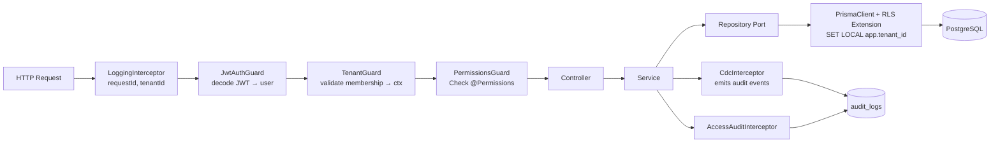

# 02 — Architecture Spec

> **Clean Architecture aplicada a NestJS: capas, módulos, dependencias y mapping del patrimonio FastAPI actual.**

---

## 1. Visión general

Arquitectura target: **Clean Architecture + DDD-lite** expresada con **primitivas NestJS** (Modules / Providers / Guards / Interceptors / Pipes).

```
┌────────────────────────────────────────────────────────────────────┐
│                       Presentation Layer                            │
│   Controllers • DTOs (Request/Response) • Pipes • Guards            │
│   Routers (public) • Routers (protected) • OpenAPI                 │
├────────────────────────────────────────────────────────────────────┤
│                       Application Layer                             │
│   Services (use-cases) • Ports (interfaces) • DTOs interservice    │
│   TenantContext • PermissionsChecker • AuditService                 │
├────────────────────────────────────────────────────────────────────┤
│                       Domain Layer                                  │
│   Entities (Prisma models) • Value Objects • Domain Errors          │
│   Business Rules (Plan quota, Tenant membership)                    │
├────────────────────────────────────────────────────────────────────┤
│                     Infrastructure Layer                            │
│   PrismaClient • Repositories • JwtAdapter • BcryptAdapter          │
│   PinoLogger • MailerAdapter • External ETL Adapter                 │
└────────────────────────────────────────────────────────────────────┘
                       Dependencies flow inward →
```

**Regla de dependencia (DIP)**: las flechas de dependencia apuntan hacia adentro. Presentation → Application → Domain. Infrastructure implementa interfaces de Application/Domain.

---

## 2. Mapeo del patrimonio FastAPI → NestJS

| FastAPI actual | NestJS idiomatico | Notas |
|---|---|---|
| `app/main.py` (FastAPI + lifespan) | `apps/api/src/main.ts` + `bootstrap()` | `NestFactory.createApplicationContext` |
| `app/core/routers.py` (aggregator) | `AppModule` (`@Module({ imports: [...] })`) | Modules importados |
| `app/auth/routers.py` | `AuthController` en `AuthModule` | `@Controller('auth')` |
| `app/auth/service.py` (AuthService) | `AuthService` `@Injectable()` | Inyecta `UserRepositoryPort`, `JwtPort`, `BcryptPort` |
| `app/auth/utils.py` (`get_current_user`) | `JwtAuthGuard` + `@CurrentUser()` | Ver `04-AUTH-SPEC.md` |
| `app/auth/permissions.py` (`PermissionChecker __call__`) | `PermissionsGuard` + `@Permissions()` decorator | Idiomatico de NestJS |
| `app/auth/dependencies.py` (`X-Active-Role`) | `TenantGuard` + `TenantContext` (request scoped) | Ver `06-TENANCY-SPEC.md` |
| `app/core/repository.py` (`BaseRepository[T]`) | `BaseRepository<T>` abstract + `PrismaRepository<T>` impl | Genérico TS vía `interface` |
| `app/core/db.py` (`SessionDep`) | `PrismaModule` (global) + `@InjectPrisma()` | AsyncLocalStorage para `tenant_id` |
| `app/core/exceptions.py` | `BusinessException` + `AllExceptionsFilter` | Mantiene la taxonomía 404/400/401/403/500 |
| `app/core/handlers.py` | `AllExceptionsFilter` (global) | Mismo mapeo a HTTP |
| `app/core/config.py` (`Settings`) | `ConfigModule.forRoot()` + `validate(config)` schema Joi/Zod | `@nestjs/config` |
| `app/core/audit/middleware.py` | `AccessAuditInterceptor` (global) | Sin BaseHTTPMiddleware; NestJS usa Interceptors |
| `app/core/audit/hooks.py` (SQLAlchemy events) | `PrismaExtensions` (`$extends` con `query` hook) | CDC con Prisma |
| `app/core/audit/context.py` (ContextVars) | `AsyncLocalStorage` (Node native) | Igual semántica |
| `app/models/*.py` (SQLModel) | `prisma/schema.prisma` | DSL declarativo |
| `app/models/mixins.py` (`AuditMixin`) | `trait` mixin via TS `MIXIN` helper | Cada modelo añade `created_at`, `updated_at` automáticamente |
| `app/modules/tasks/*.py` | `TasksModule` (resource completo) | `nest g resource tasks` |
| `app/modules/assets/**` | `AssetsModule` (con submódulos) | Cada subdominio es submódulo |
| `app/modules/core/**` | `CoreModule` (org-units, positions, staff) | Igual |
| `app/modules/core/catalogs/` | `CatalogsModule` + `CatalogProvider` interface | Registry pattern |
| `scripts/sync_siger.py` (ETL) | `apps/api/src/etl/SyncService.ts` (invocable como Job BullMQ) | Idéntica semántica UPSERT/soft-delete |
| `app/util/datetime.py` | `timeUtils.ts` en `libs/shared/utils` | UTC always |

---

## 3. Estructura de un módulo NestJS (bounded context)

Cada módulo de dominio sigue esta estructura:

```
modules/<domain>/
├── <domain>.module.ts              ← @Module({ imports, controllers, providers, exports })
├── <domain>.controller.ts          ← Rutas HTTP (Presentation)
├── dto/
│   ├── Create<Domain>Dto.ts        ← Request body (class-validator)
│   ├── Update<Domain>Dto.ts         ← Partial<Create>
│   └── <Domain>ResponseDto.ts      ← Response shape (class-transformer @Expose)
├── <domain>.service.ts             ← Lógica de negocio (Application)
├── ports/
│   └── <domain>.repository.port.ts ← Interface (Port)
├── infrastructure/
│   └── <domain>.prisma.repository.ts ← Implementación con Prisma (Adapter)
├── <domain>.errors.ts              ← Domain-specific exceptions
└── __tests__/
    ├── <domain>.service.spec.ts     ← Unit (mock port)
    └── <domain>.controller.spec.ts  ← Integration (mock service)
```

### Ejemplo: TasksModule (`apps/api/src/modules/tasks/`)

```ts
// tasks.module.ts
@Module({
  imports: [PrismaModule, TenantModule, PermissionsModule],
  controllers: [TasksController],
  providers: [
    TasksService,
    { provide: 'TaskRepositoryPort', useClass: TaskPrismaRepository },
  ],
  exports: [TasksService],
})
export class TasksModule {}
```

```ts
// tasks.controller.ts
@Controller('api/v1/tasks')
@UseGuards(JwtAuthGuard, TenantGuard, PermissionsGuard)
export class TasksController {
  constructor(private readonly tasks: TasksService) {}

  @Post()
  @Permissions('tasks', 'create')
  create(
    @Body() dto: CreateTaskDto,
    @CurrentTenant() ctx: TenantContext,
  ): Promise<TaskResponseDto> {
    return this.tasks.create(dto, ctx.tenantId, ctx.userId);
  }

  @Get()
  @Permissions('tasks', 'read')
  list(
    @Query() query: PaginationDto,
    @CurrentTenant() ctx: TenantContext,
  ): Promise<Paginated<TaskResponseDto>> {
    return this.tasks.list(query, ctx.tenantId);
  }
}
```

---

## 4. Patronesclave (NestJS)

### 4.1. Dependency Injection (DIP)

NestJS DI nativa:

- Clase `@Injectable()` marcada como provider.
- Token-basado (string o Symbol) para interfaces: `{ provide: 'TaskRepositoryPort', useClass: TaskPrismaRepository }`.
- `@Injectable()` constructor injection: `constructor(@Inject('TaskRepositoryPort') private repo: TaskRepositoryPort)`.
- **No** usar `Reflector` para inyectar servicios — mala práctica.

### 4.2. Multi-tenant Context (AsyncLocalStorage)

Reemplazo del `ContextVar` de Python con `AsyncLocalStorage` nativo de Node:

```ts
// src/tenancy/tenant-async-storage.ts
import { AsyncLocalStorage } from 'node:async_hooks';

export interface TenantContext {
  tenantId: string;
  userId: string;
  role: string;
  scope: 'all' | 'own';
}

export const tenantAls = new AsyncLocalStorage<TenantContext>();
```

El `TenantInterceptor` ejecuta `tenantAls.run(ctx, () => next.handle())` y toda la cadena
async (incluida Prisma extension) tiene acceso al contexto sin pasarlo a mano.

### 4.3. Guards vs Interceptors vs Pipes

| Componente | Cuándo usar | Caso de uso |
|---|---|---|
| **Guard** | Autorización (sí/no) | `JwtAuthGuard`, `TenantGuard`, `PermissionsGuard` |
| **Interceptor** | Cross-cutting con side-effects en request/response | `LoggingInterceptor`, `AccessAuditInterceptor`, `TenantContextInterceptor` |
| **Pipe** | Validación / transformación de input | `ValidationPipe` (class-validator), `ParseUUIDPipe` |
| **Filter** | Manejo de errores global | `AllExceptionsFilter`, `BusinessExceptionFilter` |
| **Middleware** | Compatibilidad Express (evitar en favor de Interceptors) | Solo si una lib requiere Express middleware real |

### 4.4. Decoradores custom

Reemplazan los `Depends()` de FastAPI:

| Decorador | Propósito | Implementación |
|---|---|---|
| `@CurrentUser()` | Extrae `user_id` del JWT (passport user) | ParamDecorator |
| `@CurrentTenant()` | Devuelve `TenantContext` desde `TenantGuard` | ParamDecorator |
| `@Permissions('tasks', 'create')` | Metadata para `PermissionsGuard` | `Reflector` + SetMetadata |
| `@Public()` | Marca ruta sin `JwtAuthGuard` | `Reflector` + override en `JwtAuthGuard` |
| `@TenantScoped()` | Aplica `TenantGuard` automáticamente | Composición de guards |
| `@AuditAction('CREATE')` | Metadata para `CdcInterceptor` | Reflector |

### 4.5. Boundaries de dominio

```
Presentation  ─── usa ────►  Application (Service)
                                  │
                                  ├── depende de ──►  Port (Interface)
                                  │                       ▲
                                  │                       │
                                  └── implementa ──► Infrastructure (PrismaRepository)
```

- El **Service** nunca importa `PrismaClient`; depende de una `Port` (interface).
- La implementación concreta se inyecta en el módulo (DIP).
- En tests, se inyecta un `MockRepository` implementando el mismo Port.

---

## 5. Límites de un módulo (Bounded Context) — heredados del proyecto actual

El proyecto FastAPI actual usa **DDD-lite con flat hierarchy**:
- Módulos base (`assets`, `core`, `tasks`) contienen submódulos hermanos.
- Los submódulos son self-contained (routers+service+repo+models+schemas).

NestJS preserve esto con **submódulos**:

```
modules/
├── assets/
│   ├── assets.module.ts            ← Aggregator module
│   ├── assets/  (submódulo)
│   ├── areas/   (submódulo)
│   ├── groups/  (submódulo)
│   ├── statuses/(submódulo)
│   ├── institutions/ (submódulo)
│   └── acts/    (submódulo)
├── core/
│   ├── core.module.ts
│   ├── org-units/   (submódulo)
│   ├── positions/   (submódulo)
│   └── staff/       (submódulo)
├── tasks/
│   └── tasks.module.ts
├── catalogs/
│   └── catalogs.module.ts
├── auth/
│   └── auth.module.ts
├── tenancy/
│   └── tenancy.module.ts
└── audit/
    └── audit.module.ts
```

**Regla DDD-lite**: un submódulo no importa otro submódulo hermano; todo cruce pasa por `Service.forRoot()` o eventos.

---

## 6. Cross-cutting concerns globales



---

## 7. Frontend boundary (Angular 21)

- DTOs compartidos desde `libs/shared/dto` en Nx monorepo.
- El backend NO conoce Angular; solo publica OpenAPI y los tipos compartidos.
- Angular 21 genera su propio cliente API vía `ng OpenAPI-gen` o consume directamente los DTOs desde `@saas/shared`.

**Ver `13-PROJECT-STRUCTURE-SPEC.md` para layout del monorepo.**

---

## 8. Anti-patrones prohibidos

1. **Service importando `PrismaClient` directamente** — rompe DIP, dificultando tests.
2. **`any` en DTOs** — pierde tipado end-to-end.
3. **Lógica de negocio en Controllers** — solo orchestación HTTP.
4. **Múltiples módulos con providers solapados** — provoca errores DI inesperados.
5. **Usar Express Middleware para cross-cutting** — preferir Interceptors (`enable 执行序` controlado por NestJS).
6. **Endpoints sin `TenantGuard` en módulos de dominio** — fuga de datos garantizada.
7. **Harcodear variables de entorno** — pasar siempre por `ConfigService`.

---

## 9. Referencias

- Spec de datos: `03-DATA-SPEC.md`
- Auth: `04-AUTH-SPEC.md`
- Multi-tenant: `06-TENANCY-SPEC.md`
- Decisiones: `15-ADRs.md` ADR-003 (DI en NestJS), ADR-004 (RLS vs DI-only)
