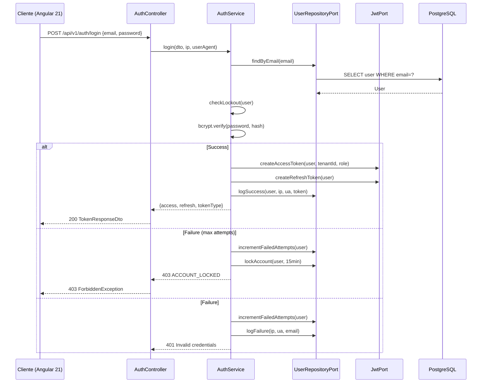

# 04 — Auth Spec

> **Especificación de autenticación JWT con login por email, lockout, rotación de refresh tokens, blacklist y contexto de usuario.**

---

## 1. Flujo de autenticación (heredado del proyecto actual)



---

## 2. Contratos de Authentication

### 2.1. POST `/api/v1/auth/login`

**Request** — ver `09-HTTP-API-SPEC.md §3.1`

```ts
class LoginDto {
  @IsEmail() email: string;
  @MinLength(8) @MaxLength(128) password: string;
}
```

> **Diferencia crítica con FastAPI actual**: ya no usamos `OAuth2PasswordRequestForm` (campo `username`); login exclusivamente por `email`.

**Response 200**

```ts
class TokenResponseDto {
  accessToken: string;
  refreshToken: string;
  tokenType: 'bearer';
  expiresIn: number; // seconds
}
```

**Respuestas de error**

| Status | Código interno | Cuándo |
|---|---|---|
| 401 | INVALID_CREDENTIALS | Email no existe o password incorrecto |
| 403 | ACCOUNT_LOCKED | 5 intentos fallidos; devolver `unlock_at`, `wait_seconds` |
| 422 | VALIDATION_FAILED | DTO inválido |

### 2.2. POST `/api/v1/auth/refresh`

Body:
```ts
class RefreshDto { @IsString() refreshToken: string; }
```

- Valida payload con `JwtService.verifyAsync`.
- Verifica que el token **no esté en `revoked_tokens`**.
- **Blacklist** del refresh actual (rotation).
- Genera nuevo par `(access, refresh)`.
- Devuelve mismo `TokenResponseDto`.

**Errores**: 401 INVALID_REFRESH_TOKEN, 401 TOKEN_REVOKED.

### 2.3. POST `/api/v1/auth/logout`

- Requiere `Authorization: Bearer <access>`.
- Body opcional: `{ refreshToken?: string }`.
- Revoca `access` y (si vino) `refresh` insertándolos en `revoked_tokens`.
- Updates `UserLogLogin.loggedOutAt`.
- Response: `{ msg: 'Successfully logged out' }`.

### 2.4. GET `/api/v1/auth/me`

- Requiere JWT.
- Devuelve `UserResponseDto` (sin `passwordHash`).

### 2.5. GET `/api/v1/auth/me/tenants` (NEW en multi-tenant)

- Lista los `TenantUser` activos del usuario:
  ```ts
  class TenantMembershipDto {
    tenantId: string;
    tenantName: string;
    tenantSlug: string;
    role: string; // 'Admin' | 'Empleado' | ...
    planName: string;
  }
  ```
- Usado por el selector de tenant del frontend Angular 21.

### 2.6. PUT `/api/v1/auth/role` (legacy — **REMOVIDO**)

En el proyecto FastAPI actual había un endpoint para "setear el rol activo". En multi-tenant, el rol se define **por miembrosía** (`tenant_users.rol`), no se setea globalmente.

**Acción**: eliminar endpoint. En su lugar: `PUT /api/v1/auth/tenant-context` que setea el `tenantId` activo en el JWT (ver `06-TENANCY-SPEC.md`).

---

## 3. JWT payload

### 3.1. Access Token (15 min)

```ts
type AccessJwtPayload = {
  sub: string;      // user.id
  email: string;
  iat: number;      // issued at
  exp: number;      // expires at
  jti: string;      // token id (for blacklist)
  tenantId: string; // tenant activo
  role: string;     // rol en el tenant
};
```

> **Importante**: `tenantId` va en el access JWT solo si el tenant ya está elegido. En el primer login, el frontend debe:
> 1. Llamar `/auth/me/tenants` para listar tenants.
> 2. Mostrar el selector al usuario.
> 3. Llamar `PUT /auth/tenant-context` para avanzar a un nuevo token con `tenantId`.

### 3.2. Refresh Token (7 días)

Mismo payload con `exp` extendido. Separable a su propio secret si se quiere.

### 3.3. Configuración en `@nestjs/jwt`

```ts
@Module({
  imports: [
    JwtModule.registerAsync({
      inject: [ConfigService],
      useFactory: (cfg: ConfigService) => ({
        secret: cfg.getOrThrow('JWT_SECRET'),
        signOptions: { expiresIn: cfg.get('JWT_ACCESS_EXPIRES_MINUTES') + 'm' },
      }),
    }),
  ],
  providers: [{ provide: 'JwtPort', useClass: NestJwtAdapter }],
  exports: ['JwtPort', JwtModule],
})
export class AuthModule {}
```

---

## 4. Ports & Adapters (DIP)

### 4.1. Ports

```ts
// apps/api/src/auth/ports/jwt.port.ts
export interface JwtPort {
  signAccess(payload: JwtPayload): string;
  signRefresh(payload: JwtPayload): string;
  verify(token: string): Promise<JwtPayload>;
}

// apps/api/src/auth/ports/user.repository.port.ts
export interface UserRepositoryPort {
  findByEmail(email: string): Promise<User | null>;
  findById(id: string): Promise<User | null>;
  save(user: User): Promise<User>;
  incrementFailedAttempts(id: string, attempt: number): Promise<User>;
  lock(id: string, until: Date): Promise<User>;
}

// apps/api/src/auth/ports/bcrypt.port.ts
export interface BcryptPort {
  hash(plain: string): string;
  verify(plain: string, hashed: string): boolean;
}

// apps/api/src/auth/ports/revoked-token.repository.port.ts
export interface RevokedTokenRepositoryPort {
  isRevoked(token: string): Promise<boolean>;
  revoke(token: string, userId: string): Promise<void>;
}
```

### 4.2. Adapters (`infrastructure/`)

- `NestJwtAdapter` implementa `JwtPort` usando `JwtService` de NestJS.
- `BcryptAdapter` usando `bcrypt` Node.
- `PrismaUserRepository` implementa `UserRepositoryPort`.
- `PrismaRevokedTokenRepository` implementa `RevokedTokenRepositoryPort`.

**Ventaja**: tests unitarios inyectan mocks; sin tocar Postgres.

---

## 5. Guards

### 5.1. `JwtAuthGuard`

```ts
@Injectable()
export class JwtAuthGuard extends AuthGuard('jwt') {
  canActivate(ctx: ExecutionContext) {
    const request = ctx.switchToHttp().getRequest();
    const isPublic = this.reflector.getAllAndOverride('isPublic', [
      ctx.getHandler(),
      ctx.getClass(),
    ]);
    if (isPublic) return true;
    return super.canActivate(ctx);
  }
}
```

`@Public()` decorator → metadata `'isPublic' = true`.

### 5.2. `@CurrentUser()` param decorator

```ts
export const CurrentUser = createParamDecorator(
  (data: keyof JwtPayload | undefined, ctx: ExecutionContext) => {
    const req = ctx.switchToHttp().getRequest();
    const user = req.user as JwtPayload;
    return data ? user?.[data] : user;
  },
);
```

Uso en Controller:
```ts
@Get('me')
@UseGuards(JwtAuthGuard)
me(@CurrentUser() user: JwtPayload) { ... }
```

---

## 6. Lockout (seguridad heredada)

### 6.1. Reglas

- `SECURITY_LOGIN_MAX_ATTEMPTS` (default 5) intentos fallidos → lock `SECURITY_LOGIN_LOCKOUT_MINUTES` (default 15).
- Cada intento fallido: `failed_login_attempts += 1`.
- Si llega al máximo: `locked_until = now + 15min`.
- Login exitoso: resetea `failed_login_attempts = 0`, `locked_until = null`, actualiza `last_login_at`.

### 6.2. Mitigación de timing attacks

Si el email no existe:
1. **No** revelar "email no existe" en el mensaje de error (siempre `INVALID_CREDENTIALS`).
2. Ejecutar `bcrypt.verify` contra un hash dummy (recomendado por OWASP) para simular el tiempo de un usuario real.

```ts
const DUMMY_HASH = '$2b$12$2QldhwW8iLfBYmgRv30PT.LvIhDHP7E6cFqrHEyhjkDckn65FohGK';

if (!user) {
  bcryptAdapter.verify(dto.password, DUMMY_HASH); // waste time
  throw new UnauthorizedException('INVALID_CREDENTIALS');
}
```

### 6.3. Response de lockout

```json
HTTP 403
{
  "code": "ACCOUNT_LOCKED",
  "message": "Account is locked due to too many failed attempts.",
  "unlock_at": "2026-07-08T03:12:18.123Z",
  "wait_seconds": 893,
  "max_attempts": 5,
  "lockout_minutes": 15
}
```

Headers: `Retry-After: <wait_seconds>`.

---

## 7. Rate limiting en `/auth/login` (NUEVO vs proyecto actual)

El proyecto FastAPI actual tiene pendiente rate limiting. Aquí se implementa desde día 1:

```ts
// apps/api/src/auth/auth.controller.ts
@Throttle({ default: { limit: 5, ttl: 60000 } }) // 5 attempts / minute / IP
@Post('login')
login(...) { ... }
```

Vía `@nestjs/throttler` global + override por endpoint.

**Ver `12-SECURITY-SPEC.md` para configuración global.**

---

## 8. Variables de entorno

```ts
// apps/api/src/config/env.validation.ts
JWT_SECRET: Joi.string().min(32).required(),
JWT_ACCESS_EXPIRES_MINUTES: Joi.number().default(15),
JWT_REFRESH_EXPIRES_DAYS: Joi.number().default(7),
SECURITY_LOGIN_MAX_ATTEMPTS: Joi.number().default(5),
SECURITY_LOGIN_LOCKOUT_MINUTES: Joi.number().default(15),
```

---

## 9. Tests requeridos (Auth)

| ID | Nombre | Valida |
|---|---|---|
| AUTH-1 | login exitoso | 200 con access+refresh |
| AUTH-2 | login email inválido | 401 INVALID_CREDENTIALS |
| AUTH-3 | login password inválido | 401 INVALID_CREDENTIALS |
| AUTH-4 | 5 intentos fallidos → 6to | 403 ACCOUNT_LOCKED, `Retry-After` presente |
| AUTH-5 | login exitoso resetea counter | counter=0, lockout=null |
| AUTH-6 | refresh rota token | old refresh → revoked, new tokens |
| AUTH-7 | refresh con revocado | 401 TOKEN_REVOKED |
| AUTH-8 | logout inserta revocado | access + refresh revoked |
| AUTH-9 | timing email inexistente | duración comparable a hash válido |
| AUTH-10 | `GET /me` sin token | 401 |
| AUTH-11 | `GET /me` con token caducado | 401 |
| AUTH-12 | `GET /me/tenants` lista membresías | array con role y planName |

**Ver `10-TESTING-SPEC.md` para estructura de tests.**

---

## 10. Migración desde FastAPI

1. Migrar `users.email` a UNIQUE NOT NULL.
2. Quitar constraint unique de `users.username` (o dejarlo nullable).
3. Endpoint `/auth/login` cambia body de `{ username, password }` → `{ email, password }`.
4. La próxima vez que cada usuario realice login, el frontend lo fuerza a olvidar `username`.
5. Blacklist de tokens viejos: rotación de `JWT_SECRET` para invalidar todos los tokens previos a la migración.

---

## 11. Referencias

- `06-TENANCY-SPEC.md` — `PUT /auth/tenant-context`.
- `12-SECURITY-SPEC.md` — rate limit, helmet, CORS.
- Código actual ancestro: `app/auth/routers.py`, `app/auth/service.py`, `app/auth/utils.py`.
