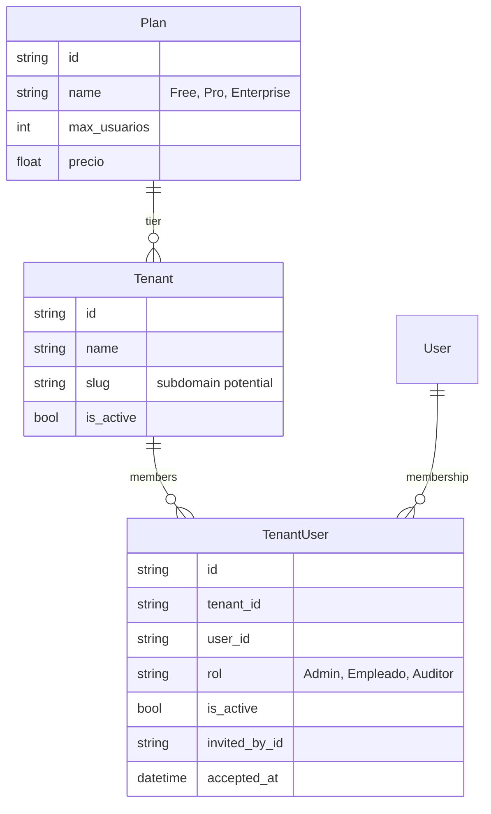

# 06 — Tenancy Spec

> **Multi-tenancy B2B con planes, cuotas, invitations y aislamiento por `tenant_id` + RLS PostgreSQL.**

---

## 1. Modelo de tenancy



Reglas:
- Un `User` pertenece a **0..N** Tenants con rol distinto por membresía.
- Login por **email** (no username), globalmente único.
- Una membresía única por `(tenant_id, user_id)` — `@@unique`.
- `invited_by_id` permite trazabilidad del inviter.

---

## 2. Selección de estrategia (Shared Database + RLS)

Ver ADR-002 para análisis completo.

| Estrategia | Veredicto para Uyuni SaaS |
|---|---|
| Database per tenant | ❌ Sobre-ingeniería para B2B masivo; costo Postgres × N |
| Schema per tenant | ⚠️ Solo para tier Enterprise / nichos regulados |
| **Shared DB + `tenant_id` + RLS** | ✅ Default para tier Free/Pro (~95% tenants) |
| Shared DB + `tenant_id` sin RLS | ⚠️ Aceptable en MVP, RLS se activa día 1 en este spec |

---

## 3. `TenantContext` (DTO propagado por request)

```ts
// apps/api/src/tenancy/tenant-context.ts
export interface TenantContext {
  tenant: TenantDto;
  tenantId: string;
  userId: string;
  role: string;            // rol desde tenant_users
  scope: 'all' | 'own';     // scope_all desde role_modules
}
```

Se propaga en el request de NestJS y se almacena en `AsyncLocalStorage` para acceso transversal (auditoría, RLS Prisma).

---

## 4. `TenantGuard` (NestJS)

```ts
// apps/api/src/tenancy/tenant.guard.ts
@Injectable()
export class TenantGuard implements CanActivate {
  constructor(
    private readonly reflector: Reflector,
    @Inject('TenantMembershipPort') private memberships: TenantMembershipPort,
  ) {}

  async canActivate(ctx: ExecutionContext): Promise<boolean> {
    // Endpoints marcados como @PlatformAdmin() no requieren tenant
    const isPlatform = this.reflector.getAllAndOverride('isPlatform', [
      ctx.getHandler(), ctx.getClass(),
    ]);
    if (isPlatform) return true;

    const req = ctx.switchToHttp().getRequest();
    const user: JwtPayload = req.user;
    if (!user) throw new UnauthorizedException();

    // 1. Resolver tenant_id del header
    const tenantId = req.headers['x-tenant-id'];
    if (!tenantId) {
      throw new BadRequestException('X-Tenant-Id header required');
    }

    // 2. Validar membresía activa
    const membership = await this.memberships.findActive(tenantId, user.sub);
    if (!membership) {
      throw new ForbiddenException('No active membership in this tenant');
    }

    // 3. Validar tenant activo
    if (!membership.tenant?.isActive) {
      throw new ForbiddenException('Tenant suspended');
    }

    // 4. Resolver scope desde role_modules para el primer module default
    //    (en endpoints de dominio se valida granularmente via PermissionsGuard)
    req.tenantContext = {
      tenantId: membership.tenantId,
      tenant: membership.tenant,
      userId: user.sub,
      role: membership.rol,
      scope: 'own', // sobreescrito por PermissionsGuard si scope_all
    };
    return true;
  }
}
```

### `@CurrentTenant()` param decorator

```ts
export const CurrentTenant = createParamDecorator(
  (data: keyof TenantContext | undefined, ctx: ExecutionContext) => {
    const req = ctx.switchToHttp().getRequest();
    const tctx: TenantContext = req.tenantContext;
    return data ? tctx?.[data] : tctx;
  },
);
```

Uso:
```ts
@Post()
@TenantScoped()
@Permissions('tasks_general', PermissionAction.CREATE)
create(@Body() dto: CreateTaskDto, @CurrentTenant() ctx: TenantContext) {
  return this.tasks.create(dto, ctx.tenantId, ctx.userId);
}
```

---

## 5. `TenantContextInterceptor` (AsyncLocalStorage)

```ts
// apps/api/src/tenancy/tenant-context.interceptor.ts
@Injectable()
export class TenantContextInterceptor implements NestInterceptor {
  intercept(ctx: ExecutionContext, next: CallHandler) {
    const req = ctx.switchToHttp().getRequest();
    if (!req.tenantContext) return next.handle();
    return from(
      tenantAls.run(req.tenantContext, () => lastValueFrom(next.handle())),
    );
  }
}
```

Toda la cadena async (incluida Prisma extension) puede leer `tenantAls.getStore()` sin pasarlo manualmente.

---

## 6. `TenantScopedRepository` — filtro automático

La clase base para repositorios de dominio hereda medidas de seguridad:

```ts
// apps/api/src/common/tenant-scoped.repository.ts
export abstract class TenantScopedRepository<T> {
  constructor(
    protected readonly prisma: PrismaService,
    protected readonly model: Prisma.ModelName,
  ) {}

  protected scopedWhere(extra?: object): object {
    const ctx = tenantAls.getStore();
    if (!ctx) {
      throw new Error('TenantContext missing — data access refused');
    }
    return { tenantId: ctx.tenantId, isActive: true, ...extra };
  }

  async findById(id: string): Promise<T | null> {
    const obj = await this.prisma[this.model].findUnique({ where: { id } });
    if (!obj) return null;
    if (obj.tenantId !== tenantAls.getStore()?.tenantId) return null; // cross-tenant = 404
    return obj as T;
  }

  async list(pagination: PaginationDto, extra?: object): Promise<T[]> {
    return this.prisma[this.model].findMany({
      where: this.scopedWhere(extra),
      skip: pagination.offset,
      take: pagination.limit,
    });
  }
}
```

**Regla invariante**: ningún repository de dominio funciona sin `tenantAls` inicializado.
Active CI **lint rule** que detecte uso de `prisma.<model>.findMany` sin `scope()`.

---

## 7. Prisma extension — defense in depth

Reemplaza el requisito de setear `SET LOCAL app.tenant_id`:

```ts
// apps/api/src/infrastructure/prisma/extensions/tenant-scope.extension.ts
import { Prisma } from '@prisma/client';
import { tenantAls } from '../../../tenancy/tenant-async-storage';

const TENANT_SCOPED_MODELS = new Set([
  'task', 'orgUnit', 'staffPosition', 'staff', 'institution',
  'area', 'assetGroup', 'assetStatus', 'act', 'fixedAsset', 'auditLog',
]);

export const tenantScopeExtension = Prisma.defineExtension({
  query: {
    $allModels: {
      async $allOperations({ model, operation, args, query }) {
        if (!TENANT_SCOPED_MODELS.has(model)) return query(args);
        const ctx = tenantAls.getStore();
        if (!ctx) {
          if (operation === 'count') return query(args);
          throw new Error('TenantContext missing for tenant-scoped model');
        }
        // Inject tenantId on writes
        if (operation === 'create') {
          args.data = { ...args.data, tenantId: ctx.tenantId };
        }
        // Inject where.tenantId on reads/updates/deletes
        if (['findMany','findUnique','update','delete','count','updateMany'].includes(operation)) {
          if (operation === 'findUnique' && args.where?.id) {
            // findUnique con where: { id } → cambiamos a findFirst para añadir filtro
            const result = await query({ ...args, where: { id: args.where.id, tenantId: ctx.tenantId } });
          }
          args.where = { ...args.where, tenantId: ctx.tenantId };
        }
        return query(args);
      },
    },
  },
});
```

> **Bug guard**: la extensión NO reemplaza tests. Es **defense in depth**. Ver gate anti-fuga en `10-TESTING-SPEC.md §5`.

---

## 8. Postgres RLS — defense in depth layer 2

- Aunque Prisma extension falle, Postgres bloquea la fuga.
- Activar en cada tabla tenant-scoped:

```sql
ALTER TABLE tasks ENABLE ROW LEVEL SECURITY;
ALTER TABLE tasks FORCE ROW LEVEL SECURITY;
CREATE POLICY tenant_isolation ON tasks
  USING (tenant_id = current_setting('app.tenant_id', true)::uuid);
```

- NestJS aplica `SET LOCAL app.tenant_id = $tenantId` al inicio de cada transacción:

```ts
// apps/api/src/infrastructure/prisma/prisma.service.ts
async $transactionScoped<T>(fn: (tx: PrismaTransaction) => Promise<T>): Promise<T> {
  const ctx = tenantAls.getStore();
  if (!ctx) throw new Error('Tenant context required for transaction');
  return this.prisma.$transaction(async (tx) => {
    await tx.$executeRawUnsafe(`SET LOCAL app.tenant_id = $1`, ctx.tenantId);
    return fn(tx);
  });
}
```

---

## 9. Endpoints de tenancy

| Method | Path | Auth | Propósito |
|---|---|---|---|
| `GET` | `/api/v1/tenants/me` | JWT | Lista membresías del user (`TenantMembershipDto[]`) |
| `POST` | `/api/v1/tenants` | Public (signup) | Crea tenant nuevo + owner `Admin`, asigna `Plan.free` |
| `GET` | `/api/v1/tenants/:id` | Tenant Admin | Detalles del tenant + plan |
| `PUT` | `/api/v1/tenants/:id/plan` | Platform Admin | Cambiar plan (upgrade/downgrade) |
| `POST` | `/api/v1/tenants/:id/invitations` | Tenant Admin | Invitar user por email; valida `max_usuarios` |
| `GET` | `/api/v1/tenants/:id/users` | Tenant Admin | Lista miembros activos |
| `DELETE` | `/api/v1/tenants/:id/users/:userId` | Tenant Admin | Revoca membresía (isActive=false, no delete) |
| `PUT` | `/api/v1/tenants/:id/users/:userId/role` | Tenant Admin | Cambiar rol de un miembro |
| `PUT` | `/api/v1/auth/tenant-context` | JWT | Setea nuevo `tenantId` activo en JWT |

---

## 10. Flujo de invitación con validación de cuota

```ts
@Post('tenants/:id/invitations')
@UseGuards(JwtAuthGuard, TenantGuard, PermissionsGuard)
@Permissions('tenancy_users', PermissionAction.CREATE)
async invite(
  @Param('id', ParseUUIDPipe) tenantId: string,
  @Body() dto: InviteUserDto,
  @CurrentTenant() ctx: TenantContext,
): Promise<InviteResponseDto> {
  if (ctx.role !== 'Admin') throw new ForbiddenException('Only tenant admins can invite');
  if (ctx.tenantId !== tenantId) throw new BadRequestException('Tenant mismatch');

  // 1. Validar cuota del plan
  const activeCount = await this.tenants.countActiveMembers(tenantId);
  const plan = ctx.tenant.plan;
  if (activeCount >= plan.maxUsuarios) {
    throw new ConflictException({
      code: 'PLAN_QUOTA_EXCEEDED',
      message: 'Plan quota exceeded',
      maxUsuarios: plan.maxUsuarios,
      current: activeCount,
    });
  }

  // 2. Upsert user — invitación por email
  const user = await this.users.findOrCreateByEmail(dto.email);

  // 3. Idempotencia: si ya existe membresía activa, no re-invitar
  const existing = await this.tenants.findMembership(tenantId, user.id);
  if (existing) throw new BadRequestException('User already in tenant');

  // 4. Crear membresía
  const membership = await this.tenants.createMembership({
    tenantId, userId: user.id, rol: dto.rol, invitedById: ctx.userId,
  });

  // 5. Enviar invitación por email
  await this.mailer.sendInvitation(dto.email, ctx.tenant.name, dto.rol);

  return { tenantUserId: membership.id, detail: 'Invitation sent' };
}
```

### Race condition protection

Para evitar 2 admins invitando al mismo tiempo y exceder la cuota:

```ts
// Lock pesimista en la fila del Plan
await tx.$queryRaw`SELECT * FROM plans WHERE id = ${planId} FOR UPDATE`;
const count = await tx.tenantUser.count({ where: { tenantId, isActive: true }});
if (count >= plan.maxUsuarios) throw new ConflictException(...);
```

Ver ADR-006 para justificación de `SELECT ... FOR UPDATE` en lugar de `version乐观`.

---

## 11. Endpoint "PUT /auth/tenant-context"

Permite al user cambiar el tenant activo sin re-auth:

```ts
@Put('tenant-context')
@UseGuards(JwtAuthGuard)
async setTenantContext(
  @Body() dto: SetTenantContextDto,
  @CurrentUser() user: JwtPayload,
): Promise<TokenResponseDto> {
  const membership = await this.tenants.findActive(dto.tenantId, user.sub);
  if (!membership) throw new ForbiddenException('No membership');
  return this.auth.reissueTokenWithTenant(user.sub, dto.tenantId, membership.rol);
}
```

---

## 12. Anti-patrones prohibidos

1. Endpoint de dominio sin `TenantGuard` → fuga.
2. Repository que no filtra por `tenantId` → fuga.
3. Service que lee `tenantId` de un header directamente (sin guard) → inseguro.
4. Mutation sin `tenantAls` → lanza `Error` en runtime.
5. Permitir conflict assembly de 2 tenants en una sola request (mala arquitectura).
6. Endpoints `/platform/*` sin `isPlatformAdmin` decorator → fuga cross-tenant.

---

## 13. Tests anti-fuga (gate CI obligatorio)

Ver `10-TESTING-SPEC.md §5`. Resumen:

- User A en TenantA crea Task.
- User B en TenantB hace `GET /api/v1/tasks/{A_task_id}` → **404** (no 403, para no revelar existencia).
- Usuario del TenantA no puede, mediante `POST /api/v1/tenants/B_id/users`, manipular membresías del TenantB.

---

## 14. Referencias

- `03-DATA-SPEC.md` — schema Prisma completo con `tenant_id`.
- `15-ADRs.md` — ADR-002 (Shared DB + RLS), ADR-006 (cuota con lock pesimista).
- Código ancestro: no existe (es NEW); el contexto de rol activo en FastAPI usaba `X-Active-Role` header.
