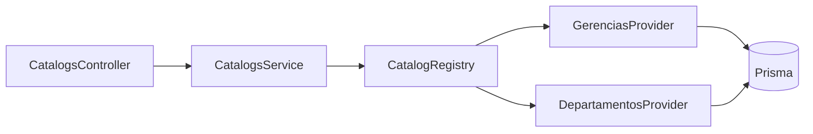

# 08 — Catalogs Spec

> **Catálogos dinámicos con `CatalogProvider` (Strategy) + bulk loader para minimizar round-trips HTTP del frontend Angular 21.**

---

## 1. Visión (heredada del proyecto actual)

El proyecto FastAPI actual implementa un sistema de catálogos dinámicos en `app/core/catalogs/` con:

- **Registry** global `global_registry` slugs → providers.
- **CatalogProvider** protocol (Python) implementado por cada dominio.
- **Dual endpoints**:
  - `GET /api/catalogs/{name}` — un catálogo.
  - `POST /api/catalogs/bulk` — resolver múltiples catálogos en 1 sola request.

En NestJS se preserva el patrón con **idiomatic TS**.

---

## 2. Contrato

### 2.1. Response del catálogo individual

```ts
// libs/shared/dto/catalog-item.dto.ts
class CatalogItemDto {
  value: string;   // UUID del item
  label: string;   // texto a mostrar
  [key: string]: unknown;  // metadata opcional (ej. extra attrs)
}
```

### 2.2. `GET /api/v1/catalogs/{name}`

```json
[
  { "value": "uuid-1", "label": "Gerencia de Operaciones" },
  { "value": "uuid-2", "label": "Gerencia de TI" }
]
```

Soporta query params pasados al provider (ej. `?gerencia_id=...`).

### 2.3. `POST /api/v1/catalogs/bulk`

#### Request

```ts
class BulkCatalogRequestDto {
  // Mapa slug → params opcionales
  [slug: string]: Record<string, string> | undefined;
}
```

Ejemplo body:
```json
{
  "gerencias": {},
  "departamentos": { "gerencia_id": "uuid-1" },
  "positions": {},
  "asset_statuses": {}
}
```

#### Response

```ts
class BulkCatalogResponseDto {
  [slug: string]: CatalogItemDto[];
}
```

Ejemplo:
```json
{
  "gerencias": [{ "value": "uuid-1", "label": "Gerencia" }],
  "departamentos": [{ "value": "uuid-2", "label": "Depto TI" }],
  "positions": [],
  "asset_statuses": [{"value":"uuid-3","label":"Operativo"}]
}
```

---

## 3. Arquitectura — NestJS



### 3.1. `CatalogProviderPort` (interface)

```ts
// apps/api/src/catalogs/catalog-provider.port.ts
import { PrismaService } from '../../infrastructure/prisma/prisma.service';
import { CatalogItemDto } from '@saas/shared';

export interface CatalogProviderPort {
  getItems(params: Record<string, string>): Promise<CatalogItemDto[]>;
}
```

### 3.2. Registry

```ts
// apps/api/src/catalogs/catalog.registry.ts
@Injectable()
export class CatalogRegistry {
  private providers = new Map<string, CatalogProviderPort>();

  register(slug: string, provider: CatalogProviderPort) {
    this.providers.set(slug, provider);
  }

  get(slug: string): CatalogProviderPort {
    const p = this.providers.get(slug);
    if (!p) throw new NotFoundException(`Catalog '${slug}' not registered`);
    return p;
  }

  list(): string[] { return [...this.providers.keys()]; }
}
```

### 3.3. Providers — auto-registro en module constructor

```ts
// apps/api/src/modules/core/catalogs/gerencias.provider.ts
@Injectable()
export class GerenciasProvider implements CatalogProviderPort {
  constructor(private prisma: PrismaService) {}

  async getItems(_params: Record<string, string>): Promise<CatalogItemDto[]> {
    const ctx = tenantAls.getStore();
    if (!ctx) throw new InternalServerErrorException('Tenant context required');

    const rows = await this.prisma.orgUnit.findMany({
      where: { parentId: null, isActive: true, tenantId: ctx.tenantId },
      orderBy: { name: 'asc' },
      select: { id: true, name: true },
    });
    return rows.map(r => ({ value: r.id, label: r.name }));
  }
}

// departamentos.provider.ts
@Injectable()
export class DepartamentosProvider implements CatalogProviderPort {
  constructor(private prisma: PrismaService) {}

  async getItems(params: Record<string, string>): Promise<CatalogItemDto[]> {
    const ctx = tenantAls.getStore();
    if (!ctx) throw new InternalServerErrorException('Tenant context required');
    const gerenciaId = params['gerencia_id'];
    if (!gerenciaId) return [];

    if (!isUuid(gerenciaId)) return []; // UUID inválido = vacío, no 500

    const rows = await this.prisma.orgUnit.findMany({
      where: { parentId: gerenciaId, isActive: true, tenantId: ctx.tenantId },
      orderBy: { name: 'asc' },
      select: { id: true, name: true },
    });
    return rows.map(r => ({ value: r.id, label: r.name }));
  }
}
```

### 3.4. CatalogsModule — auto-registro en `onModuleInit`

```ts
@Module({
  imports: [PrismaModule, TenancyModule],
  providers: [
    CatalogRegistry,
    GerenciasProvider, DepartamentosProvider,
    { provide: 'CATALOG_GERENCIAS', useExisting: GerenciasProvider },
    { provide: 'CATALOG_DEPARTAMENTOS', useExisting: DepartamentosProvider },
    CatalogsService,
  ],
  controllers: [CatalogsController],
  exports: [CatalogRegistry],
})
export class CatalogsModule implements OnModuleInit {
  constructor(
    private registry: CatalogRegistry,
    private gerencias: GerenciasProvider,
    private departamentos: DepartamentosProvider,
  ) {}

  onModuleInit() {
    this.registry.register('gerencias', this.gerencias);
    this.registry.register('departamentos', this.departamentos);
  }
}
```

### 3.5. CatalogsService

```ts
@Injectable()
export class CatalogsService {
  constructor(private registry: CatalogRegistry) {}

  async get(slug: string, params: Record<string, string>): Promise<CatalogItemDto[]> {
    return this.registry.get(slug).getItems(params);
  }

  async bulk(req: BulkCatalogRequestDto): Promise<BulkCatalogResponseDto> {
    const entries = Object.entries(req);
    const results = await Promise.all(
      entries.map(async ([slug, params]) => [slug, await this.get(slug, params ?? {})] as const),
    );
    return Object.fromEntries(results);
  }
}
```

### 3.6. CatalogsController

```ts
@TenantScoped()
@Controller('api/v1/catalogs')
export class CatalogsController {
  constructor(private catalogs: CatalogsService) {}

  @Get(':name')
  @Permissions('catalogs', PermissionAction.READ)
  get(
    @Param('name') name: string,
    @Query() query: Record<string, string>,
  ) {
    return this.catalogs.get(name, query);
  }

  @Post('bulk')
  @Permissions('catalogs', PermissionAction.READ)
  bulk(@Body() req: BulkCatalogRequestDto) {
    return this.catalogs.bulk(req);
  }
}
```

---

## 4. Multi-tenant en catálogos

Todos los providers leen `tenantAls.getStore().tenantId` y aplican `tenantId` al `where` de la consulta:

```ts
where: { ..., tenantId: ctx.tenantId }
```

> **Regla**: ningún provider puede exponer datos cross-tenant. CI gate garantizado por
> test anti-fuga (`10-TESTING-SPEC.md §5`).

---

## 5. Convención de SLUGS

| Slug | Provider | Fuente |
|---|---|---|
| `gerencias` | `GerenciasProvider` | `OrgUnit WHERE parent_id IS NULL` |
| `departamentos` | `DepartamentosProvider` | `OrgUnit WHERE parent_id = ?` |
| `positions` | `PositionsProvider` | `StaffPosition` |
| `asset_statuses` | `AssetStatusesProvider` | `AssetStatus` |
| `asset_groups` | `AssetGroupsProvider` | `AssetGroup` |
| `areas` | `AreasProvider` | `Area` |
| `institutions` | `InstitutionsProvider` | `Institution` |
| `staff` | `StaffProvider` | `Staff` |
| `roles` | `RolesProvider` | `Role` (catálogo global) |

Cada módulo de dominio registra sus providers en su `*Module.onModuleInit()`.

---

## 6. Performance

El `bulk` resuelve en **paralelo** (`Promise.all`) en lugar de serie. Cada provider tiene su propia consulta Prisma; si una falla, las otras no se afectan.

**Optimización futura**: si un catálogo cambia raramente (ej. `asset_statuses`), cachear en Redis con TTL=60s.

---

## 7. Tests requeridos

| ID | Nombre | Valida |
|---|---|---|
| CAT-1 | `GET /catalogs/gerencias` lista org units sin parent | array con items del tenant actual |
| CAT-2 | `GET /catalogs/departamentos?gerencia_id=X` filtra | solo hijos de X |
| CAT-3 | `GET /catalogs/departamentos` sin param | array vacío |
| CAT-4 | `GET /catalogs/departamentos?gerencia_id=invalid` | array vacío (no 500) |
| CAT-5 | `POST /catalogs/bulk` resuelve slugs | response con cada slug |
| CAT-6 | Bulk con slug inexistente | 404 `Catalog not registered` |
| CAT-7 | Items no filtran cross-tenant | items del TenantB en TenantA → 0 items |
| CAT-8 | Performance bulk < 200ms con 10 catálogos | p95 < 200ms |

---

## 8. Mapeo con el proyecto FastAPI actual

| FastAPI (ancestro) | NestJS |
|---|---|
| `app/core/catalogs/registry.py:global_registry` | `CatalogRegistry` provider |
| `app/core/catalogs/base.py:CatalogProvider` (Protocol) | `CatalogProviderPort` interface |
| `app/core/catalogs/routers.py` (GET + POST bulk) | `CatalogsController` |
| `app/modules/core/catalogs/providers.py` | `GerenciasProvider`, `DepartamentosProvider` TS |
| `app/modules/core/catalogs/__init__.py` (auto-registro) | `CatalogsModule.onModuleInit()` |
| `CatalogItemSchema` (Pydantic) | `CatalogItemDto` en `@saas/shared` |

---

## 9. Referencias

- `02-ARCHITECTURE-SPEC.md` — módulos NestJS.
- `06-TENANCY-SPEC.md` — `TenantGuard` que garantice `tenantAls` para providers.
- Código ancestro: `app/core/catalogs/*`, `app/modules/core/catalogs/*`.
