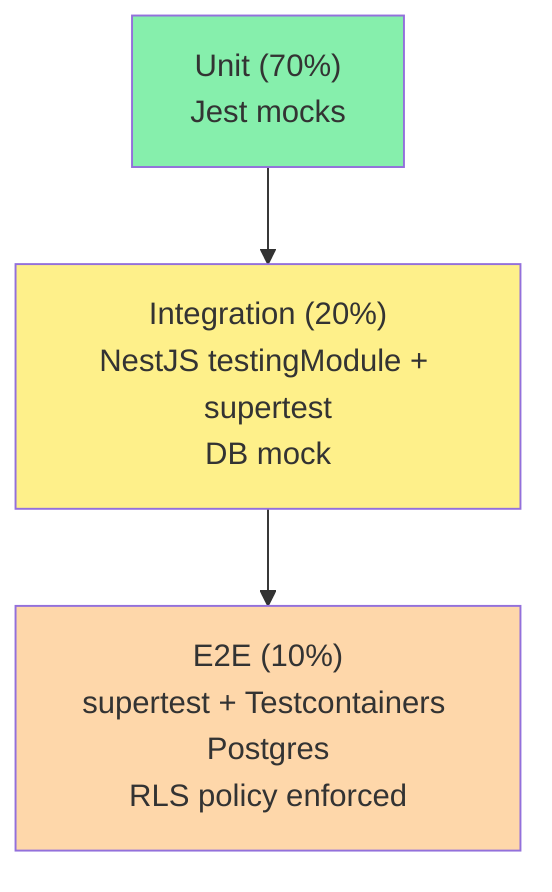

# 10 — Testing Spec

> **Pirámide de tests, Jest + supertest + Testcontainers, gates CI anti-fuga de `tenant_id` y el estándar 90% coverage heredado del proyecto FastAPI.**

---

## 1. Estrategia (heredada + extendida)

El proyecto FastAPI actualmente usa:
- **pytest** (unit)
- **TestClient** (integration)
- **In-memory SQLite** (`tests/conftest.py`)

NestJS adopta la misma pirámide pero con **stack TS**:

| Capa | FastAPI actual | NestJS target |
|---|---|---|
| Unit | pytest + mocks | Jest + mocks de Ports |
| Integration | pytest + TestClient | Jest + supertest + NestJS testing module |
| E2E | pytest + TestClient | supertest + Testcontainers (Postgres real) |
| Property/Generative | no usa | fast-check para invariants (opcional) |
| Coverage gate | aspiracional 90% | **Enforced CI 90%** (`@saas/shared`) |

**Diferencia clave**: en tests de E2E se usa **PostgreSQL real vía Testcontainers** (no SQLite in-memory) porque RLS y behavior de JSONB son Postgres-only. Ver ADR-011.

---

## 2. Pirámide



---

## 3. Estructura de archivos

```
apps/api/
└── src/
    └── modules/
        └── tasks/
            ├── tasks.service.ts
            ├── tasks.service.spec.ts            # Unit test
            ├── tasks.controller.ts
            ├── tasks.controller.spec.ts         # Integration test (mock port)
            └── __tests__/
                └── tasks.e2e-spec.ts            # E2E con Testcontainers

apps/api/test/
├── jest-unit.config.js
├── jest-integration.config.js
├── jest-e2e.config.js
├── setup.ts                                     # Instanciar NestApp
├── fixtures/
│   ├── users.fixture.ts
│   ├── tenants.fixture.ts
│   └── auth.fixture.ts
└── helpers/
    ├── create-tenant.helper.ts
    ├── auth.helper.ts
    └── http.helper.ts
```

---

## 4. Tests unitarios — puertos y mocks

```ts
// tasks.service.spec.ts
describe('TasksService', () => {
  let service: TasksService;
  let repo: jest.Mocked<TaskRepositoryPort>;

  beforeEach(async () => {
    const module = await Test.createTestingModule({
      providers: [
        TasksService,
        { provide: 'TaskRepositoryPort', useValue: mockDeep<TaskRepositoryPort>() },
      ],
    }).compile();

    service = module.get(TasksService);
    repo = module.get('TaskRepositoryPort');
  });

  it('create task en tenant activo', async () => {
    const dto: CreateTaskDto = { title: 'Test', description: '', completed: false };
    repo.create.mockResolvedValue({ id: 'uuid-1', ...dto, tenantId: 't1' } as any);
    const result = await service.create(dto, 't1', 'u1');
    expect(result.tenantId).toBe('t1');
    expect(repo.create).toHaveBeenCalledWith(expect.objectContaining({ tenantId: 't1' }));
  });

  it('list con scope=own filtra por createdBy', async () => {
    repo.findMany.mockResolvedValue([] as any);
    await service.list({ offset: 0, limit: 10 }, 't1', 'own', 'u1');
    expect(repo.findMany).toHaveBeenCalledWith(expect.objectContaining({
      where: expect.objectContaining({ tenantId: 't1', createdBy: 'u1' }),
    }));
  });
});
```

---

## 5. **Gate CI anti-fuga de tenant** (no negociable)

Test E2E que el CI ejecuta en cada PR. Ver ADR-012.

```ts
// apps/api/test/gates/tenant-isolation.e2e-spec.ts
describe('Tenant Isolation Gate', () => {
  let tenantA: string;
  let tenantB: string;
  let tokenA: string;
  let tokenB: string;
  let taskIdA: string;

  beforeAll(async () => {
    // 1. Crear 2 tenants con plan free cada uno
    ({ tenantId: tenantA, token: tokenA } = await createTenantAndLogin('a@test.local'));
    ({ tenantId: tenantB, token: tokenB } = await createTenantAndLogin('b@test.local'));

    // 2. Crear Task en TenantA
    const res = await request(app.getHttpServer())
      .post('/api/v1/tasks')
      .set('Authorization', `Bearer ${tokenA}`)
      .set('X-Tenant-Id', tenantA)
      .send({ title: 'Task in A' });
    taskIdA = res.body.id;
  });

  it('Usuario A ve su task', async () => {
    const res = await request(app.getHttpServer())
      .get(`/api/v1/tasks/${taskIdA}`)
      .set('Authorization', `Bearer ${tokenA}`)
      .set('X-Tenant-Id', tenantA);
    expect(res.status).toBe(200);
  });

  it('Usuario B NO ve task de Usuario A (404, no 403)', async () => {
    const res = await request(app.getHttpServer())
      .get(`/api/v1/tasks/${taskIdA}`)
      .set('Authorization', `Bearer ${tokenB}`)
      .set('X-Tenant-Id', tenantB);
    expect(res.status).toBe(404);
    expect(res.body.code).toBe('NOT_FOUND');
  });

  it('Bulk catalogs A no incluye items del tenant B', async () => {
    const res = await request(app.getHttpServer())
      .post('/api/v1/catalogs/bulk')
      .set('Authorization', `Bearer ${tokenB}`)
      .set('X-Tenant-Id', tenantB)
      .send({ gerencias: {} });
    expect(res.status).toBe(200);
    // Validamos que ningún item value coincida con items del tenantA
  });
});
```

**Regla**: este test **debe estar verde**. Si falla, el CI bloquea el merge.

---

## 6. Tests de integración — NestJS testing module

```ts
// tasks.controller.spec.ts
describe('TasksController', () => {
  let app: INestApplication;
  let tasksService: jest.Mocked<TasksService>;

  beforeAll(async () => {
    const module = await Test.createTestingModule({
      imports: [AppModule],
    })
      .overrideProvider(TasksService)
      .useValue({ create: jest.fn(), list: jest.fn() })
      .compile();

    app = module.createNestApplication();
    tasksService = module.get(TasksService);
    await app.init();
  });

  afterAll(() => app.close());

  it('POST /tasks valida DTO', async () => {
    const res = await request(app.getHttpServer())
      .post('/api/v1/tasks')
      .set('Authorization', 'Bearer mock')
      .set('X-Tenant-Id', 'mock-tenant')
      .send({ /* invalid */ });
    expect(res.status).toBe(422);
  });
});
```

> Mock de `JwtAuthGuard` en integration tests: `overrideGuard(JwtAuthGuard).useValue({ canActivate: () => true })`.

---

## 7. Tests E2E con Testcontainers

```ts
// apps/api/test/setup.ts
import { PostgreSqlContainer } from '@testcontainers/postgresql';

let container: StartedPostgreSqlContainer;
let prisma: PrismaClient;

beforeAll(async () => {
  container = await new PostgreSqlContainer('postgres:16-alpine').start();
  process.env.DATABASE_URL = container.getConnectionUri();
  // Aplicar migraciones + RLS sql
  execSync('pnpm prisma migrate deploy', { stdio: 'inherit' });
  execSync('psql $DATABASE_URL -f prisma/sql/rls.sql', { stdio: 'inherit' });
  prisma = new PrismaClient();
});

afterAll(async () => {
  await prisma.$disconnect();
  await container.stop();
});
```

---

## 8. Cobertura y gates CI

### 8.1. Configuración Jest

```js
// jest.config.js
export default {
  preset: 'ts-jest',
  testEnvironment: 'node',
  collectCoverageFrom: [
    'src/**/*.ts',
    '!src/**/*.module.ts',
    '!src/main.ts',
    '!src/**/*.dto.ts',
  ],
  coverageThreshold: {
    global: { branches: 80, functions: 90, lines: 90, statements: 90 },
  },
  coveragePathIgnorePatterns: ['/node_modules/', '/test/'],
};
```

### 8.2. GitHub Actions gate

```yaml
# .github/workflows/ci.yml
- name: Jest unit + coverage
  run: pnpm jest --config jest-unit.config.js --coverage

- name: Jest E2E (Testcontainers)
  run: pnpm jest --config jest-e2e.config.js
  env:
    DOCKER_HOST: unix:///var/run/docker.sock

- name: Coverage gate
  uses: codecov/codecov-action@v4
  with:
    fail_ci_if_error: true
```

---

## 9. Tests de seguridad (RBAC)

```ts
describe('Security RBAC', () => {
  it('Empleado no puede delete', async () => {
    const res = await request(app)
      .delete(`/api/v1/tasks/${taskId}`)
      .set('Authorization', `Bearer ${empleadoToken}`)
      .set('X-Tenant-Id', tenantId);
    expect(res.status).toBe(403);
    expect(res.body.code).toBe('FORBIDDEN');
  });

  it('Tenant B Admin no puede manipular Tenant A Users', async () => {
    const res = await request(app)
      .post(`/api/v1/tenants/${tenantAId}/invitations`)
      .set('Authorization', `Bearer ${tenantBAdminToken}`)
      .set('X-Tenant-Id', tenantBId)
      .send({ email: 'new@test.local', rol: 'Admin' });
    // Validation in TenantGuard: ctx.tenantId !== tenantAId → 400
    expect(res.status).toBe(400);
  });
});
```

---

## 10. Fixtures compartidas

```ts
// test/fixtures/tenants.fixture.ts
export async function createTenantAndLogin(email: string): Promise<TenantContextResult> {
  const tenant = await prisma.tenant.create({
    data: { name: `Tenant ${email}`, slug: email.replace('@', '_'), plan: { connect: { name: 'Free' } } },
  });
  const passwordHash = await bcrypt.hash('Passw0rd!', 12);
  const user = await prisma.user.create({ data: { email, passwordHash } });
  await prisma.tenantUser.create({
    data: { tenantId: tenant.id, userId: user.id, rol: 'Admin', invitedById: user.id, acceptedAt: new Date() },
  });
  const token = await jwtService.signAccess({ sub: user.id, email, tenantId: tenant.id, role: 'Admin' });
  return { tenantId: tenant.id, token, userId: user.id };
}
```

---

## 11. Tests contractuales (frontend / backend)

> Optional en MVP; integra `@pact-foundation/pact` cuando Angular 21 se conecte.

---

## 12. Lint-like test gate anti-fuga (AST check)

Para evitar que un dev haga `prisma.task.findMany({})` sin `where.tenantId`:

```ts
// test/gates/no-bare-find-many.spec.ts
import { ESLint } from 'eslint';

it('Ningún service usa prisma.task.findMany sin where', async () => {
  const eslint = new ESLint();
  const results = await eslint.lintFiles(['src/**/*.ts']);
  const violations = results.flatMap(r => r.messages.filter(m => m.ruleId === 'no-bare-find-many'));
  expect(violations).toEqual([]);
});
```

Regla ESLint custom: ver `15-ADRs.md` ADR-013.

---

## 13. Anti-patrones prohibidos

1. Tests que dependen del orden de ejecución (state leakage).
2. `setTimeout` en tests para esperar algo — usar `await`.
3. Skip de tests E2E en CI ("lo arreglo luego").
4. Mock de `PrismaClient` directamente — usar `mockDeep<PrismaClient>()` de `vitest-mock-extended` para tipado correcto.
5. Tests E2E con la base de datos del dev local — Testcontainers garantiza aislamiento.

---

## 14. Referencias

- `06-TENANCY-SPEC.md` — fundamento del gate anti-fuga.
- `15-ADRs.md` — ADR-011 (Postgres real en E2E vs SQLite), ADR-012 (gate anti-fuga), ADR-013 (ESLint custom).
- Código ancestro: `tests/conftest.py`, estructura `tests/test_*.py`.
