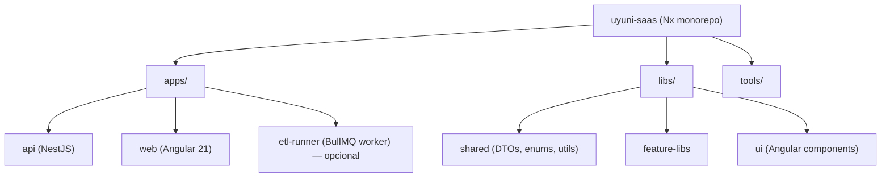

# 13 — Project Structure Spec

> **Monorepo Nx: apps (api + web) + libs (shared + feature libs). Layout de NestJS idiomatic.**

---

## 1. Monorepo Nx



---

## 2. Layout completo

```
uyuni-saas/
├── apps/
│   ├── api/                        # NestJS app
│   │   ├── src/
│   │   │   ├── main.ts
│   │   │   ├── app.module.ts
│   │   │   ├── config/
│   │   │   │   ├── env.validation.ts
│   │   │   │   └── config.module.ts
│   │   │   ├── common/
│   │   │   │   ├── decorators/                 # @CurrentUser, @Permissions, @TenantScoped
│   │   │   │   ├── filters/                     # AllExceptionsFilter, BusinessExceptionFilter
│   │   │   │   ├── interceptors/                # AccessAuditInterceptor
│   │   │   │   ├── pipes/                        # UUIDPipe, PaginationPipe
│   │   │   │   └── guards/                       # JwtAuthGuard, TenantGuard, PermissionsGuard
│   │   │   ├── modules/
│   │   │   │   ├── auth/
│   │   │   │   │   ├── auth.module.ts
│   │   │   │   │   ├── auth.controller.ts
│   │   │   │   │   ├── auth.service.ts
│   │   │   │   │   ├── dto/
│   │   │   │   │   ├── ports/
│   │   │   │   │   │   ├── jwt.port.ts
│   │   │   │   │   │   ├── bcrypt.port.ts
│   │   │   │   │   │   └── user.repository.port.ts
│   │   │   │   │   └── infrastructure/
│   │   │   │   │       ├── nest-jwt.adapter.ts
│   │   │   │   │       ├── bcrypt.adapter.ts
│   │   │   │   │       └── prisma-user.repository.ts
│   │   │   │   ├── tenancy/
│   │   │   │   │   ├── tenancy.module.ts
│   │   │   │   │   ├── tenants.controller.ts
│   │   │   │   │   ├── tenants.service.ts
│   │   │   │   │   ├── tenant.guard.ts
│   │   │   │   │   ├── tenant-context.interceptor.ts
│   │   │   │   │   ├── tenant-async-storage.ts
│   │   │   │   │   ├── dto/
│   │   │   │   │   ├── ports/
│   │   │   │   │   └── infrastructure/
│   │   │   │   ├── rbac/
│   │   │   │   │   ├── rbac.module.ts
│   │   │   │   │   ├── permissions.guard.ts
│   │   │   │   │   ├── permissions.service.ts
│   │   │   │   │   ├── permissions.decorator.ts
│   │   │   │   │   └── ports/
│   │   │   │   ├── audit/
│   │   │   │   │   ├── audit.module.ts
│   │   │   │   │   ├── access-audit.interceptor.ts
│   │   │   │   │   ├── cdc.extension.ts
│   │   │   │   │   ├── audit-context.ts
│   │   │   │   │   └── ports/
│   │   │   │   ├── catalogs/
│   │   │   │   │   ├── catalogs.module.ts
│   │   │   │   │   ├── catalog-provider.port.ts
│   │   │   │   │   ├── catalog.registry.ts
│   │   │   │   │   ├── catalogs.service.ts
│   │   │   │   │   ├── catalogs.controller.ts
│   │   │   │   │   └── providers/
│   │   │   │   │       ├── gerencias.provider.ts
│   │   │   │   │       └── departamentos.provider.ts
│   │   │   │   ├── tasks/
│   │   │   │   │   ├── tasks.module.ts
│   │   │   │   │   ├── tasks.controller.ts
│   │   │   │   │   ├── tasks.service.ts
│   │   │   │   │   ├── dto/
│   │   │   │   │   ├── ports/
│   │   │   │   │   │   └── task.repository.port.ts
│   │   │   │   │   └── infrastructure/
│   │   │   │   │       └── task.prisma.repository.ts
│   │   │   │   ├── core/
│   │   │   │   │   ├── org-units/
│   │   │   │   │   ├── positions/
│   │   │   │   │   └── staff/
│   │   │   │   ├── assets/
│   │   │   │   │   ├── areas/
│   │   │   │   │   ├── asset-groups/
│   │   │   │   │   ├── asset-statuses/
│   │   │   │   │   ├── institutions/
│   │   │   │   │   ├── acts/
│   │   │   │   │   └── fixed-assets/
│   │   │   │   ├── etl/
│   │   │   │   │   ├── etl.module.ts
│   │   │   │   │   ├── sync-siger.service.ts            # Equivalente a sync_siger.py
│   │   │   │   │   ├── upsert.helper.ts
│   │   │   │   │   └── soft-delete.helper.ts
│   │   │   │   └── platform/                           # endpoints Platform Admin
│   │   │   │       ├── tenants-platform.controller.ts
│   │   │   │       └── metrics-platform.controller.ts
│   │   │   ├── infrastructure/
│   │   │   │   ├── prisma/
│   │   │   │   │   ├── prisma.service.ts
│   │   │   │   │   ├── prisma.module.ts
│   │   │   │   │   └── extensions/
│   │   │   │   │       ├── tenant-scope.extension.ts
│   │   │   │   │       ├── soft-delete.extension.ts
│   │   │   │   │       └── audit-fields.extension.ts
│   │   │   │   ├── mailer/
│   │   │   │   │   ├── mailer.module.ts
│   │   │   │   │   └── smtp.adapter.ts
│   │   │   │   └── logger/
│   │   │   │       └── logger.module.ts
│   │   │   └── observability/
│   │   │       ├── logger.module.ts
│   │   │       ├── request-id.middleware.ts
│   │   │       ├── health.module.ts
│   │   │       ├── metrics.module.ts
│   │   │       └── tracing.ts
│   │   ├── prisma/
│   │   │   ├── schema.prisma
│   │   │   ├── migrations/
│   │   │   ├── seeds/
│   │   │   │   ├── plans.seed.ts
│   │   │   │   ├── roles-permissions.seed.ts
│   │   │   │   ├── modules.seed.ts
│   │   │   │   └── demo-tenant.seed.ts
│   │   │   └── sql/
│   │   │       └── rls.sql
│   │   ├── test/
│   │   │   ├── jest-unit.config.js
│   │   │   ├── jest-integration.config.js
│   │   │   ├── jest-e2e.config.js
│   │   │   ├── setup.ts
│   │   │   ├── fixtures/
│   │   │   ├── helpers/
│   │   │   └── gates/
│   │   │       └── tenant-isolation.e2e-spec.ts
│   │   ├── Dockerfile
│   │   ├── nest-cli.json
│   │   ├── tsconfig.app.json
│   │   ├── tsconfig.spec.json
│   │   ├── package.json
│   │   └── .eslintrc.cjs
│   │
│   └── web/                          # Angular 21 app
│       ├── src/
│       │   ├── main.ts
│       │   ├── app/
│       │   │   ├── app.config.ts     # standalone + provideRouter
│       │   │   ├── app.routes.ts
│       │   │   ├── core/
│       │   │   │   ├── auth/
│       │   │   │   ├── tenant/         # selector de tenant
│       │   │   │   └── api/             # httpResource-based services
│       │   │   ├── features/
│       │   │   │   ├── tasks/
│       │   │   │   ├── assets/
│       │   │   │   └── core/
│       │   │   └── shared/
│       │   │       ├── ui/             # components reusable
│       │   │       └── utils/
│       │   └── environments/
│       ├── angular.json
│       └── tsconfig.json
│
├── libs/
│   └── shared/
│       ├── src/
│       │   ├── index.ts                  # barrel
│       │   ├── dto/
│       │   │   ├── auth/
│       │   │   │   ├── login.dto.ts
│       │   │   │   └── token-response.dto.ts
│       │   │   ├── tasks/
│       │   │   │   ├── create-task.dto.ts
│       │   │   │   └── task-response.dto.ts
│       │   │   ├── tenancy/
│       │   │   ├── catalogs/
│       │   │   └── pagination.dto.ts
│       │   ├── enums/
│       │   │   └── permission-action.enum.ts
│       │   ├── errors/
│       │   └── utils/
│       │       ├── uuid.util.ts
│       │       └── time.util.ts
│       ├── package.json                  # publicable a npm "uyuni/shared"
│       └── tsconfig.json
│
├── tools/
│   ├── generators/
│   └── scripts/
│       ├── prisma-migrate.sh
│       └── reset-db.sh
│
├── .github/
│   ├── workflows/
│   │   ├── ci.yml                        # lint, unit, integration, e2e, anti-fuga gate
│   │   ├── security.yml
│   │   └── deploy.yml
│   └── dependabot.yml
│
├── docker-compose.yml                    # Postgres local + Redis + Mailhog
├── nx.json
├── pnpm-workspace.yaml
├── package.json
├── pnpm-lock.yaml
├── tsconfig.base.json
├── .env.example
├── .eslintrc.cjs
├── .prettierrc
└── README.md
```

---

## 3. Reglas de dependencia entre libs y apps

1. `apps/api/**/*.ts` puede importar `@saas/shared`.
2. `apps/web/**/*.ts` puede importar `@saas/shared`.
3. **Nadie** importa `apps/api/*` en `apps/web` o viceversa.
4. `libs/shared` **no** importa nada de `apps/*`.
5. DTOs de infraestructura Prisma (`@prisma/client`) **no** se exponen a `apps/web`; los response DTOs en `apps/api/.../dto/*.response.dto.ts` actúan como boundary.

---

## 4. Nx workspace config

```json
// nx.json
{
  "tasksRunnerOptions": {
    "default": {
      "runner": "@nx/workspace/tasks-runners/default",
      "options": { "cacheableOperations": ["build","test","lint","e2e"] }
    }
  },
  "generators": {
    "@nx/nest": {
      "application": { "linter": "eslint", "unitTestRunner": "jest" },
      "library": { "linter": "eslint", "unitTestRunner": "jest" }
    },
    "@nx/angular:application": {
      "style": "scss",
      "standalone": true,
      "changeDetection": "OnPush"
    }
  }
}
```

---

## 5. `tsconfig.base.json`

```json
{
  "compilerOptions": {
    "strict": true,
    "noUncheckedIndexedAccess": true,
    "exactOptionalPropertyTypes": true,
    "noImplicitOverride": true,
    "noFallthroughCasesInSwitch": true,
    "forceConsistentCasingInFileNames": true,
    "moduleResolution": "bundler",
    "target": "ES2022",
    "module": "ESNext",
    "lib": ["ES2023", "DOM"],
    "skipLibCheck": true,
    "paths": {
      "@saas/shared": ["libs/shared/src/index.ts"],
      "@saas/shared/*": ["libs/shared/src/*"]
    }
  }
}
```

---

## 6. Code style

- ESLint + Prettier compartido en root.
- Husky pre-commit: lint-staged + type-check.
- Conventional Commits (`feat:`, `fix:`, `spec:"`).
- Branch naming: `feat/*`, `fix/*`, `spec/*`, `chore/*`.

```json
// .husky/pre-commit
lint-staged:
  "*.{ts,tsx}": ["eslint --fix","prettier --write","jest --bail --findRelatedTests"]
  "*.prisma": ["pnpm prisma format","prisma validate"]
```

---

## 7. Docker compose (ambiente dev)

```yaml
# docker-compose.yml
services:
  postgres:
    image: postgres:16-alpine
    environment:
      POSTGRES_USER: uyuni
      POSTGRES_PASSWORD: uyuni
      POSTGRES_DB: uyuni_dev
    ports: ["5432:5432"]
    volumes: [pgdata:/var/lib/postgresql/data]

  redis:
    image: redis:7-alpine
    ports: ["6379:6379"]

  mailhog:
    image: mailhog/mailhog
    ports: ["1025:1025","8025:8025"]

volumes:
  pgdata:
```

---

## 8. Anti-patrones

1. `apps/web` importando de `apps/api/src/*` (excepto dto de `@saas/shared`).
2. Servicios en `libs/shared` (deben ser puros DTOs/utils, sin IO).
3. Módulos NestJS en `apps/api` importando de otro módulo de dominio sin pasar por `Service`.
4. `apps/api` importando de `apps/web` (circular физico).
5. Funciones en `apps/api/.../controllers/*.ts` con lógica de negocio.
6. Sub-módulos NestJS importando `@prisma/client` directamente — usa `PrismaService` (`@InjectPrisma`).

---

## 9. Scripts npm

```json
{
  "scripts": {
    "dev:api": "nx serve api",
    "dev:web": "nx serve web",

    "build": "nx run-many --target=build --all",
    "test": "nx run-many --target=test --all",
    "test:e2e": "nx e2e api-e2e",
    "lint": "nx run-many --target=lint --all",
    "typecheck": "nx run-many --target=typecheck --all",

    "prisma:migrate": "pnpm --filter api prisma migrate dev",
    "prisma:deploy": "pnpm --filter api prisma migrate deploy",
    "prisma:seed": "pnpm --filter api prisma db seed",

    "docker:up": "docker compose up -d",
    "docker:down": "docker compose down"
  }
}
```

---

## 10. Mapeo con el proyecto FastAPI actual

| FastAPI (ancestro) | NestJS |
|---|---|
| `app/main.py` | `apps/api/src/main.ts` |
| `app/core/routers.py` (aggregator) | `apps/api/src/app.module.ts` (imports) |
| `app/core/db.py` (engine) | `apps/api/src/infrastructure/prisma/prisma.service.ts` |
| `app/core/config.py:Settings` (Pydantic) | `apps/api/src/config/env.validation.ts` (Joi) + `ConfigModule` |
| `app/core/repository.py:BaseRepository[T]` | `apps/api/src/common/tenant-scoped.repository.ts` |
| `app/core/exceptions.py` | `apps/api/src/common/filters/business.exception.ts` |
| `app/core/handlers.py` | `apps/api/src/common/filters/all-exceptions.filter.ts` |
| `app/core/audit/` | `apps/api/src/modules/audit/` |
| `app/modules/**` | `apps/api/src/modules/**` (mismos bounded contexts) |
| `app/auth/` | `apps/api/src/modules/auth/` |
| `scripts/archive_audit.py` | `apps/api/src/modules/etl/jobs/archive-audit.job.ts` |
| `scripts/sync_siger.py` | `apps/api/src/modules/etl/sync-siger.service.ts` |
| `tests/conftest.py` | `apps/api/test/setup.ts` |
| `tests/test_*.py` | `apps/api/src/**/*.spec.ts` |
| `alembic/` | `apps/api/prisma/migrations/` |
| `requirements.txt` | `pnpm-lock.yaml` |
| `ruff.toml` | `.eslintrc.cjs` |
| `mypy.ini` | `tsconfig.base.json` |
| `.env.example` | `.env.example` |

---

## 11. Referencias

- `02-ARCHITECTURE-SPEC.md` — layering dentro de un módulo.
- `03-DATA-SPEC.md` — prisma schema layout.
- `15-ADRs.md` — ADR-017 (Nx monorepo), ADR-018 (Husky + lint-staged).
