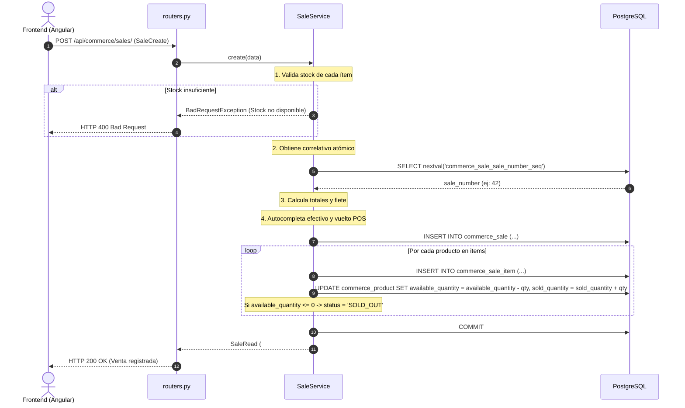

# 01. Arquitectura y Lógica Backend — Ventas (`commerce/sales`)

Este documento detalla la arquitectura de software, patrones de diseño, mecanismos de concurrencia y fórmulas financieras implementadas en el módulo de **Ventas** del Backend Uyuni.

---

## 🏛️ 1. Arquitectura DDD-Lite en Capas

El submódulo se organiza bajo el patrón de arquitectura modular desacoplada:

```
FastAPI Router (routers.py)
       │
       ▼
Service Layer (service.py) ──► Transacciones ACID, Secuencias, Arqueo de Caja
       │
       ▼
Repository Layer (repository.py) ──► Consultas SQLModel, Búsqueda Numérica (#)
       │
       ▼
Data Models (models.py) ──► Tablas 'commerce_sale' y 'commerce_sale_item'
```

### Componentes del Módulo:
* **`routers.py`**: Endpoints REST, inyección de dependencias (`SessionDep`), validación de schemas Pydantic y control de acceso RBAC con `PermissionChecker`.
* **`service.py`**: Lógica de negocio transaccional. Coordina la creación atómica de ventas, cálculo de vuelto de efectivo, asignación de correlativo secuencial y catálogo de productos disponibles.
* **`repository.py`**: Acceso a datos. Extiende de `BaseRepository[Sale]` implementando `_apply_search` para soportar búsqueda por `#número` y términos textuales.
* **`models.py`**: Entidades SQLModel con convención singular (`commerce_sale`, `commerce_sale_item`), auditoría automática (`AuditMixin`) y llaves primarias `UUIDv7`.
* **`schemas.py`**: Modelos Pydantic v2 para validación estricta de payloads (`SaleCreate`, `SaleUpdate`, `SaleRead`, `AvailableProductForSale`).

---

## 🔒 2. Transacción Atómica de Venta (ACID)

Cuando se invoca `POST /api/commerce/sales/`, el servicio ejecuta una operación **atómica e indivisible**. Si ocurre un error en cualquier punto, la base de datos realiza un `ROLLBACK` completo:



---

## 🔢 3. Secuencia Atómica Numérica (`sale_number`)

Para evitar códigos alfanuméricos largos (`VTA-20261120-XXXX`) que dificultan la búsqueda rápida y la impresión de boletaje físico:
* En **PostgreSQL (Producción/Staging):**
  Se apoya en la secuencia nativa `commerce_sale_sale_number_seq`:
  ```sql
  SELECT nextval('commerce_sale_sale_number_seq');
  ```
  Esto garantiza unicidad estricta y evita condiciones de carrera (*race conditions*) cuando varios cajeros o streamers venden en simultáneo.
* En **SQLite (Tests Unitarios / Local):**
  Calcula `SELECT MAX(sale_number) + 1` de forma transparente.
* **Calibración en Arranque (`app/main.py`):**
  Al iniciar la aplicación, se ejecuta automáticamente una calibración que sincroniza la secuencia con el valor máximo actual:
  ```sql
  SELECT setval('commerce_sale_sale_number_seq', COALESCE((SELECT MAX(sale_number) FROM commerce_sale), 1), (SELECT MAX(sale_number) FROM commerce_sale) IS NOT NULL);
  ```

---

## 💰 4. Fórmulas Financieras y Arqueo de Caja POS

### A. Deducción Automática de Transporte / Envíos
Si la entrega tiene costo y este es asumido por la empresa:
$$\text{flete\_tienda} = \begin{cases} \text{delivery\_cost} & \text{si } \text{delivery\_cost\_paid\_by} = \text{'STORE'} \\ 0.0 & \text{en otro caso} \end{cases}$$

La ganancia neta se calcula de forma inmutable como:
$$\text{net\_profit} = \text{total\_collected} - \text{total\_cost} - \text{flete\_tienda}$$

### B. Control de Caja en Efectivo (`amount_tendered` y `change_given`)
Para evitar discrepancias en los arqueos de caja:
* Si el cliente paga en efectivo (`CASH`) y entrega un billete mayor al total:
  $$\text{change\_given} = \text{amount\_tendered} - \text{total\_collected}$$
* Si el frontend no envía `amount_tendered` (ej: cobro exacto por QR o transferencia bancaria), el backend autocompleta:
  $$\text{amount\_tendered} = \text{total\_collected}, \quad \text{change\_given} = 0.0$$
  *De esta manera se garantiza que ninguna columna en base de datos quede en `NULL`.*

---

## 🔍 5. Algoritmo de Búsqueda Flexible (`#`)

En `SaleRepository._apply_search`:
El usuario puede ingresar en el buscador:
* `#42` o `#042` $\rightarrow$ Sanitiza el `#` y busca `sale_number == 42` o `sheet_sale_id == 42`.
* `VTA-42` $\rightarrow$ Sanitiza el prefijo y busca `sale_number == 42`.
* `42` $\rightarrow$ Si es puramente numérico, evalúa igualdad sobre el número de venta.
* `Juan` $\rightarrow$ Aplica búsqueda con `ILIKE` sobre `customer_name`, `customer_phone`, `observations`, etc.

---

## 🛡️ 6. Catálogo POS Desacoplado (`/available-products`)

### Problema de Permisos Resuelto
En arquitecturas de seguridad RBAC:
* Un **Cajero** solo posee permisos en el módulo `commerce_sales`.
* No debe tener permisos de administración ni lectura global sobre `commerce_products` (inventario).
* Por tanto, el endpoint `GET /api/commerce/sales/available-products`:
  1. Requiere permiso de lectura en el ámbito de **Ventas** (`CommerceModuleSlug.GENERAL`).
  2. Filtra automáticamente en base de datos:
     ```python
     Product.status == "AVAILABLE" and Product.available_quantity > 0
     ```
  3. Soporta búsqueda reactiva `?search=...` cruzando con `ProductMaster` por nombre, código, marca, modelo y `#item_number`.
  4. Ordena por `item_number` ascendente y fecha de creación descendente.
  5. Expone el **Tri-Precio** (`published_price`, `minimum_price`, `official_price`, `discount_margin`) para habilitar la toma de decisiones del vendedor.
