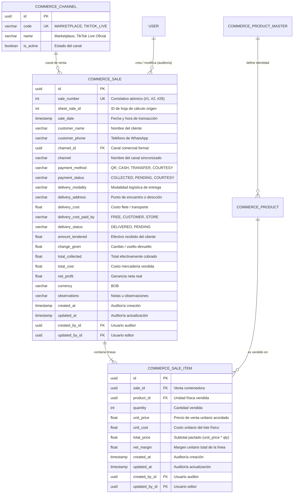

# 02. Diccionario de Base de Datos — Ventas (`commerce/sales`)

Este documento es la referencia técnica de base de datos relacional para el submódulo de **Ventas**. Contiene el diagrama Entidad-Relación (ERD) oficial, especificación exhaustiva de tablas, secuencias numéricas, índices y consultas SQL de mantenimiento.

---

## 🗺️ Diagrama Entidad-Relación (ERD)



---

## 🔢 1. Secuencia de PostgreSQL: `commerce_sale_sale_number_seq`

El número de venta correlativo no depende de contadores en tablas bloqueadas, sino de una secuencia de motor nativa:

```sql
CREATE SEQUENCE IF NOT EXISTS commerce_sale_sale_number_seq
    START WITH 1
    INCREMENT BY 1
    NO MINVALUE
    NO MAXVALUE
    CACHE 1;
```

---

## 🗃️ 2. Especificación de Tablas

> [!NOTE]
> Todas las tablas utilizan nombres en **singular estricto** (`commerce_sale`, `commerce_sale_item`) según los estándares de arquitectura del proyecto, e integran `AuditMixin` para trazabilidad de creación y modificación por usuario.

### Tabla: `commerce_sale` (Transacciones Comerciales)
Almacena el encabezado consolidado de cada venta física o en línea.

| Columna | Tipo SQL | Nulo | Default | Índice / Restricción | Descripción Semántica |
| :--- | :--- | :---: | :---: | :---: | :--- |
| `id` | `UUID` | No | UUIDv7 | PK, Index | Identificador único universal secuencial. |
| `sale_number` | `INTEGER` | No | Sequence | Unique, Index | Número de venta correlativo atómico (#1, #2, #29...). |
| `sheet_sale_id` | `INTEGER` | Sí | `NULL` | Index | ID de correlativo histórico proveniente de Google Sheets. |
| `sale_date` | `TIMESTAMP` | No | `now()` | Index | Fecha y hora en la que se efectuó la venta. |
| `customer_name` | `VARCHAR(150)` | No | `'Cliente Casual'`| — | Nombre completo o alias del comprador. |
| `customer_phone` | `VARCHAR(50)` | Sí | `NULL` | — | Teléfono para coordinación de entrega o envío de recibo. |
| `channel_id` | `UUID` | Sí | `NULL` | FK -> `commerce_channel.id`, Index | Relación con el canal de ventas formal. |
| `channel` | `VARCHAR(50)` | No | `'Marketplace'`| — | Nombre textual legible del canal (fallback desnormalizado). |
| `payment_method` | `VARCHAR(50)` | No | `'QR'` | — | Método de pago: `QR`, `CASH`, `TRANSFER`, `COURTESY`. |
| `payment_status` | `VARCHAR(50)` | No | `'COLLECTED'`| — | Estado del cobro: `COLLECTED`, `PENDING`, `COURTESY`, `REFUNDED`. |
| `delivery_modality`| `VARCHAR(100)`| No | `'FREE_MEETING_POINT'`| — | Forma de despacho (`FREE_MEETING_POINT`, `HOME_DELIVERY`, etc.). |
| `delivery_address` | `VARCHAR(255)`| Sí | `NULL` | — | Dirección específica, destino provincial o punto de encuentro. |
| `delivery_cost` | `DOUBLE PRECISION`| No | `0.0` | — | Costo monetario del flete o transporte contratado. |
| `delivery_cost_paid_by`| `VARCHAR(50)`| No | `'FREE'`| — | Quién asume el flete: `FREE` (gratis), `CUSTOMER`, `STORE`. |
| `delivery_status` | `VARCHAR(50)` | No | `'DELIVERED'`| Index | Estado de entrega: **`DELIVERED`** o **`PENDING`**. |
| `amount_tendered` | `DOUBLE PRECISION`| Sí | `NULL` | — | Monto en efectivo entregado por el cliente en caja (POS). |
| `change_given` | `DOUBLE PRECISION`| Sí | `NULL` | — | Cambio o vuelto devuelto al cliente. |
| `total_collected` | `DOUBLE PRECISION`| No | `0.0` | — | Monto final efectivamente cobrado al cliente. |
| `total_cost` | `DOUBLE PRECISION`| No | `0.0` | — | Costo total acumulado de las unidades físicas vendidas. |
| `net_profit` | `DOUBLE PRECISION`| No | `0.0` | — | Ganancia neta real deducida de costo y flete de tienda. |
| `currency` | `VARCHAR(3)` | No | `'BOB'` | — | Código ISO de moneda comercial (`BOB`). |
| `observations` | `VARCHAR(1000)`| Sí | `NULL` | — | Observaciones, acuerdos especiales o notas de garantía. |
| `created_at` | `TIMESTAMP` | No | `now()` | — | Fecha y hora UTC de creación en el sistema. |
| `updated_at` | `TIMESTAMP` | No | `now()` | — | Fecha y hora UTC de la última modificación. |
| `created_by_id` | `UUID` | Sí | `NULL` | FK -> `user.id` | Usuario que registró la venta (Cajero/Vendedor). |
| `updated_by_id` | `UUID` | Sí | `NULL` | FK -> `user.id` | Usuario que realizó el último ajuste. |

---

### Tabla: `commerce_sale_item` (Detalle de Ítems Vendidos)
Almacena cada línea de producto físico comprometido en la transacción.

| Columna | Tipo SQL | Nulo | Default | Índice / Restricción | Descripción Semántica |
| :--- | :--- | :---: | :---: | :---: | :--- |
| `id` | `UUID` | No | UUIDv7 | PK, Index | Identificador único de la línea de venta. |
| `sale_id` | `UUID` | No | — | FK -> `commerce_sale.id`, Index | Venta a la que pertenece esta línea. |
| `product_id` | `UUID` | No | — | FK -> `commerce_product.id`, Index | Unidad física específica del inventario que fue vendida. |
| `quantity` | `INTEGER` | No | `1` | — | Cantidad de unidades vendidas. |
| `unit_price` | `DOUBLE PRECISION`| No | `0.0` | — | Precio unitario real acordado con el cliente. |
| `unit_cost` | `DOUBLE PRECISION`| No | `0.0` | — | Costo unitario asignado al producto según el lote de importación. |
| `total_price` | `DOUBLE PRECISION`| No | `0.0` | — | Subtotal pactado (`unit_price * quantity`). |
| `net_margin` | `DOUBLE PRECISION`| No | `0.0` | — | Margen neto de la línea (`total_price - (unit_cost * quantity)`). |
| `created_at` | `TIMESTAMP` | No | `now()` | — | Fecha y hora UTC de creación. |
| `updated_at` | `TIMESTAMP` | No | `now()` | — | Fecha y hora UTC de actualización. |
| `created_by_id` | `UUID` | Sí | `NULL` | FK -> `user.id` | Usuario que agregó el ítem. |
| `updated_by_id` | `UUID` | Sí | `NULL` | FK -> `user.id` | Último usuario que modificó el ítem. |

---

## 🛠️ 3. Consultas SQL de Mantenimiento y Backfill

### Prellenado de Efectivo y Normalización Histórica:
```sql
-- 1. Asegurar que no existan valores NULL en auditoría de caja POS
UPDATE commerce_sale
SET amount_tendered = COALESCE(total_collected, 0.0),
    change_given = 0.0
WHERE amount_tendered IS NULL;

-- 2. Sincronizar nombres legibles del canal desde commerce_channel
UPDATE commerce_sale
SET channel = commerce_channel.name
FROM commerce_channel
WHERE commerce_sale.channel_id = commerce_channel.id
  AND commerce_channel.name IS NOT NULL;

-- 3. Migrar estados obsoletos (Opción 2 Simplificada)
UPDATE commerce_sale
SET delivery_status = 'PENDING'
WHERE delivery_status = 'SHIPPED';
```

### Calibración manual de la secuencia PostgreSQL:
```sql
SELECT setval(
    'commerce_sale_sale_number_seq',
    GREATEST(COALESCE((SELECT MAX(sale_number) FROM commerce_sale), 1), 1),
    (SELECT MAX(sale_number) FROM commerce_sale) IS NOT NULL
);
```
