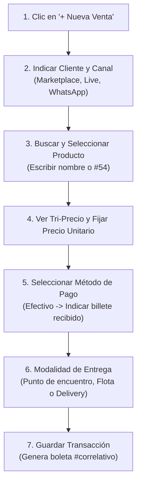

# 04. Manual Operativo de Usuario: Ventas, Caja y Despachos

> **Dirigido a:** Vendedores de mostrador, cajeros, operadores de streaming (TikTok Live), gestores de Marketplace y administradores.  
> **Objetivo:** Dominar el registro de ventas diarias, cobrar en efectivo con cálculo exacto de cambio, negociar inteligentemente con clientes usando la estrategia del Tri-Precio y coordinar las entregas sin errores.

---

## 🎯 1. La Filosofía Comercial del Negocio

En Uyuni, una venta no es solo anotar un número: es el cierre de un ciclo donde recuperamos el capital invertido y aseguramos la rentabilidad del negocio.

Para que la atención al cliente sea rápida y sin equivocaciones, el sistema cuenta con herramientas pensadas para el vendedor:
1. **Búsqueda Instantánea por Numeral (`#`):** Cada producto físico tiene un número (ej: `#54`) y cada venta genera una boleta correlativa (ej: `#12`). Si un cliente pregunta por el producto 54, solo escribes `#54`.
2. **La Estrategia del Tri-Precio:** Nunca tendrás que calcular de memoria hasta cuánto puedes rebajar un producto. El sistema te lo muestra en pantalla.
3. **Caja Física Blindada:** Al cobrar en efectivo, el sistema te dice de inmediato cuánto cambio debes devolver, evitando faltantes en el arqueo al final del día.

---

## 💡 2. La Regla de Oro: Cómo Negociar con el Tri-Precio

Cuando seleccionas un producto para agregar a la venta, verás una **Barra Informativa** con tres montos:

```
┌────────────────────────────────────────────────────────────────────────────────────────┐
│  📦 Stock: 5 en almacén  ·  Caja Amazon 02                                             │
│  🏷️ P. Publicado: 80.00 Bs  │  🛑 Piso Mínimo: 60.00 Bs  │  🏪 Ref. Mercado: 120.00 Bs │
│  💡 Margen de Regateo: Hasta 20.00 Bs de rebaja permitida                             │
└────────────────────────────────────────────────────────────────────────────────────────┘
```

### ¿Qué significa cada valor?

| Concepto | Término en Pantalla | ¿Cómo usarlo frente al cliente? |
| :--- | :--- | :--- |
| **Precio Publicado** | `P. Publicado` | **El precio oficial de entrada.** Es lo que está anunciado en redes sociales y es el valor que debes cotizarle al cliente de inicio. |
| **Piso de Regateo** | `Piso Mínimo` | **Tu límite sagrado.** Es el monto más bajo al que tienes autorización de vender. Si vendes por debajo de este monto, la empresa pierde dinero. |
| **Precio de Referencia** | `Ref. Mercado` | **Tu argumento de venta.** Es el precio promedio en tiendas locales de Bolivia. Úsalo para convencer al cliente: *"En el mercado cuesta 120 Bs, pero nosotros se lo estamos dejando en 80 Bs"*. |
| **Margen de Rebaja** | `Margen de Rebaja` | Es la diferencia entre el Publicado y el Mínimo. En este ejemplo tienes **hasta 20 Bs** para ceder ante un cliente insistente. |
| **Precio Fijo** | `Precio Fijo` | Si el producto muestra "Precio Fijo", significa que el precio publicado es igual al piso mínimo: **no se admite ningún tipo de descuento**. |

---

## 🛒 3. Paso a Paso: Registrar una Venta en Mostrador o Redes



### Paso 1: Abrir el Formulario
Haz clic en el botón verde superior **`+ Nueva Venta`**. Se abrirá el panel lateral de transacciones.

### Paso 2: Pestaña "Cliente y Canal"
* **Nombre del Cliente:** Escribe el nombre o alias (ej: *Juan Carlos Pérez* o *Cliente Casual*).
* **Teléfono:** Número de WhatsApp para enviar ubicación o confirmación.
* **Canal de Venta:** Selecciona por dónde te contactó (*Marketplace, TikTok Live, WhatsApp, Tienda Física*).
* **Fecha y Hora:** Por defecto se establece en el momento actual.

### Paso 3: Pestaña "Ítems y Precios" (Agregar Productos)
1. En el buscador de producto, escribe parte del nombre o el número con numeral (ejemplo: `#54` o `cable`).
2. Haz clic en el producto encontrado.
3. Observa la **Barra del Tri-Precio**:
   * El campo **Precio Unit. (Bs)** se llenará automáticamente con el *Precio Publicado*.
   * Si acordaste una rebaja con el cliente, modifica el precio respetando siempre el *Piso Mínimo*.
4. Indica la **Cantidad** (por defecto 1).
5. Haz clic en **`+ Agregar al Carrito`**.

> [!WARNING]
> Si intentas ingresar un precio inferior al *Piso Mínimo*, el sistema te mostrará una alerta de advertencia en color ámbar solicitando confirmación expresa para continuar.

### Paso 4: Pestaña "Pago y Logística"
1. **Método de Pago:**
   * **Pago QR:** El cliente te transfiere el monto exacto.
   * **Efectivo (Cobro en Caja):** Se habilitará la calculadora de Punto de Venta:
     * En **Monto Pagado en Efectivo**, ingresa con cuánto billete te paga el cliente (ejemplo: `100.00`).
     * En **Cambio / Vuelto a Devolver**, el sistema te mostrará automáticamente en grande el cambio exacto a entregar (ejemplo: `20.00 Bs`).
2. **Estado de Pago:**
   * `Cobrado`: Si el dinero ya ingresó en mano o en cuenta bancaria.
   * `Pendiente`: Si el cliente pagará contra entrega al recibir el paquete.

### Paso 5: Coordinación del Despacho y Entrega
1. **Modalidad de Entrega:**
   * `Punto de Encuentro Gratis` (ej: Plaza Colón, El Prado, Estación del Tren).
   * `Delivery a Domicilio` (Motoquero local).
   * `Envío por Flota` (Terminal de buses interdepartamental).
   * `Recojo en Tienda / Almacén`.
2. **Estado de Entrega:**
   * **`Entregado`:** Si el cliente ya tiene el paquete en sus manos.
   * **`Pendiente de Entrega`:** Si el paquete aún está en almacén o va en camino y falta la confirmación de recepción.
3. **Costo de Envío:**
   * Si el envío cuesta 15 Bs y lo paga el cliente, selecciona `Pagado por Cliente`.
   * Si acordaron que la tienda asume el envío como cortesía, selecciona `Asumido por Tienda`. *(El sistema descontará automáticamente esos 15 Bs de la ganancia neta de la venta).*

### Paso 6: Guardar
Haz clic en **`Guardar y Salir`**. En la pantalla aparecerá un mensaje de éxito:  
> ✅ *«La transacción #12 fue guardada exitosamente.»*

---

## 🔎 4. Búsqueda y Seguimiento en la Tabla Principal

En la pantalla principal de ventas:
* **Para buscar una venta específica:** Escribe en la barra de búsqueda `#12` o directamente `12` para localizar la boleta. También puedes buscar por el nombre del cliente o teléfono.
* **Para cambiar el estado de entrega:**
  Cuando el cliente recoja su paquete de la terminal o el motoquero confirme la entrega:
  1. Abre la venta haciendo clic en ella.
  2. Ve a la pestaña **Pago y Logística**.
  3. Cambia el estado a **`Entregado`**.
  4. Haz clic en **Guardar Cambios**.
  *(El tag en la tabla cambiará automáticamente de amarillo a verde).*
